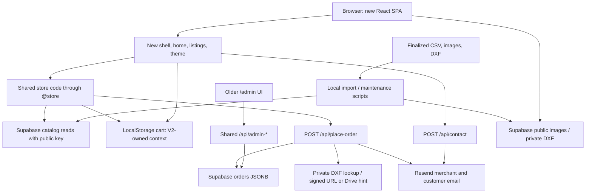

# BarqMech new storefront — living architecture

Last reviewed: **2026-10-20 (Asia/Karachi)**
Active implementation: **V3** `CodeShinobi/barqmech-store-v3/` (separate motion study; V2 preserved)  
Local previews: **V3** `http://localhost:5177/`; preserved **V2** `http://localhost:5176/`; unchanged **V1** `http://localhost:5175/`  
Status: **V3 released through merged PR1 and Vercel production.346 live listings,20 preserved historical orders and342 checksum-verified private non-Panel DXFs are in the new Supabase project.42 regression tests/CI and actual Preview/production commerce checks pass. Both owner-only test emails show delivered at Resend; the test order is completed. Original project/recovery tag retained. Temporary Preview bypass revoked. Verified custom domains serve V3; final canonical www, sitemap and form-origin acceptance pass.**

## Current deployed state — 2026-10-20

This supersedes earlier prepared-only/no-migration/no-deployment statements retained below as historical records.

- Production: https://www.barqmech.com (bare barqmech.com redirects to www); https://barqmech.vercel.app remains a working alias. PUBLIC_SITE_URL now selects www; ALLOWED_ORIGINS explicitly lists all three verified origins. Root Directory stays empty; Node22; V3 output. Existing admin password preserved.
- GitHub PR1 merged; first production release commit2d7d6ba. Recovery tag pre-v3-2026-10-19 points to prior main5a14dbb. Old Supabase ajaugjszvbsdxicswfwx is unchanged; active target bymhkgakvotcqdgcllat has346 live listings,346 compatibility products,2470 variants,20 historical orders plus one completed owner-only QA order. No historical emails replayed.
- Private product-dxf:342 non-Panel objects/300106317bytes, every copied file SHA256 matched. Panels remain orderable with manual DXF notice. Public product-images bucket is empty/unused; compressed pictures/video are served from GitHub-built Vercel assets. Anonymous direct orders/catalog reads denied; public private-bucket download denied; signed sample verified.
- Actual production test submitted through /api/place-order: both Black-finish lines, quantities2+3; shipping charged once at Rs1400 for largest area. Durable retry returned same order without extra sends; changed retry409; receipt excludes PII and rejects tampering. Merchant has one selected Artwork DXF download and Panel manual notice; customer has no CAD links. All six email image URLs returned200. Resend lists exactly two matching messages, both delivered to merchant inbox. Inbox visual rendering was not observed.
- Deployed admin API files are now api/admin-{login,logout,session,orders}.mjs and server/shared/admin-auth.mjs; TypeScript helper is compatibility-only. Malformed cookies ignored, foreign-origin admin mutations blocked, listing conflicts use migration015/PT409.42 tests pass; real Preview fixture CRUD/status/conflict checks pass and fixture removed.
- GitHub hourly retry workflow secrets configured; production worker smoke returned0 pending retries. Temporary owner-authorized automation bypass revoked; protected Preview now redirects to login without it. Scoped account tokens remain only in ignored local credential storage.
- Actual desktop/mobile browser commerce review: default Black finish, cart→checkout totals and cleanup, no sampled overflow/broken loaded images, no captured console errors on checkout. Desktop hero was playing; offscreen collection videos had not loaded. Screenshots under docs/previews/v3-production-*.png. This is sampled browser evidence, not full cross-browser, physical-device, throttled-network, frame-rate or accessibility certification. Dynamic listing HTML/SEO remains build-snapshot-based; live API/catalog/pricing behavior is authoritative.
- Verified encrypted backup includes live listings and historical tables under ignored .cache/backups/20261020-004717. It requires the same Windows user; source/media copies retained. Code rollback alone does not change database/env settings; prefer the prior Vercel production deployment with its original config for legacy recovery.

## 0. Historical V3 architecture — 2026-10-19 release preparation

This section supersedes older catalog, loader, checkout, asset and deployment descriptions below. Those descriptions remain historical evidence for V1/V2 and earlier V3 decisions. User now selected Supabase live listings/prices; setup/ownership/limitations: [V3-LIVE-CATALOG.md](V3-LIVE-CATALOG.md). Existing order/email cutover gates remain in [V3-GITHUB-VERCEL-LAUNCH.md](V3-GITHUB-VERCEL-LAUNCH.md).

### Implemented data and runtime boundaries

- User decision updated2026-10-19: **Supabase live listings/prices and orders; GitHub code/media/seed snapshot**. V3 CSV retains346 products/2470 designs/7419 size-price rows in PKR, with preserved UUIDs. It is now the seed/offline snapshot, not the planned live price authority or an automatic backup of admin edits. No real Supabase catalog import/read/migration was executed.
- `scripts/build-catalog.mjs` validates CSV/images, generates a lightweight synchronous `src/data/catalog-browse.json` and versioned `/catalog/<hash>/<slug>.json` details. Current version `cfaf7c2f65aefbbe`. Product options are fetched on demand/prefetched on intent with deduplication, caching, timeout and retry. V3 local `catalog/CatalogProvider.tsx`, `CatalogImage.tsx` and `RotatingImageStack.tsx` replace shared implementations through Vite aliases. Local PDP/checkout/receipt routes own V3-specific contracts.
- **Shipping, 2026-10-19:** `prices.csv` now has validated `area_sqft` on all7419 size rows; generated tiers include `areaSqFt`. Shared V3 `scripts/shipping.mjs` calculates rectangular area from inches and charges once for the largest individual item: ≤4 sq ft Rs500; >4–7 Rs1000; >7 Rs1000 +200×(ceil(area)−7). Partial square feet above7 round up; quantity/number of products do not multiply shipping. Checkout and authoritative server use the same module/canonical dimensions. Persistence attributes the one charge to the first largest-area line, other lines0, preserving line/order reconciliation. Old orders retain historical totals. V3 PDP/checkout copy corrected; shared older storefront remains unchanged. See V3 `catalog/README.md`.
- Browser product images come from V3 `public/catalog-images/`: 875 images, 2625 WebP delivery files, 153.80 MB combined across all sizes, largest 302350 bytes. This is repository/delivery inventory, not first-page transfer. Responsive candidates use actual widths and per-context sizes; stationary listing cards render one image. Browser catalog browsing no longer needs a Supabase public key.
- Root `api/place-order.mjs` delegates to `server/v3/order-handler.mjs`. With CATALOG_SOURCE=supabase, new orders resolve active canonical listings/prices freshly through the server service role, then recompute add-ons/shipping. Disabled listings and stale/tampered totals are rejected; already accepted idempotent retries retain saved totals. CSV compilation remains for offline/snapshot tests, not live Vercel price authority. Production builds require Supabase catalog mode and admin settings. Server helpers live outside public API entry directories.
- Live catalog code: public `api/v3/catalog.mjs` serves active browse summaries/detail; protected `api/v3/admin-catalog.mjs` validates writes and calls revision-checked RPC. Prepared migration012 creates isolated service-only/RLS v3_storefront_listings with derived starting-price/design-count summaries. Existing catalog/order tables untouched. Offline seed script validates all346 products and refuses overwrite of a nonempty table when explicitly applied. **SQL/RPC/RLS and seed not applied/tested against a real database.**
- Browser provider uses the seed for first paint, then live mount/focus/visibility/30s refresh and same-origin BroadcastChannel invalidation; unchanged revisions skip product-state writes. Detail caches reconcile revisions, homepage featured items reconcile current availability/prices. Existing tabs can lag up to the next refresh; checkout always checks canonical live data. New products use SPA routing and live sitemap; initial prerendered HTML/OG/JSON-LD remains snapshot-based, so full dynamic SSR/SEO is still open.
- Admin now has compact Orders/Listings sections with natural vertical page flow (supersedes locked desktop workspace). Listing editor supports metadata/public image URLs/designs/sizes/prices/enable-disable/reversible archive with validation, unsaved-change guards and stale-edit conflicts. Direct file uploads/optimization are not implemented. Local authenticated edits use ignored local JSON; demo edits use isolated memory. Public static share still blocks admin/API. cPanel is optional media/backup hosting, not a required second backend.
- Checkout persists a session idempotency UUID, reuses it after uncertain timeouts, and navigates using an HMAC-signed private receipt. Browser storage cleanup failures do not mask an already accepted order. The receipt API returns minimal verified totals/status without customer records. Arbitrary six-digit codes no longer prove an order exists.
- Orders persist before notification sending and are never deleted for email failure. Notification payloads and stable provider keys are durable, partial delivery is recorded, retry has bounded backoff and manual-review limits. `/api/v3/retry-notifications` requires `CRON_SECRET`; GitHub workflow supports hourly/manual retries only after repository secrets are configured. No scheduler has been connected/run.
- Supabase service role stays server-side. Existing private `catalog_variants` / DXF storage is retained solely for optional merchant manufacturing links, not public catalog/pricing. Customer messages do not include CAD links. V3 now has its own /admin UI using existing cookie-authenticated root admin APIs; historical UI remains preserved in store/src/AdminPage.tsx. V3 adds no public order endpoint. Temporary static sharing continues to block admin/API paths.
- Prepared migration `store/supabase/migrations/011_v3_checkout_reliability.sql` adds order request/notification state, private distributed request limiting and revokes anonymous order writes. **Not applied**: it must be coordinated with API cutover or applied to an isolated Preview database, because it intentionally breaks the legacy anonymous-insert order API.
- Contact/order/admin-login requests gain distributed rate limits; contact/order JSON body size is limited. Production admin signing fails closed without a suitable secret. Email links use the configured canonical origin, not browser-supplied destinations.

### Implemented media and presentation

Hero master remains untouched. Compressed desktop 6265765 bytes / mobile 2248271 bytes replace the 33400601-byte delivery source; both are 30 fps, H.264, silent and fast-start. The 69160-byte poster appears immediately. Four collection clips are 844177–966176 bytes. All six outputs were FFprobe/box-order checked for no audio and metadata before media. `catalog/delivery-report.json` records sizes.

Videos attach their source only on visibility and pause away from view; reduced motion, explicit Save-Data and 2G detection retain static imagery. A 3G estimate selects the compact hero video instead of disabling playback; connection changes are observed. Poster and video share the same absolute rectangle, fixing the previously invisible playing video below the poster. The duplicate boot video/percentage loader is no longer mounted. Local category images have WebP variants; V3 owns its favicon/email/header assets and no longer depends on shared `public/`. Hero typography now fits the available short desktop viewport; a mobile PDP breadcrumb/back-button wrap was corrected. Existing blue/cream palette, mosaic, motion and desktop-only category scroll behavior remain.

Cart journal compaction uses a shared Web Lock, retains monotonic revision checkpoints and preserves concurrent-tab operations. Browsers without Web Locks retain the uncompacted journal fallback rather than risking data loss. Existing older cached clients are not a verified cross-version concurrency contract.

### Deployment and evidence

Root `vercel.json` now targets V3, with repository-root dependency installation, static asset/versioned catalog caching, security headers, filesystem routes and a 404 fallback. This changes the **next deployment**, not the currently deployed production site. Legacy config saved in `docs/VERCEL-LEGACY-CONFIG.json`. `.gitignore` and `.vercelignore` exclude secret files, operational exports and unused masters/versions; no files staged or published. Shared `store/src/` remains required for the build.

Build produces 346 product-specific metadata/JSON-LD landing pages, canonical/OG tags, sitemap, robots and a 404 page. React bodies remain client-rendered; this is not full SSR. Runtime metadata updates on internal navigation and private routes are noindex. `.env.example` and launch runbook document server-only settings; Vercel builds fail when required settings are missing. GitHub validation workflow runs tests/build; live Actions were not executed.

**Locally checked:** 18/18 regression tests (cart compaction/concurrency, CSV integrity, authoritative checkout, durable retry/partial email, private receipt, body/origin/rate-limit/admin configuration); production TypeScript/Vite build; artifact checks for every product page/detail/image variant and required public assets; V2 manifest 51/51 unchanged. Browser checked real hero desktop/mobile playback, deferred/offscreen collection playback, instant catalog counts, local product options, responsive image selection, temporary cart→checkout→empty cleanup, private-route noindex and no horizontal overflow in sampled mobile commerce views. Screenshots: `docs/previews/v3-github-catalog-mobile.png` and `docs/previews/v3-github-catalog-desktop.png`. Fresh navigation/reloads worked; earlier dev HMR context mismatch logs are historical and were resolved on reload, not a claim of a clean full-session console. No real order/contact/email submitted.

**Open launch gates:** actual clean-clone CI and Vercel Preview build/function packaging/routing/headers; isolated migration/RLS tests; verified sender/secrets and retry worker setup; controlled order/email/contact/admin checks; real device/network/Lighthouse/accessibility validation. CSS consolidation completed locally as described below; further cleanup can be incremental. No claim of flawless deployment or production certification.


### CSS ownership and video correction — 2026-10-17

`src/main.tsx` now has one CSS entry: `src/styles/storefront.css`. It explicitly preserves the established cascade order. Four home files (`home-sections`, `home-composition`, `home-responsive`, `home-palette`) were consolidated into `src/pages/home.css`; components no longer import global CSS. `src/styles/store-base.css` is a V3-owned snapshot of the shared commerce/reset CSS with unused admin chrome omitted, while the existing shared token file remains imported. V3 no longer directly imports the entire production `store/src/index.css`. Shared production styles were not modified. Ownership/editing guidance: V3 `src/styles/README.md`.

Removed110 unused legacy rules (old intro loader, marquee, card/mosaic variants),298 superseded exact-selector declarations and78 empty blocks. Winning source order, media conditions, specificity/importance and same-rule fallbacks were preserved; only adjacent compatible rules were merged. Source CSS285967→235824 bytes before the small entry/ownership comments. Production CSS approximately227580→196308 bytes; gzip approximately41080→35253 bytes (~14% reduction). This is measured asset size, not a speed score. Counts/details: `docs/V3-CSS-CONSOLIDATION.json`.

**Video regression:** browser measurement showed the hero `<video>` was playing at top724.8px in a720px viewport, following the full-height poster in normal document flow. `.shinobi-fixed-video__el` now uses absolute positioning/inset0 for both layers. Desktop/mobile checks show the video at top0, viewport height, advancing playback and correct responsive source. This corrects the prior session's playback-only evidence: paused=false had not proved that the moving video was visible. Connection listeners and explicit muted playback also added to hero/collection videos; reduced-motion and explicit data-saving behavior retained.

**Validation:** production build passes228 modules plus346-product artifact validation. Before/after browser comparison of44 sampled home elements ×19 computed properties matches at desktop1280×720 and mobile390×844. Reviewed desktop mosaic, catalog/PDP/cart and mobile PDP; no sampled overflow or broken loaded images. Hero/collection offscreen pause checked. Saved evidence: `docs/previews/v3-css-browser-checks.json` (zero sampled style differences; visible desktop playback0.38s→4.16s) and `docs/previews/v3-video-css-desktop.png`. V2 manifest51/51 unchanged; root diff whitespace check passes. Existing18 commerce/backend tests were not rerun for this styling/media-only change. Real-device/autoplay-policy/Save-Data/reduced-motion emulation and full cross-browser visual regression remain unverified.

### Scroll rendering pass — 2026-10-18

User reports scrolling feels closer to30fps and asks to continue the smoothness work. Applied the standing V4 motion/frontend-quality/performance/browser-QA guidance; no new dependencies installed. Followed the browser-rendering guidance to avoid unnecessary layout/paint work; [web.dev animation guidance](https://web.dev/articles/animations-guide) is supporting guidance, not a profiler result.

Implemented in V3 only:

- `useHomeSections.ts`: browser-native smooth section scrolling replaces the custom520ms RAF/scrollTo loop. `scrollend` releases the gesture guard, with a1s deadline fallback. Explicit reduced-motion navigation remains instant. Section nodes/absolute positions and scroll limits are cached and refreshed by ResizeObserver/resize; the scroll callback no longer queries/measures every section repeatedly. State and navigation datasets change only when the section changes. Desktop one-gesture chapters/internal category sequencing and mobile native scrolling remain the intended contract.
- `ScrollProgress.tsx`: one scheduled transform write through a DOM ref, no React state update per scroll event. Scroll range is refreshed on layout/resize rather than read on every event. Header React state only changes when crossing its scroll threshold.
- `useStudioMotion.ts`: character nodes,256-step color palette and last color steps are cached. Settled letters no longer receive identical style writes; the gradual muted-blue→bright-blue→ink progression remains. Footer lift updates skip identical values.
- `StudioMotion.tsx`: ribbon text path is limited to the visible arc and phrase repetitions scale to the viewport instead of laying out12 copies on a multi-screen path. Curve/text stay aligned; paint containment limits the drawing region. The liquid reveal and ribbon motion still require some paint work; no claim of compositor-only rendering.
- `shinobi.css`: hero brightness now uses a static black overlay rather than filtering the full-screen video every frame. The former slight saturation boost is removed; blue identity/layout/video source retained.
- `MetalPlayground.tsx`: dimensions are assigned on reset/resize; physics frames update transforms rather than rewriting width/height for every piece.
- `src/dev/motionDiagnostics.ts`: opt-in development-only `?motionDebug=1` panel samples RAF intervals during scroll and nearby long tasks. It is not mounted for ordinary visits and is eliminated from production builds. It measures callback cadence, **not** GPU/display FPS. No telemetry or external reporting.

Pre-change local transition sample:28 intervals,41Hz average,33.5ms p95. Intermediate samples varied (~44–46Hz, one background-throttled2.8Hz sample with1000ms gap); a visible1280×720 follow-up recorded44.2Hz,33.5ms p95, no >50ms interval or nearby long task. Builds/HMR, media warming and preview visibility affected some runs. These short samples are exploratory and not a controlled before/after benchmark or proof of sustained60fps. Raw samples and limits: `docs/previews/v3-scroll-timing-2026-10-18.json`; screenshots: `docs/previews/v3-scroll-desktop.png` and `docs/previews/v3-scroll-mobile.png`. A foreground Chrome/Edge Performance trace on the user's actual device, ideally against a production preview, remains needed. Media is still encoded at30fps; that does not impose a30fps cap on page scrolling.

## 1. Purpose and how to maintain this document

### 2026-10-19 — GitHub release preparation and original-project credential checks

- **Authorization/target:** user explicitly requests Supabase implementation, safe old-storage cleanup if needed, end-to-end testing and publishing V3 to DerpFlag/barqmech for Vercel. User will enter Vercel settings themselves and prefers programmatic SQL access. Original project ajaugjszvbsdxicswfwx explicitly reaffirmed after newly supplied supabase_keys.txt was found to contain different-project xpyavvkinxrhckfcnkup keys and a literal DB-password placeholder. Those new-project data credentials were not used or copied over the working original-project settings.
- **Credential safety:** supabase_keys.txt excluded explicitly from both Git and Vercel; contents treated as data only, never printed. Scoped management token supplied later, but original-project Management API returns403 missing database_read. Harmless SELECT checks only; no SQL migration, seed, storage write/deletion or live email sent. User asked to correct token Database Read+Write permissions in local file.
- **Release packaging:** remote main5a14dbbcd6d7a0398e344a66332f634f16e1545f differs from dirty root's older local HEAD. Created separate ignored .cache/release-v3 checkout on codex/v3-storefront-release, copied V3 as real files rather than embedded CodeShinobi Git link. Preserved legacy store sources and historical SQL, excluded V1/V2, scratch packs, node_modules/dist/cache, credential files and private DXFs. GitHub dry-run push access verified using saved DerpFlag GCM account. Production baseline metadata/stable URL recorded in docs/V3-RELEASE-2026-10-19.md; https://barqmech.vercel.app returns200 old storefront, custom domain not verified.
- **Security/dependencies/checks:** clean root/store/V3 lockfile installs reported advisories; applied compatible fixes and explicit offline csv-parse upgrade to patched7.0.3 in the release checkout. Synced manifests/locks to workspace without changing current local node_modules. npm reported zero known advisories after fixes in all three installs.38/38 regressions and clean Supabase-mode production223module build/346product artifact checks pass on patched dependencies. Source scan: zero configured-secret matches, zero private DXFs or embedded Git in new V3 package. No claim of full vulnerability-free code/provider integration.
- **Backup/settings:** scripts/v3-release-operations.py backup created and round-trip verified Windows-user DPAPI-encrypted catalog/order export under ignored .cache/backups;346products/2355variants/20orders, no private rows printed. Not a full SQL roles/policies/media backup. Private .cache/vercel-v3-settings.env prepared with existing server settings and generated signing/retry secrets; ADMIN_PASSWORD intentionally needs user replacement; management token excluded. Vercel CLI auth file empty, user owns settings handoff. CI branch trigger added for the release branch.
- **Rollback/next:** code can be reverted or Vercel deployment rolled back; database policy/storage changes need their own verified recovery. Do not revoke old API write permissions or delete old public images/Panel DXFs until new deployment acceptance and validated recovery copies. Complete original-project SQL access, additive012+013/seed and real integration tests; then merge main/deploy and controlled cutover/cleanup. Publication state will be updated when push occurs; currently preparation only.

### 2026-10-19 — Keep Supabase; exclude Panel DXFs from hosted manufacturing workflow

- **Latest decision:** user chooses GitHub/Vercel for all public images/videos, Supabase for tables and private DXFs excluding Panels; Panel manufacturing DXFs supplied manually by merchant. This supersedes Cloudflare replacement/R2 proposals. No Cloudflare migration required under this choice. Panel products/prices/pictures/orderability remain intact; exclusion is only binary hosting/automated DXF links.
- **Measured live metadata:** read-only bucket enumeration by exact product slug/category: Panels2128objects/2215763672bytes; Artwork123/82027400; Islamic157/147796430; Misc62/70282487. Non-Panels342objects/300106317bytes (~300MB), fitting the1GB file allowance in isolation. All115 absent legacy mappings belong to Panels; remaining non-Panel mappings/objects were present in the prior audit. Report: docs/previews/supabase-dxf-category-sizes-2026-10-19.json. Metadata presence is not a geometry/size verification or tested email download.
- **Implemented locally:** shared manufacturing-policy.mjs marks Panels as manual. Server strips stale incoming download fields, excludes Panel IDs from manufacturing lookups, and never signs their DXFs in Panel-only or mixed carts. Merchant template shows Supply manually for this Panel order; customer retains picture/order details without manufacturing copy. Seed/admin validation omit Panel DXF paths; editor displays manual workflow instead of path input for Panels. Other categories retain selected-design private Supabase downloads. Order status/checkout unaffected.
- **Storage cleanup boundary:** actual current buckets still total~3.60GB. Removing only Panel DXFs would leave old product-images~1.08GB plus non-Panel DXFs~300MB (~1.38GB), still above1GB. Target allowance requires moving public delivery to GitHub/Vercel and then separately reviewing old image-bucket and Panel-object cleanup. No objects, mappings, legacy catalog, original local DXFs or order records were deleted/changed. Original production may still depend on Supabase images; backup/cutover/verification required before deletion.
- **Checks:**38/38 tests pass, including Panel-only no DB lookup, mixed-cart signing only for non-Panels, stale links removed, both email pictures retained, customer manual message omitted, and Panel seed/admin private paths stripped without changing design/pricing counts. Seed dry run validates346products. Production TypeScript/Vite build passes223modules and346product artifact checks. No actual order/email/migration/seed/upload/deletion/deployment. Existing accepted notification HTML remains a historical snapshot, not rewritten.
- **Next:** finish V3 Supabase setup in authorized dashboard/Preview, verify real email image/DXF delivery with controlled recipients, then plan storage cleanup after public media cutover and verified backups. Broader audit/production acceptance remains open.

### 2026-10-19 — Signed-link access wording corrected

- **Clarification:** current emailed DXF links are bearer URLs: anyone possessing the complete signed link can download that specific file until expiry, without merchant/admin login. Merchant-only describes which email recipient receives the link, not identity enforcement at download. Forwarding the email shares access. Current Supabase resolver requests14days; no login-gated download route is implemented.
- **Source/checks:** reviewed manufacturing.mjs createSignedUrl and official Supabase private download guidance. No live link generated/disclosed, email sent, runtime/security setting changed or tests needed for this discussion-only clarification.
- **Next:** if identity-restricted downloads are desired, implement authenticated merchant download authorization rather than describing direct signed URLs as merchant-only access. Provider migration/storage choice remains pending; architecture otherwise unchanged.

### 2026-10-19 — Email images do not require database-provider Storage

- **Clarification:** user asks whether email pictures require Supabase/Cloudflare Storage and whether DXF hosting exists only to provide merchant downloads. Source-reviewed email templates use HTML img tags with absolute public image URLs resolved against the deployed site; compressed public images/videos can remain versioned in GitHub and delivered by Vercel. The same public image URL serves storefront and both email templates; no duplicate image upload to database-provider Storage is required. Remote image display remains subject to recipient email-client settings.
- **DXF purpose/boundary:** within current web app, DXF binaries are used for merchant manufacturing download links; catalog pricing/size/checkout do not read their geometry at runtime. Manufacturing originals remain needed operationally. Private DXF hosting is separate from public images; public GitHub/deployed assets would make them public, while private GitHub links require authorized GitHub access and are not equivalent to current emailed signed downloads. No decision to expose or move private DXFs inferred.
- **Changes/next:** documentation-only, architecture/runtime unchanged. Clarified that the storage-capacity decision concerns private CAD files, not displaying email images. Full Supabase-to-Cloudflare database migration remains optional/separate from that storage need; provider decision still being discussed. No upload/deletion/connection/migration/deployment/email test performed.

### 2026-10-19 — Cloudflare account setup instructions

- **Latest user steering:** user reports signed into Cloudflare and asks what to do next. Screenshot shows account home with Storage & databases. Treat Cloudflare as intended replacement target; implementation/source runtime still uses existing Supabase code and no Cloudflare resources have been verified or created.
- **Guidance:** create private Standard R2 bucket barqmech-v3-dxf and empty D1 database barqmech-v3 with automatic locations. User handles any R2 subscription/payment/terms activation themselves. Do not enable public DXF access or import Postgres SQL into SQLite D1. Public compressed media/code remain GitHub/Vercel initially; no need to move frontend/domain for backend migration.
- **Changes/checks:** documentation-only new docs/V3-CLOUDFLARE-MIGRATION.md records setup and port/migration/security/acceptance gates. Official current Cloudflare R2/D1 setup/location docs reviewed; no account/resource connection, CLI installation, keys, database/storage writes or deployment. Existing35 tests/build evidence belongs to previous code changes, not Cloudflare integration.
- **Next:** verify newly created resources, implement/test D1/Workers and R2 adapters plus controlled data/file copy, then cutover only after acceptance. Supabase setup scripts remain unapplied and superseded as a deployment destination pending migration.

### 2026-10-19 — Live inventory, DXF coverage fixes and alternative backend evaluation

- **Authorized live read-only findings:** existing local service credentials reach project ajaugjszvbsdxicswfwx. Tables/catalog counts:346 products,2355 variants; orders/order_products schemas exist (only aggregate counts/schema read, no customer/order rows). No V3 listings table, request-limits table or RPCs present. Anonymous orders count0 and order_products denied401; these checks do not establish all RLS/write policies.
- **Storage:** product-images public1293objects/1079775688bytes; product-dxf private2470objects/2515869989bytes; unsigned public DXF route denied400. All2470 expected V3 slug/dcCODE.dxf paths exist;115 design mappings absent from legacy variants, zero mapped objects missing. Combined3595645677bytes exceeds advertised1GB Free Storage; actual account plan/billing not inspected. No deletion/move/upload/signing/email/DB mutation performed. Sanitized aggregate report: docs/previews/supabase-readonly-audit-2026-10-19.json; reusable read-only script scripts/audit-supabase-readonly.py; product-only remediation details stay in ignored .cache.
- **Local implementation:** V3 seed now includes all2470 private DXF paths in listing variants, avoiding the incomplete legacy map. Admin adds per-design private DXF path field; strict relative .dxf validation and explicit publicProduct allowlist prevent paths leaking into public detail responses. Live manufacturing lookup uses V3 variants; snapshot mode retains legacy lookup. Merchant email warns if download unavailable rather than silently omitting it; customer has no manufacturing links. Malformed checkout line arrays now return400 before catalog/database work. New mappings need real database seed, not claimed active yet.
- **Nonbreaking setup prepared:** migration013_v3_nonbreaking_prepare.sql adds order columns/rate-limit service RPC without revoking existing checkout privileges. Atomic012+013 script in ignored .cache/v3-supabase-prepare.sql. Do not apply011's legacy permission revocation until coordinated V3 cutover. User offered dashboard sign-in, but last observed UI was GitHub sign-in; no SQL applied.
- **Checks:**35/35 tests passed, including the malformed-cart regression; production TypeScript/Vite222module build and346-product artifact checks passed after private mapping/editor changes. No real provider delivery, SQL/RPC/RLS migration test, full end-to-end production order or current responsive UI verification claimed.
- **Latest steering:** user asks whether another platform can replace Supabase entirely, rather than only moving files. Evaluated Cloudflare D1 (relational data) +R2 Standard (private DXFs) +Workers (backend), retaining GitHub and optionally Vercel for frontend. Official current free limits: R2 10GB-month Standard,1M ClassA/10M ClassB monthly and no direct egress fee; D1 5GB total across account but500MB per Free database,5M rows read/100k rows written daily; Workers100k requests/day. R2 requires subscription activation and has usage-based overages; not a guaranteed hard-capped free hosting promise. R2 presigned URL max7days differs from current Supabase14days, so design merchant admin link to obtain fresh short-lived downloads if adopted. Existing Postgres SQL/RPC/RLS code is not directly compatible with D1 SQLite; backend/admin/order idempotency/email retry/rate-limit adapters and controlled migration required. No Cloudflare account/resource/credentials connected or code switched. Sources: https://developers.cloudflare.com/r2/pricing/ ; https://developers.cloudflare.com/r2/api/s3/presigned-urls/ ; https://developers.cloudflare.com/d1/platform/pricing/ ; https://developers.cloudflare.com/d1/platform/limits/ ; https://developers.cloudflare.com/workers/platform/limits/ .
- **Next:** settle backend destination before applying pending Supabase setup. Preserve existing production/orders/storage, copy and verify data/files before any cutover or cleanup. Original audit/end-to-end request remains incomplete pending provider choice/access and controlled real email acceptance.

### 2026-10-19 — Historical merchant email confirmed; Drive removed from V3

- **Evidence:** barqmech_old/api/place-order.mjs contains product pictures in both email templates, customer includeDxf:false, and merchant link text Open Google Drive Finalized folder. Its resolver skips specific-object signing whenever GOOGLE_DRIVE_FINALIZED_URL is set. This supports the user's recollection; no delivered inbox message or deployed env was accessed, so actual historical delivery/configuration remains unverified.
- **Decision/implementation:** user chooses only GitHub/Supabase/Vercel; no cPanel/Google Drive. Removed obsolete Drive env handling and folder/path output from server/v3/manufacturing.mjs and Drive rendering from order-email.mjs. V3 now signs product-dxf objects by ordered product UUID plus design code regardless of any stale Drive setting. Private links remain merchant-only,14days; both templates retain pictures. Protected original app/old backup files unchanged. Root API delegates to this V3 server, so the next deployment adopts this behavior; currently deployed code unchanged. Existing saved notification payloads are immutable/retried unchanged and can retain historical links.
- **Checks:**32/32 regression tests pass, including selected variant matching, private bucket/expiry, legacy env ignored, public pictures in both templates and no DXF URL in customer HTML. No build needed for server-only JavaScript change; no actual emails/DB queries/uploads/migrations/deployment. Documentation updated; pending live private file inventory, mapping completeness/new listing association and controlled email acceptance.

### 2026-10-19 — DXF-only merchant download scope accepted

- **Decision:** user accepts a download link to the ordered product's DXF rather than the full product-folder ZIP. This supersedes the preceding proposed ZIP/package implementation scope. Both customer and merchant emails retain product pictures; manufacturing download links remain merchant-only.
- **Existing implementation/source evidence:** manufacturing.mjs resolves each ordered product_id plus selected design_code through catalog_variants.dxf_storage_path and creates a14-day private product-dxf signed URL when no Drive fallback is configured. This identifies a design's existing source DXF; it does not prove a separate DXF exists for every purchased size or that uploaded objects/mappings are complete, especially for new live listings.
- **Checks/next:** reviewed current resolver; documentation-only clarification, no runtime changes, real emails, uploads or database operations. Before launch, verify private bucket inventory and product/design mappings, including new listings; check downloaded DXF against ordered dimensions and perform controlled merchant/customer email acceptance. Do not claim delivery verified.

### 2026-10-19 — Image references and merchant product-file requirement

- **Request:** clarify image URLs/DXF location; customer and merchant emails should show product pictures, and merchant email should link each product's complete related-file folder.
- **Source findings:** image URLs are public addresses for deployed images, with Supabase storing references rather than image bytes. server/v3/order-email.mjs already renders product thumbnails for both recipients, resolving relative paths against canonicalOrigin. Merchant-only manufacturing.mjs resolves catalog_variants.dxf_storage_path into product-dxf private signed links (14days), or an optional shared Google Drive folder fallback. Neither inspected local store environment file configures that fallback. Local originals remain under Media/Finalized; historical import supports SKIP_DXF, so mappings alone do not prove uploaded objects exist. No live bucket inventory/email delivery verified.
- **New requirement/proposal:** retain thumbnails in both emails; add merchant-only Download product files linking a versioned, curated per-product ZIP containing related DXF/source/preview/spec files and subfolders. Prefer an admin-authenticated download endpoint that issues a fresh short-lived private object URL; never include manufacturing downloads in customer notifications/public catalog. Storage destination/actual inventory/size and product-to-package mapping must be reviewed first; Supabase private storage is possible within budget, cPanel requires a verified protected-download setup. Prepackage outside order requests, retain order-to-package-version references. Existing single-DXF or shared Drive folder links do not fulfill this full-folder requirement.
- **Checks/next:** read-only code/docs/local configuration-presence checks plus official private Storage download guidance. No media uploaded, external email sent or production data changed; folder ZIP/download feature remains unimplemented. Next implementation should inventory product assets and choose private storage with capacity evidence.

### 2026-10-19 — Media hosting plan clarification

- **Discussion:** current compressed public media remains in GitHub and is served by Vercel after deployment; GitHub is version control, not the visitor-facing media CDN. Supabase live catalog stores image URL references, prices/status and private orders, without requiring these public binaries in Storage. New GitHub media requires a deployment; live price/existing URL edits do not.
- **Checks:** reviewed recorded ownership and official current Supabase billing/storage bandwidth guidance: Free1GB file storage, separate5GB cached/5GB uncached monthly egress. No account usage, migrations, uploads or deployment inspected/performed.
- **Decision/next:** clarified existing plan in V3-LIVE-CATALOG.md; no runtime changes. Supabase Storage/cPanel remain optional future media destinations if direct admin uploads are added. Check selected Vercel plan/traffic budget during launch acceptance; compression does not remove transfer limits.

### 2026-10-19 — Previously linked Supabase project identification

- **Request/findings:** identify the earlier Supabase account connection. Sanitized local configuration inspection found the same project host, `ajaugjszvbsdxicswfwx.supabase.co`, in both current `store/` environment files and the `barqmech_old/store/` copies. The shared browser client reads VITE_SUPABASE_URL and VITE_SUPABASE_ANON_KEY.
- **Evidence limits:** this identifies the configured project reference, not its owning account email/organization or the current production deployment's environment. No Supabase dashboard session was present in the available browser inventory. No provider API, database records, credentials or live deployment settings were queried or exposed.
- **Changes/next:** documentation only; architecture unchanged. Confirm project ownership by opening the project in an authorized Supabase dashboard session. Existing local values were not changed.

This is the architecture and continuity reference for improving the new BarqMech website. It describes the code that exists today, its connections to the older production application, confirmed problems, and planned work. It is not a claim that the project is production-ready.

For every subsequent project response:

1. Read the current focus, open issues, and latest session entry before working.
2. Update the relevant architecture sections when behavior, contracts, files, configuration, or deployment changes.
3. Add a dated session entry covering the request, changes or findings, validation, remaining issues, and next step. For discussion-only responses, record any decisions; otherwise note that architecture is unchanged.
4. Mark an issue resolved only with evidence. Keep proposed designs separate from implemented behavior.
5. Keep this document consistent with `updates.md` and the more specialized documents linked below. Do not erase historical evidence when correcting stale descriptions.
6. Never include credentials, customer records, signed CAD URLs, or private environment contents.

Paths in this document are repository-relative. The repository root is `C:/Users/raoan/Downloads/barqmech` in the current workspace.

**Version boundary (2026-10-16):** the user requested preserving V1 and improving a separate V2. Earlier source paths and session evidence naming `CodeShinobi/barqmech-store/` describe the V1 baseline. V2 mirrors its architecture and shared contracts, with the explicit refinements/version workflow in section18 and [STOREFRONT-VERSIONS.md](STOREFRONT-VERSIONS.md). No deployment target was switched.

### Evidence labels

- **Source-confirmed:** directly traced in the checked-out implementation.
- **Locally checked:** executed during this review, with results below.
- **Historical:** recorded in earlier documentation; not a fresh live measurement.
- **Unverified:** requires browser interaction, provider access, or controlled integration testing.
- **Proposed:** intended improvement, not implemented.

## 2. Project boundaries

There are two BarqMech React storefronts and an additional design-reference website. The new storefront is a separate presentation layer over much of the existing store implementation. It is not an independent backend application.

| Area | Role | Relationship to the new design |
| --- | --- | --- |
| `store/` | Older storefront; user identifies it as production | Supplies shared catalog, pricing, cart, search, PDP, checkout, contact components, scripts, SQL, and public assets |
| `CodeShinobi/barqmech-store/` | New BarqMech design | Own entry point, router, shell, home, listings, search page, media constants, theme, and Vite configuration |
| `CodeShinobi/barqmech-store-v1/` | Frozen V1 source snapshot | 42 baseline files hash-verified; dependency recovery archive included; no separate dev process |
| `CodeShinobi/barqmech-store-v2/` | Preserved V2 design | Separate source/config/dist/cache and port5176; 51 files hash-recorded before V3 copy |
| `CodeShinobi/barqmech-store-v3/` | Active V3 motion study | Copied V2 source/config/media; own5177 proxy/dist/cache and dependency junction; same shared backend/domain dependencies |
| `barqmech_old/` | User-provided older webapp snapshot | Read-only layout reference; its store and new-app mosaic source were compared on 2026-10-16; not imported by the running app |
| `CodeShinobi/templates/` | Agency website and effects showcase | Visual reference; its GSAP/Lenis/Three.js demos are not dependencies of the React storefront |
| `api/` | Shared Vercel serverless backend | Orders, contact email, admin authentication, and order management |
| `Media/` | Logos, category images, manufacturing source data, local exports, key notes | Some assets bundled by Vite; finalized catalog imported into Supabase; keys must stay private |
| `video/` | New hero video sources | New design imports `stitched-4x-fixed.mp4` |
| `docs/` | Technical/operational documentation | This reference plus catalog, launch, and older intro-video notes |
| `logo/` | Additional local logo material | Not established as a runtime dependency by this review |
| Root `package.json` | Backend dependency package | Supabase SDK, Resend, raw-body; no frontend dev command |
| Root `vercel.json` | Existing deployment configuration | Builds `store/`, not the new storefront |

**Change impact:** current work belongs in `CodeShinobi/barqmech-store-v3/src/`; original `CodeShinobi/barqmech-store/src/` and the V1 snapshot are preserved. Edits in `store/src/`, `api/`, catalog data, or database policies can affect both storefronts and the production business.

## 3. Technology and runtime topology

Declared new-app dependencies: React/React DOM `^19.2.5`, React Router `^7.14.2`, Supabase JS `^2.49.1`; development dependencies include TypeScript `~6.0.2`, Vite `^8.0.10`, React Vite plugin `^6.0.1`, and Node/React types. Node engine: `22.x`. These are package ranges, not guaranteed installed versions; the local server reported Vite **8.2.2**.

The application is a client-rendered React SPA using `BrowserRouter`. There is no storefront SSR, dedicated new-app API folder, customer login, online payment gateway, or implemented inventory reservation in the traced purchase flow.



### Local request routing

- New Vite server: `localhost:5175`, host `localhost`, strict port (does not silently switch).
- `/api/*` is proxied to `http://127.0.0.1:3000`.
- `/__supabase/*` is proxied to the selected Supabase project with the prefix removed.
- During development the new Vite config substitutes `http://localhost:5175/__supabase` as the browser Supabase URL.
- Product images remain Storage URLs; the REST proxy does not proxy those image downloads.
- The optional local API server is `store/scripts/dev-api-server.mjs`. It handles **only `/api/place-order`**. Contact and admin paths return 404 there.
- This session started the frontend only. Availability of the API on port 3000 has not been confirmed.

## 4. Boot, providers, routes, and layout

`index.html` loads Google Fonts (Space Grotesk, JetBrains Mono), Fontshare (Clash Display), `/favicon.png`, and `src/main.tsx`. The entry point imports shared `store/src/index.css`, then new `shinobi.css`, shared new-app `theme.css` tokens and scoped `storefront-commerce.css`, and mounts `StrictMode → BrowserRouter → App`.

`App.tsx` places all routes under `ShinobiLayout`. It scrolls to the top when the pathname changes. Query-only changes do not trigger that effect.

**Home update (2026-10-15, revised after feedback):** `useHomeSections.ts` registers six main sections plus the sibling `[data-home-footer]`, making seven destinations. It measures the sticky header, supplies active state, and handles wheel gestures with a 24px threshold, 180ms idle separation and 750ms transition guard. Wheel handling no longer requires a fine-pointer media match. PageUp/PageDown, arrows and Space work outside controls; reduced-motion navigation is instant; touch retains native proximity snapping. Expanded/tall content, inputs, dialogs and zoom retain native behavior. An aligned section is realigned on resize, while mid-content reading is preserved. Previous/next buttons and a native section selector include the footer. Listeners/root CSS state are cleaned up on unmount.

```text
StrictMode
└── BrowserRouter
    └── App / Routes
        └── ShinobiLayout (.shinobi-shell)
            ├── ShinobiLoader (until boot complete)
            ├── ScrollProgress (after boot)
            └── CatalogProvider
                └── CartProvider
                    ├── FixedVideoBackground (selected routes, after boot)
                    ├── ShinobiHeader
                    ├── Outlet (active route)
                    ├── ShinobiFooter
                    └── CartDrawer (V2-owned since 2026-10-17; V1 uses shared implementation)
```

| URL | Implementation | Loading and behavior |
| --- | --- | --- |
| `/` | `pages/ShinobiHomePage.tsx` | Eager; home and contact |
| `/products` | `routes/ShinobiProductsRoute.tsx` | Eager; category, sorting, price, pagination |
| `/products/search?q=...` | `routes/ShinobiProductsSearchRoute.tsx` | Lazy; full search results |
| `/products/:categorySlug/:productSlug` | Shared `store/src/routes/ProductRoute.tsx` | Lazy; product configuration and purchase |
| `/checkout` | Shared `CheckoutRoute.tsx` | Lazy; COD order submission |
| `/checkout/success?code=...` | Shared `CheckoutSuccessRoute.tsx` | Lazy; confirmation display |
| Other paths, including `/admin` | Redirect to `/` | New router has no admin route or dedicated 404 |

The fixed video now appears only on home. Products, search, PDP, checkout and success use the cream commerce shell without video. `ShinobiLayout` applies .shinobi-shell--home or .shinobi-shell--commerce by route. All routes render the home-style blue metal-footer, retaining its bottom artifact overlay; its up link points to / on commerce routes and #home on home. Shared embedded .site-footer markup is hidden only within the commerce shell to avoid duplicate footers. Catalog/cart providers persist during ordinary route navigation within the shell.

### Loader and animation lifecycle

- Loader creates a detached video for preload; `loadeddata` or `canplaythrough` marks it ready, with a 4.5-second fallback.
- Counter animates 0–100 over 1.6 seconds using rAF and a 50 ms interval. A 5.2-second counter safety timer exists.
- Both counter completion and video readiness are required before a 900 ms exit animation. Catalog loading runs independently underneath; 100% is an animation value, not actual catalog/network progress.
- Body class `shinobi-loading-active` prevents scrolling; `shinobi-is-ready` is added on completion.
- Fixed video is muted, looping, inline, autoplay; rejected `play()` calls are swallowed.
- `ScrollProgress` tracks scroll and resize using React state; catalog/layout changes do not directly invoke its update.
- `VideoHero.tsx` exists but is not imported into the active route/layout tree; the active home uses a hero panel over the fixed video.

## 5. Presentation, assets, and responsive behavior

`shinobi.css` defines the new theme under `.shinobi-shell`: dark navy surfaces, blue accents (`#2d76d9`, `#5aa7ff`), glass header, mosaic, cards, loader, forms, cart overrides, and PDP readability overrides. The README's red-accent description is historical and does not match the current CSS.

Palette tokens live in `src/theme.css` and are available to every new-app route. The home page imports `src/pages/home-sections.css`, `src/pages/home-composition.css`, then `src/pages/home-responsive.css` and color-only `src/pages/home-palette.css`. The responsive file owns the current <=767px lower-home layout and fixed slideshow-cell correction. The palette file owns current lower-home colors and section-navigation tokens across viewport sizes; neither changes the approved hero colors. Desktop composition remains in the earlier layers. Mobile lower sections now use natural vertical content flow, regular grids and full-width form controls instead of fixed viewport-height compositions. The approved hero and desktop sections outside the mosaic retain their styles. **The first navy/blue lower-home revision was rejected by the user.** The current revision alternates cream (#fff5e6) for collection/product edit/contact and light blue (#d9eaf5) for mosaic/workshop/footer, following the preserved blue hero. Lower-home text is near-black (#171b20), muted text charcoal (#41464c), and all action/selection accents reference the hero’s --bm-accent-glow blue (#5aa7ff), with the same blue hover and near-black labels for contrast. Pink/red UI colors are superseded. The footer uses the same light blue as the other blue chapters. Hero heading/video/blue accents remain; at the user’s subsequent request its two CTAs now use the shared blue clipped-corner cut-button style and arrow. “All” is unhighlighted on home; its active class now requires a products route without a category filter. These choices apply at all viewport sizes. Collection video previews, product images and the enlarged SVG finish study have transparent backing stages without padding mats. The application section now uses a tightly packed, full-bleed seven-tile mosaic matching the user-supplied reference: large lead image upper left, stairs above a tall lamp in the middle, racks upper right, doors/Islamic/ceiling tiles below. Doors and stairs exchanged positions at the user’s request; the grid geometry is unchanged. White overlaid headings remain inside full-tile links to existing category routes; Discover visuals were removed at the user’s request. Photos rotate through every image in their own category at a configured 2000ms interval, using local MosaicSlideshow.tsx. Each slide fills its fixed mosaic cell with one object-fit:cover photograph. Intentional edge cropping removes letterboxing; the former decorative blurred duplicate has been removed. Captions/gradients remain anchored to fixed cells. This supersedes complete-photo fitting at the user’s explicit request on 2026-10-16. The gallery pause/resume button was removed at the user’s request; timers still stop near-offscreen, on document hiding, or under reduced-motion preference. Collection videos and product images remain contained. Collection arrows and Explore the shop now share blue; product-edit arrows and selected categories use the same blue. Mobile reuses the older app’s named-area structure: wide lead, two columns with tall racks/lamp, and an Islamic/ceiling bottom row. It has generous fixed row sizes and natural section height. The four-product collection index and finish/backlight controls remain. Home supporting type uses Segoe UI/Arial at weight 600 with larger small-copy sizes; display headings retain Clash Display. The opening hero keeps its original heading accents, composition and video; its CTAs now share the lower-home blue button design as explicitly requested. Section `data-section-theme` values drive home-shell `data-home-tone` state in `useHomeSections`; header/search/category/cart and section-navigation colors follow the active chapter. `data-at-footer` relocates chapter controls above footer content. Home-only state is removed on route cleanup. Desktop chapters use dynamic viewport height minus the measured header. At <=767px, all lower chapters and the footer use natural height, allowing readable image sizes, vertical controls and one-column inquiry fields; mobile proximity snapping is disabled. Compact previous/next arrows remain below the hero, and floating navigation hides at the footer. Footer retains its blue palette and ends at document bottom without a forced empty screen. The scroll hook clamps destinations to document bounds and sends a fitting final chapter to the document end; document-end detection marks a short natural-height footer active and preserves its endpoint on resize. Truly oversized sections retain native scrolling. The brand logo artwork is not recolored. See `CodeShinobi/barqmech-store/DESIGN.md` for current decisions and clearly marked historical revisions.

The shared stylesheet is substantial and imports `styles/tokens.css`. Shared `base-and-shop.css` and `product-detail.css` also exist; inspect imports before assuming that changing those files changes the active stylesheet. New CSS intentionally hides shared `.topbar` elements and selected `.confidence-section` blocks. Reused pages still render their older chrome in the DOM.

Major new-theme breakpoint groups include 960px, 520px, and desktop adjustments above 1100px. Shared search has its own 920px mobile threshold and portals its mobile dropdown into `document.body`. **That portal leaves `.shinobi-shell` ancestry**, so inherited/scoped new-theme styles need explicit browser verification.

Asset ownership:

- New `src/data/catalog.ts` imports the root logo, hero video, and eager glob of `Media/category pics/` images.
- Seven collection tiles map to the four actual database categories; they are navigation/presentation groupings, not separate DB collections.
- Vite `publicDir` points to `store/public`; favicon, email logo, wordmark, and public brand assets are reused.
- Catalog photographs come from Supabase, not the category-photo glob.
- `@store` maps to `store/src`. Vite additionally tries to replace the resolved shared `data/catalog.ts` module with the new data module. This is consequential because the two modules have different media exports (`introVideoUrl` versus `heroBgVideoUrl`). Verify module resolution before widening imports or refactoring the alias.
- Assets imported outside the new-app folder require the complete repository layout in a clean build.

`RotatingImageStack` observes visibility (80px margin), preloads active/next images, rotates on a timer only near the viewport, and disables rotation for reduced-motion preference. It still renders all image elements in a stack. The helper uses a bounded preload concurrency; browser image caching handles reuse.

Image strategies in `productImages.ts`: direct public URL by default; optional Supabase transformations; optional production-only Vercel optimizer. Size presets are thumb 120, card 480, hero 1100, zoom 2400 with quality 72/78/82/88. `CatalogImage` updates its selected source but **does not automatically fall back on transform failure**. Optimizer support depends on deployment configuration. Root Vercel settings cover public `product-images` paths; a separate new deployment must carry equivalent settings if enabled.

Reduced-motion coverage includes stack rotation, the new capability strip, lower-home transitions and immediate chapter navigation. The capability strip also has a keyboard-accessible pause/resume control. Loader/video behavior still needs a fuller motion/accessibility review. V1 cart and the shared lightbox implement Escape and scroll locking without the focus trap/restore found in V2's new cart on 2026-10-17.

### Metallic footer playground

`src/components/ShinobiFooter.tsx` renders `MetalPlayground` as an absolute overlay in both home and commerce footer variants; DOM placement before copyright does not reserve space. Original code-native SVG washers, pierced hexagons, eight-point stars and frames use gold/black/silver gradient treatments; they are illustrative, not catalog product assets. Styling is local in `src/components/metal-playground.css`. The component runs a small circle-hull approximation with gravity, velocity damping, floor/wall bounds, collision separation/impulses and angular motion. Rendering updates element transforms directly inside requestAnimationFrame rather than React state per frame. Pointer capture supports dragging and release velocity; Arrow keys nudge and Space/Enter toss; initialization/resize reseeds the pieces. Only the individual shape buttons disable native touch panning. The transparent overlay ignores pointer input except on its draggable pieces; shapes may cover footer text/links as explicitly requested, and can be moved away; data-native-scroll prevents the home chapter listener from consuming playground input.

Nine bodies appear above600px world width, six below. The world spans the existing footer using absolute inset0 positioning and100% height. No caption, reset control, border/floor line, margins or reserved play-area height remain. Original home footer typography, spacing and natural mobile height are restored. Pieces settle at its bottommost edge in front of content. ResizeObserver rebuilds bounds. IntersectionObserver and document visibility pause the loop offscreen/hidden; reduced motion removes automatic physics and retains direct movement. Animation sleeps after settling or600 ticks and wakes on interaction. Observers/listeners/animation frame are disposed on unmount. Circle hulls approximate silhouettes and do not simulate interlocking holes. No physics package, generated bitmap, paid service, or shared-production import was added. Native mobile touch/reduced-motion emulation and formal performance/accessibility audits remain unverified.

### Commerce design ownership — 2026-10-16

`src/theme.css` owns palette variables previously defined in home-palette.css. `src/storefront-commerce.css` owns the new commerce presentation. `.shinobi-shell--commerce` uses cream backgrounds, light-blue image/summary panels, near-black text, Segoe UI supporting type, Clash Display headings and clipped-corner #5aa7ff actions. It styles existing shared React markup without editing `store/src/` or domain contracts. Primary route coverage:

| Surface | Current new-app design | Evidence |
| --- | --- | --- |
| Shop/category listings | Large title, quiet blue filter rail, contained image grid; mobile2-column cards and filter disclosures | Desktop/mobile visual review; category/sort/price/pagination interactions checked |
| Search/results/suggestions | Same cards/headings; portalled mobile suggestions scoped with body:has(.shinobi-shell) | Lamp query14 results and zero-result query reviewed; source suggestions styled |
| PDP | Cream configuration, blue gallery, readable pills/add-ons/quantity, matched actions, details tabs/lightbox | Gold+LED pricing, multi-image selection, description/disclaimer and zoom open/close checked |
| Cart drawer | Cream drawer, blue header/totals, clear quantities/remove and clipped checkout CTA | Empty/populated desktop/mobile; increment and cleanup checked |
| Checkout | Blue order summary, cream full-width fields, explicit COD breakdown and matched submit | Desktop/mobile, required-name native validation; no valid submission performed |
| Confirmation/incomplete link | Readable order code, shared action style and confirmation mark; styles for router-state amount card | Valid-looking synthetic code000000 display and missing-code path reviewed. Amount/email-state branch source-styled only; no order verification inferred |
| Footers/loading/error/empty | Blue home-style footer on all routes; themed loading/empty/catalog-alert controls | Footer markup integration and empty checkout/search reviewed; live network-error injection not performed |

Cart rules use `.shinobi-shell .cart-drawer...` so they also match a drawer opened from home. Portalled search rules require a page containing the new shell; original production store has neither selector. Earlier dark styles use important native-select/price text paints; the new scoped stylesheet explicitly overrides those declarations for legibility. Checkbox indicator SVGs are hidden when unchecked and shown only when selected; disabled options retain their disabled state. Responsive inputs use16px type and >=48px height; quantity targets >=44px. Single-gallery/thumbnail configurations retain existing handlers and images. The original shared duplicate embedded footer is hidden, not removed from production source.

No pricing, size feasibility, variant loading, cart persistence key, shipping calculation, validation, submission handler or success data contract changed. Success remains the existing unverified query-code presentation (see FLOW-01); the visual preview is not evidence of a placed order. No backend, SQL, production-store source or deployment edits. Native devices, full accessibility/performance audits, every catalog item/option combination and actual order/email/confirmation integration remain unverified.

## 6. Catalog: data model and loading

> Historical baseline below. Current V3 implementation and remaining gates are in section0 and the GitHub/Vercel launch runbook.

Catalog is loaded directly in the browser using a public Supabase key; no custom catalog API sits between the storefront and database.

### Source tables and public storage

| Object | Main fields / constraints | Access defined by migrations |
| --- | --- | --- |
| `catalog_products` | UUID PK, unique slug, checked category, title, `image_urls text[]`, created/updated timestamps | Public SELECT to anon/authenticated; service-role import writes |
| `catalog_variants` | UUID PK, product FK with cascade delete, integer design code, sort order, pricing JSONB, optional DXF path; unique `(product_id, design_code)` | Public SELECT; service-role writes |
| `product-images` | `{slug}/preview-{index}.{extension}` | Public bucket/read policy |
| `product-dxf` | `{slug}/dc{design_code}.dxf` | Private bucket; service role used for signing/uploads |

Only `Islamic`, `Artwork`, `Panels`, `Misc` are accepted. Category URLs use lowercase slugs.

Variant pricing shape:

```json
{
  "sizes": [
    {
      "label": "12 x 24",
      "Silver": 11600,
      "Gold": 12000,
      "Black": 12500,
      "wooden": 500,
      "led": 800,
      "install": 1500,
      "feasible": true
    }
  ]
}
```

Values are PKR integers, even though CSV column names retain `_usd`. Missing/invalid numeric pricing becomes zero during normalization. Legacy casing/string JSON is supported. Missing feasibility defaults to true.

### Load sequence

1. `CatalogProvider` checks URL/key configuration and gets a singleton browser Supabase client.
2. `loadCatalogFromSupabase` selects product identity/title/images ordered by title.
3. `fetchAllCatalogVariants` fetches variant rows in pages of 1000 ordered by product/design code.
4. Variants are normalized, grouped by product, sorted, and merged into frontend `CatalogProduct` objects.
5. A formatted minimum finish price becomes each product's listing `price` string.
6. Provider exposes products, loading, error, diagnostics, build ID, and retry/refetch; a separate products-only context serves search.
7. PDP can fetch variants for an existing product with no variants and use a local rescued product. It cannot rescue a product absent from the global catalog.

Product query itself is not paginated; the variant query is. Provider has no persistent catalog cache, realtime subscription, request cancellation, or explicit deduplication. StrictMode can rerun mount effects during development. Error on either main query clears the catalog; successful loads can carry incomplete-pricing warnings.

Diagnostics cover product/variant counts, missing variants/prices, load time/method, warnings, and build ID. `CatalogPricingAlert` renders retry/diagnostic UI. Historical notes reported approximately 346 products/2355 variants; later notes contain differing counts. **No current live count is asserted here.**

### Pricing and shopping semantics

- Listing minimum uses all size tiers and Silver/Gold/Black values. It does not exclude infeasible tiers or zero values, so an advertised minimum may not be purchasable.
- Configured unit price = chosen tier finish price + enabled wooden/LED/installation add-ons.
- Wooden-frame selection is hidden by `SHOW_WOODEN_FRAME_ON_PDP=false`; schema/cart/email fields remain.
- PDP defaults to the smallest positive design code when present, selects a feasible size where possible, and checks entered design codes against actual rows.
- Gallery image selection and manufacturing design code are separate; no explicit image-to-design-code mapping exists in the frontend model.

## 7. Browse, search, PDP, and cart processes

### Home and listings

Home has seven scroll destinations: preserved hero; four muted looping category videos with counts and looping strip; seven linked application tiles with category-specific rotating photos in a fixed mosaic; single category-switched four-product edit with in-place scroll sequencing; finish/backlight study; inquiry/demo; and footer. Mosaic images cover-crop their cells at a 2000ms interval; collection videos/product images remain contained. Desktop uses section navigation; mobile lower sections and footer use natural content height. Shop the edit remains one DOM chapter with one product stage: at >=768px directional scrolling cycles its four categories at content boundaries before chapter navigation continues. The existing wheel gesture threshold/guard is reused; PageDown/PageUp/arrow/Space use the same internal-advance path outside focused controls. Below768px there is no category advance from wheel/keys; touch remains native and no custom touch handlers are installed. Direct category buttons remain available. Product titles omit category prefixes while identifiers/prices stay unchanged. Only products with images enter the sampled edit. Catalog errors retain disclosure/retry. Featured products are initialized once per home mount; retry/refetch does not rebuild that snapshot.

Products listing filters the already-loaded array by category and minimum listing price. Range defaults to **Rs. 100–150,000**, step 100; draft values apply on explicit Apply. Sort supports name ascending/descending and price ascending/descending. Pages contain 20 products. Category is URL-backed; price, sort, and page remain component state. Pagination schedules scrolling to the listing heading.

Cards with no images return null after pagination/counting, which can produce a displayed count larger than visible cards. Default range also excludes zero-price and over-limit products.

### Search

Shared `ProductSearch` uses client-side title substring matching, case-insensitive. Prefix matches rank ahead of other substrings; alphabetical order breaks ties. Dropdown shows five hits plus full-results navigation; keyboard/outside-click handling is present. Full search uses `q` and 20 results per page. It does not search SKU/design codes/descriptions, call a search backend, or apply the listing's price/category filters.

### PDP

Shared PDP resolves category+slug, shows gallery/thumbnails/lightbox, size/finish/add-ons, quantity, description/disclaimer, support links, and contact footer. Bad category redirects home; absent product redirects to category listing. Add to cart opens the drawer; Buy proceeds to checkout.

**Review edge cases:** `tryApplyDesign()` updates React state immediately before adding a line, while the add operation reads the current render's active variant/code. A typed but not previously applied design can therefore require targeted verification. A product with a single positive design code omits `designCode` from the cart because the code is only included when a range exists; server DXF lookup then defaults to zero. Size buttons disable infeasible tiers, but the add function does not independently recheck feasibility, and the all-infeasible fallback selects the first tier.

### Cart

**Shared production/V1 baseline:** `store/src/cart/CartContext.tsx` stores `barqmech-cart-v2` in localStorage. Each line carries product identity, route slugs, title/image, selected options, design code, quantity, price label, and unit price. Merge key includes product/design/size/finish/all add-ons. Matching configurations merge up to 99 units. UI quantity operations clamp to 1–99.

Baseline stored-line validation checks only a few fields (merge key, product ID, numeric quantity). V1/production still have no current-price refresh, storage-event synchronization or server cart. Different ports are separate origins and carts.

Drawer supports remove, quantity, subtotal, checkout, Escape/backdrop dismissal, and body scroll locking. WhatsApp checkout text generation exists in the context; current drawer uses normal checkout.

**V2 override — 2026-10-17:** `src/cart/CartContext.tsx`, `types.ts` and `cartStorage.ts` own the V2 context/drawer and persistence. A V2-only Vite alias matches entire `cart/CartContext.tsx` import paths (including relative imports inside shared PDP/checkout), resolving all consumers to the same local provider. Other shared modules remain shared. No production file was changed.

The old provider persisted each tab's stale complete array after state changes, allowing later tabs to overwrite earlier selections. V2 writes unique journal entries under `barqmech-cart-v3:op:<uuid>` over a one-time `barqmech-cart-v3:base` migration seed. Entries carry a logical revision and ID; replay sorts revision/ID and applies add/quantity/remove/clear operations. Distinct keys avoid whole-cart lost updates even for interleaved same-revision additions. Initial reads and storage notifications never write stale state back. `storage`, focus and visibility listeners refresh views. Legacy data is retained as the migration seed but is not the live write target; prior lost selections cannot be reconstructed automatically. Same-origin tabs sync; other devices/browsers/ports do not.

V2 validates identity/route/display fields and finite price/quantity, normalizes quantities to1–99, reports failed writes without pretending an item was saved, and preserves existing variant merge keys/order payloads. The journal currently retains operation history; safe compaction/long-term quota profiling remains a backlog item. It is still a local cart without current-price refresh or server authentication. Drawer opens focus on the centered44px close button, contains Tab navigation, restores focus/overflow, supports Escape/backdrop dismissal and preserves checkout behavior. No customer/order information was entered in cart QA.

## 8. Checkout, order persistence, email, and CAD

> Historical baseline below. Current V3 implementation and remaining gates are in section0 and the GitHub/Vercel launch runbook.

Checkout is cash on delivery. It collects name, Gmail, Pakistan mobile, street address, optional city/notes. Frontend shipping per unit: size starts with 12 → Rs. 800; 18 → 1200; 24 → 1800; otherwise 1000. Shipping is charged per quantity, not consolidated parcel weight/destination. API implements its own corresponding shipping logic; these duplicated rules can drift.

### API request contract

`POST /api/place-order` accepts:

```text
origin
customer: { name, email, phone, addressLine1, city, notes }
lines[]: { mergeKey, productId, slug, categorySlug, title, imageUrl,
           unitPrice, quantity, size, finish, designCode?,
           woodenFrame, ledBacklight, installation }
subtotal, shippingTotal, grandTotal
```

Checkout URL honors `VITE_API_ORIGIN`; contact submissions always use same-origin `/api/contact`.

### Actual handler sequence

1. Sets CORS using `ALLOWED_ORIGIN` or `*`; supports OPTIONS and POST.
2. Requires Supabase URL/anon key and Resend key before processing.
3. Parses JSON; requires customer/nonempty line array, name/address, Gmail, valid Pakistan mobile.
4. If test sender cannot reach customer, rejects **before inserting**.
5. Recomputes subtotal using submitted `unitPrice × quantity` and its own shipping calculation; compares submitted totals with tolerance Rs. 2.
6. Optionally uses service role to look up DXF paths by product/design code. With a configured Drive folder, builds folder/path hints; otherwise signs private Storage downloads for 14 days.
7. Generates order UUID and cryptographic six-digit order code. Tries up to 12 inserts on uniqueness collisions.
8. Saves enriched line snapshots in `orders.lines`; no current write to `order_lines` table.
9. Sends merchant notification first (including CAD hints), then customer confirmation (without CAD).
10. If customer sending fails, attempts to delete the order using the anon client and returns 400 with the test-mode error message. Delete result is not checked. Migrations provide insert but no public delete policy, so rollback is **not reliable**.
11. Otherwise returns `{ orderCode, customerEmailSent: true, merchantEmailSent }`. Merchant email failure can coexist with success.
12. Frontend clears cart only after a successful response with order code, then navigates to success with totals/email in route state.

```mermaid
sequenceDiagram
    participant UI as Checkout
    participant API as place-order
    participant DB as Supabase
    participant Email as Resend
    UI->>API: Customer + cart prices/options + totals
    API->>API: Validate customer; recompute submitted totals
    API->>DB: Optional CAD metadata lookup
    API->>DB: Insert order + line snapshots
    API->>Email: Merchant notification
    API->>Email: Customer confirmation
    alt Customer send succeeds
        API-->>UI: Order code + email flags
        UI->>UI: Clear cart; navigate to success
    else Customer send fails
        API->>DB: Attempt anon delete (unchecked)
        API-->>UI: 400; cart remains
    end
```

**Integrity boundary:** recomputing browser prices is not catalog price verification. Server does not validate each product/design/size/finish/add-on against trusted pricing, feasibility, inventory, or a bounded line schema. Missing/nonfinite totals can undermine numeric comparisons. Persisted quantities are rounded/clamped separately (1–999), unlike raw totals. No idempotency key or transaction/outbox prevents duplicate orders or DB/email divergence after retries or network loss.

Success page accepts any six-digit `code` query and displays confirmation. It does not retrieve/verify an order. Email and totals come from router state and are absent when opened independently without that state; this is presentation, not an order-status API.

Email HTML escapes interpolated text and uses `api/lib/email-brand.mjs`. Optimized Vercel image URLs are unwrapped to public originals for email. Site base prioritizes submitted HTTPS origin (or localhost), then `PUBLIC_SITE_URL`, then `VERCEL_URL`; origin is not restricted to a canonical allowlist. Resend response indicates sending acceptance, not inbox delivery. There is no webhook tracking, email queue, retry worker, or stored delivery status in the traced system.

## 9. Contact, demo booking, and validation

Home contact logic is implemented in the new page; reused PDP/checkout contact footer uses shared `shopContact.tsx`. Both POST to `/api/contact` with `{ name, email, subject, message, origin }`; **`subject` contains the phone number**. Optional company is understood by the API but not needed by current form.

Contact API requires fields, validates Gmail, builds merchant-only email via Resend, and returns `{ok:true}` or error. It does not persist an inquiry in the database, send visitor acknowledgement, or validate the phone as strictly as the frontend. Test sender selects the account notification inbox and suppresses visitor Reply-To; verified sender uses visitor email as Reply-To.

Gmail/Googlemail-only validation exists in frontend and backend copies. Backend normalizes Googlemail to Gmail; this is format validation, not proof the mailbox exists. Pakistan mobile validation accepts local `03...`, `+923...`, or `00923...` after stripping common formatting characters.

Demo booking validates Gmail and opens `https://calendly.com/raoanasriaz/barqmech-demo` with email prefilled. This is a link integration: no Calendly API/webhook or booking persistence. Historical shared work-email wording conflicts with Gmail-only acceptance; the new home's current field explicitly says Gmail. Phone/WhatsApp/email/social links are constants, not CMS content.

The new home demo field says Gmail address; shared older contact implementations may still use previous wording. Home directly lists email, phone and WhatsApp. A single button switches the right-hand message area to a demo form; both panels stay mounted using hidden so a message draft survives. Opening focuses the booking email; on mobile it also brings the booking panel beneath the sticky header; closing restores toggle focus. Gmail validation runs on form submit, then the existing Calendly URL opens in a separate tab with an encoded email query. Inline status explicitly leaves appointment confirmation to Calendly. No appointment/API/email submission was exercised; the external Calendly scheduling flow remains unverified. Social links live in the home footer. Exceptionally tall content retains native scrolling.

## 10. Admin and fulfillment

Admin UI is `store/src/AdminPage.tsx` in the older app. It checks session, logs in, fetches orders, searches customer/order fields, filters open/completed, shows totals, and toggles completion. The new router does not expose it.

| Endpoint | Method | Contract / purpose |
| --- | --- | --- |
| `/api/admin-login` | POST | `{password}` → signed cookie / `{ok:true}`; raw login JSON limited to 32 KB when streamed |
| `/api/admin-session` | GET | `{ok:boolean}` from cookie verification |
| `/api/admin-logout` | POST | Clears admin cookie |
| `/api/admin-orders` | GET | Protected; returns orders with normalized `order_lines` synthesized from JSONB |
| `/api/admin-orders` | PATCH | Protected; `{orderId, order_completed}` or `completed`; toggles completion and timestamp |

Cookie: `barqmech_admin`, HttpOnly, SameSite=Lax, Path=/, seven-day expiry, Secure on production/Vercel. Token contains expiration + HMAC SHA-256. Signing secret falls back from `ADMIN_SESSION_SECRET` to service-role key to a fixed development string; production login requires configured password, but token signing does not independently fail closed without a strong secret. No per-user identity, permissions, server-side session revocation, login throttle, or audit log is implemented here.

Admin uses the service-role key, bypassing RLS. GET retrieves all orders without application pagination. Response line normalization omits some manufacturing metadata such as design code/DXF; current UI is not a full production-work-order system. Fulfillment is a boolean, without pending/confirmed/manufacturing/shipped/cancelled stages, carrier tracking, or COD settlement tracking.

## 11. Orders schema and migration history

`orders` has UUID PK, unique six-digit order code, customer/contact/address fields, JSONB lines, nonnegative integer subtotal/shipping/grand totals, COD method, created time, completion boolean/time, and generated `order_date` mirroring created time. Line snapshots store snake-case identity, product/image URLs, selected configuration, quantity, unit/subtotal/shipping amounts, optional design code and DXF path. They preserve order-time values and are not normalized product foreign keys.

`order_products` expands JSONB into one row per line for reports, including aggregate product links and completion data. Migration revokes anon/authenticated access and grants service-role SELECT. The API's `order_lines` response is a compatibility field, **not proof of a live table**.

| Migration | Meaning |
| --- | --- |
| `001_orders.sql` | Orders, constraints/index, RLS, permissive insert policy |
| `002_orders_rls_public_insert.sql` | Recreates public insert policy |
| `004_order_lines.sql` | Historical normalized lines table and insert policy |
| `005_order_completed.sql` | Completion flag |
| `006_drop_order_lines.sql` | Drops legacy lines table with cascade |
| `007_order_dates_product_links_view.sql` | Completion timestamp, generated date, restricted reporting view |
| `008_catalog_products.sql` | Catalog tables, update trigger, public reads, images bucket |
| `009_catalog_variant_dxf_bucket.sql` | DXF path column and private bucket |

There is no `003` migration file in this checkout. SQL files show intended schema/policies, not proof they are applied to the active cloud project. Orders public insert policy means the public key can bypass application validation and insert directly; anon SELECT/delete are not granted by these migrations. Order-line JSONB has no full DB schema enforcement.

## 12. Import and maintenance processes

Local manufacturing inputs: `Media/Finalized/prices_summary.csv`, categorized product folders, raster images, and DXF paths. They are not required for normal browsing after import, but are required for full catalog reconstruction. CSV exists locally in this review; full import was not executed.

Full import groups valid existing DXF rows by parent folder, derives category/title/slug/design code, converts pricing and feasibility, finds images recursively to depth four, uploads public previews, upserts product by slug, **deletes that product's existing variants**, and inserts rebuilt variants. Optional DXF upload uses private storage. `SKIP_DXF=1` records logical CAD paths without uploading files, so a path is not proof a Storage object exists. The process is sequential and not atomic across uploads/product/variant replacement; interruption can leave missing variants or partial asset updates. Missing source rows/products are not a complete database reconciliation.

| Script in `store/scripts/` | Purpose | Side effects / caveats |
| --- | --- | --- |
| `import-finalized-catalog.mjs` | Full CSV/images/CAD import | DB writes, Storage overwrites, deletes/replaces variants; `DRY_RUN=1` plans only |
| `run-catalog-import.mjs` | Wrapper loading `keys_new.txt` by default | Defaults to real writes and `SKIP_DXF=1`; different from package dry-run command |
| `update-catalog-pricing.mjs` | CSV pricing/feasibility-only refresh | Updates matching existing variants; supports dry run; does not create missing products |
| `compare-prices-csv.mjs` | Compare old/new CSV prices/feasibility | Local read-only comparison |
| `rebuild-image-urls-from-storage.mjs` | Rebuild DB image arrays from bucket | DB writes; up to 100 listed objects per product; inspect stale objects before use |
| `audit-storage.mjs` | Bucket contents/size report | Read-only remote calls, requires service credentials |
| `compress-media-images.mjs` | In-place compression and duplicate removal | Rewrites local originals and deletes files grouped by equal byte size; equal size does not prove identical content; defaults to mutation |
| `import-orders-csv.mjs` | Restore `Media/orders.csv`, rewrite old host in lines | Upserts real order rows by ID |
| `apply-orders-migration.mjs` | Apply initial orders SQL | Direct Postgres writes |
| `apply-sql-file.mjs` | Apply one selected SQL file | Direct Postgres writes |
| `apply-all-migrations.mjs` | Apply explicit migration sequence | Includes legacy table creation followed by destructive drop; no migration ledger |
| `list-orders-policies.mjs` | Inspect orders policies/RLS | Direct Postgres reads |
| `load-keys-env.mjs` | Parse URL/service/anon/Postgres from key notes | Helper; `KEYS_FILE` resolves relative to scripts directory |
| `dev-api-server.mjs` | Local order endpoint | Executes real handler; can create orders/send email if configured |
| `smoke-order-api.mjs` | Direct DB insert and Resend exercise | Creates an order and sends email; not a harmless endpoint health check |

`store/supabase/scripts/clear_all_orders.sql` is a destructive order-reset utility. Do not run it as verification.

Environment-file, key-file, and wrapper conventions differ. Confirm target project using redacted identifiers before any maintenance write. `Media/Keys.txt` is ignored; **`Media/keys_new.txt` is currently untracked and not covered by the explicit keys-file ignore rule**. Do not stage it. CSV exports and `Media/html.txt` may contain private operational data and need review before inclusion in commits.

## 13. Configuration and secrets boundaries

> Historical baseline below. Current V3 implementation and remaining gates are in section0 and the GitHub/Vercel launch runbook.

| Variable / input | Used by | Exposure / meaning |
| --- | --- | --- |
| `VITE_SUPABASE_URL`, `VITE_SUPABASE_ANON_KEY` | Browser catalog | Client-safe project/public key; baked into build |
| `SUPABASE_URL`, `SUPABASE_ANON_KEY` | Order API; Vite fallback | Server config; public key used for order insert |
| `SUPABASE_SERVICE_ROLE_KEY` | Admin, CAD enrichment, imports | Server-only secret; never `VITE_*` |
| `RESEND_API_KEY` | Order/contact API | Server-only secret |
| `ORDER_FROM_EMAIL`, `ORDER_NOTIFY_EMAIL` | Orders | Sender and merchant inbox; test sender restricts customers |
| `RESEND_FROM_EMAIL`, `CONTACT_TO_EMAIL` | Contact | Sender/inbox, with test-mode fallback rules |
| `ADMIN_PASSWORD`, `ADMIN_SESSION_SECRET` | Admin | Server-only secrets |
| `PUBLIC_SITE_URL`, `VERCEL_URL` | Emails/admin links | Absolute link/logo origin |
| `GOOGLE_DRIVE_FINALIZED_URL` | Order CAD hints | Folder link fallback, not file API integration |
| `ALLOWED_ORIGIN` | Public POST APIs | CORS; defaults to wildcard; not authentication |
| `VITE_API_ORIGIN` | Checkout and older admin UI | Optional backend origin; contact does not honor it |
| `VITE_CATALOG_IMAGE_TRANSFORMS`, `VITE_CATALOG_IMAGE_OPTIMIZER` | Image helpers | Optional rendering strategy |
| `DEV_API_PORT` | Local order API | Default 3000; changing it requires proxy alignment |
| `KEYS_FILE`, `PRICES_CSV`, `FINALIZED_ROOT`, `DRY_RUN`, `SKIP_DXF`, `MAX_IMAGES_PER_PRODUCT` | Maintenance tools | Target/source/mutation controls |
| `VERCEL_GIT_COMMIT_SHA`, `VERCEL_GIT_COMMIT_REF` | Vite build | Build diagnostic ID |

New Vite config selects first usable pair from `Media/keys_new.txt`, then `Media/Keys.txt`, **before environment values**; otherwise checks process/new-app/store env values. URL/key selection is independent after the media pair. It mutates process `VITE_*` and defines browser values. This local convenience is a deployment risk: private workstation files can override intended build targets, and frontend/backend can point to different projects. Older Vite config uses a different, environment-first strategy. Active provider settings and alignment remain unverified.

## 14. Local development, build, and deployment

> Historical baseline below. Current V3 implementation and remaining gates are in section0 and the GitHub/Vercel launch runbook.

From repository root, start the new frontend:

```powershell
Set-Location CodeShinobi/barqmech-store
npm install
npm run dev
```

In a separate terminal, the existing order API command is:

```powershell
Set-Location store
npm run dev:api
```

It reads `store/.env.local` through Node's `--env-file` and can execute real external writes/email. It does not provide contact/admin parity. New Vite config already reads store env as a fallback; copying env files is not intrinsically required and copying server secrets into frontend config directories increases accidental exposure risk.

New-app scripts: `dev`, `build` (`tsc -b && vite build`), `preview`. No new-app lint/test script. Older app has lint/build/analyze and import/SQL commands. No automated test suite or CI workflow was found in the inspected project inventory.

### Build blocker resolved on 2026-10-15

On 2026-10-13, `npm run build` failed at TypeScript with TS2307 for `@store/...` and secondary type errors. Vite defined the alias, but new `tsconfig.app.json` lacked a corresponding mapping. On 2026-10-15, added `paths: { "@store/*": ["../../store/src/*"] }`; TypeScript and Vite production build now pass. Windows sandbox blocked Vite's subprocess on the first attempt; approved execution outside the sandbox succeeded. This validates a local build, not deployment configuration or all purchase flows. Build output still includes shared/older assets (including the old intro video), so asset pruning remains future performance work.

### Deployment behavior today

Root `vercel.json` installs root/store dependencies, builds `store`, outputs `store/dist`, rewrites non-API requests to index, sets immutable asset caching, and configures remote image optimization. It therefore deploys the older frontend with root `api/`.

New README suggests a second static Vercel project rooted at `CodeShinobi/barqmech-store`. That proposal needs validation: shared source, logo/video/category assets, and publicDir are outside that directory; root API functions will not automatically be deployed from the nested app root. SPA rewrites/image configuration and API routing must also be supplied. No separate working new deployment config is present.

**Proposed deployment direction:** retain repository root access, build the selected storefront explicitly, and keep same-origin root APIs, or deliberately separate API hosting with a consistent client config and proper admin-cookie/CORS strategy. Decide this before production cutover. Preserve the older deployment until new-design build, backend parity, and purchase-flow checks pass.

## 15. Confirmed issues and improvement backlog

> Historical baseline below. Current V3 implementation and remaining gates are in section0 and the GitHub/Vercel launch runbook.

Priority means proposed work order, not a claim of an incident. All entries are open unless explicitly marked otherwise.

| ID | Priority | Issue and consequence | Evidence / next action |
| --- | --- | --- | --- |
| BUILD-01 | Resolved 2026-10-15 | New production build alias failure repaired | Added new-app TypeScript paths mapping; `npm run build` passed (TypeScript + Vite) |
| SEC-01 | First | Server accepts browser prices/options instead of trusted catalog pricing | `place-order.mjs`; define validated order contract + server calculation |
| ORD-01 | First | Customer send failure attempts unchecked anon rollback after merchant mail | Handler + RLS; agree persistence policy, store email status/retry, add idempotency |
| CFG-01 | First | Media key files outrank env; browser and API can use different projects | New Vite versus API env; unify explicit environment selection |
| SEC-02 | First | `keys_new.txt` lacks explicit ignore coverage | `.gitignore` + status; protect before any staging |
| DEV-01 | High | Local server lacks contact/admin routes | `dev-api-server.mjs`; build local API parity |
| DEP-01 | High | New deployment path/build/API/SPA strategy unresolved | Root Vercel targets old app; plan isolated preview deployment |
| SEC-03 | High | Public order inserts bypass API validation; known signing fallback; no abuse controls | SQL/auth source; review RLS, fail-closed admin config, request limits/throttling |
| PDP-01 | High | Single positive design code omitted from cart; typed design application may read stale state | PDP → cart → DXF lookup; test exact variant identity end-to-end |
| PRICE-01 | High | Minimum can include infeasible/zero tiers; add lacks independent feasibility check | `pricing.ts`/PDP; define purchasable-price and invalid-data behavior |
| IMP-01 | High | Variant delete/reinsert nontransactional; compression removes equal-size files | Import/compression; make maintenance recoverable and content-aware |
| UI-01 | Medium | Shared CSS/hidden old chrome plus out-of-shell search portal complicate new theme | CSS/component structure; test routes then separate presentation from business logic |
| UX-01 | Medium | No root error boundary in new entry, no real 404; loader blocks checkout too | Compare entry points/router; define failure/loading UX |
| A11Y-01 | Medium | Motion, drawer/lightbox focus, keyboard/mobile behavior incomplete | Source review only; browser accessibility audit required |
| PERF-01 | Medium | Full catalog/all pricing loaded upfront; product query unpaginated; heavy media/stack DOM | Catalog/media source; measure before pagination/caching/media changes |
| DATA-01 | Medium, partially resolved in V2 | Stale stored cart prices remain; V1 weak validation/no cross-tab sync persists. V2 validation and same-origin sync fixed 2026-10-17; journal compaction pending | Cart source + five regression tests + live multi-tab/checkout checks; current-price refresh still required |
| FLOW-01 | Medium | Success page is unverified URL display; contact inquiries email-only | Routes/API; design durable confirmation and inquiry workflows |
| ADMIN-01 | Medium | No admin in new router, all-order fetch, minimal manufacturing metadata/status | Router/admin; decide shared or dedicated admin experience |
| DOC-01 | Medium | README email behavior, red palette, historical catalog counts conflict with code | Preserve dated evidence; update supporting docs alongside actual fixes |
| COPY-01 | Partial 2026-10-15 | New home no longer claims next-day shipping and demo label now says Gmail; shared copy still needs review | New process/contact chapter updated; older app/shared constants/forms unchanged |

### Suggested improvement sequence (not yet implemented)

1. Local new build now passes; finish secret ignore coverage, explicit env/project targeting, and complete local API routing.
2. Fix order integrity, canonical configuration identity, price/feasibility validation, idempotency, and durable email handling.
3. Complete route-by-route new design/accessibility work while protecting shared production behavior.
4. Measure catalog/media performance and improve caching/loading/asset delivery based on evidence.
5. Expand fulfillment/inquiry tooling and define an isolated deployment/cutover/rollback plan.

## 16. Validation baseline and future check matrix

### Executed in this review

| Check | Result |
| --- | --- |
| New server `npm run dev` | Running at 5175; initial sandbox spawn restriction required approved rerun |
| GET `http://localhost:5175/` | HTTP 200; title `BarqMech — Precision Metal Shop` |
| New `npm run build` | **Failed** at TypeScript alias resolution; Vite build stage not reached |
| Architecture tracing | New entry/routes/components/config, shared domain modules/routes, every backend route, SQL migrations, script responsibilities, existing docs/history inspected |
| Manufacturing input presence | `Media/Finalized/prices_summary.csv` exists; no full source completeness audit |
| Git inventory | New design and multiple assets/exports already untracked; `updates.md` already modified before this task |

### Still unverified

- Browser-rendered route behavior on desktop/mobile, actual catalog connectivity/counts, network/console errors, video failures, and performance budgets.
- Live Supabase migration/policy/grant/bucket state and frontend/backend project alignment.
- Active Vercel deployment settings, DNS/domain verification, Resend verified sender/delivery behavior, and actual Drive permissions.
- End-to-end orders, customer/merchant emails, rollback behavior, contact submissions, admin authentication/fulfillment.
- Clean-clone build with all required tracked assets. Some required new code/assets are currently untracked.

### Earlier bright revision evidence — before the palette/browsing refinements

- Production build (`tsc -b && vite build`) passes with the current new-app source. No dependency installation.
- Reviewed desktop 1440×900, laptop 1366×768, phone 390×844 and compact 582×612. Six lower destinations (including the newly registered footer) fit available screen height in these checks, with no horizontal document overflow. Expanded content can still grow naturally. The original hero remains responsive according to its existing layout rather than being clipped.
- Actual wheel contact→footer: footer top approximately 131.9px against a 131.8px header, current section `6`, document at end. Reverse wheel returned to contact section `5`. Footer back-to-top returned to hero at scrollY 0. Footer is now part of previous/next/dropdown navigation.
- Strip computed transform changed from approximately -97.9px to -401.8px while `animationPlayState` was `running`; explicit controls produced `paused` and `running`. Removed the prior hover-pause rule. Reduced-motion preferences still intentionally disable the loop.
- Room choice changed displayed image/destination; Silver/backlight controls updated the labelled SVG state. Pattern illustration is clearly separate from real product images. Catalog links route to actual category listings.
- Verified lower-home image containment and real natural dimensions. Wall/ceiling selector deliberately chooses `walls-windows-and-ceiling-panels-08.jpg` (1188×1118) rather than first thumbnail (183×275). No cover cropping or stretching is used.
- Home→shop removed the home scroll class, home theme class and home-specific footer. Clean reload produced no new recorded console errors. Screenshots: `docs/previews/home-bright-collection-desktop.png`, `docs/previews/home-bright-footer-desktop.png`.
- Not run: native touch hardware, reduced-motion emulation, cross-browser/axe/Lighthouse, checkout/contact/email side effects. Previous revision screenshots below are historical, not current design approval. Current appearance remains for user review.

### Earlier revision checks — superseded visual design

- New production build passed after the TypeScript alias repair; no new packages installed.
- Actual catalog content and prices appeared during home/shop browser checks. This verifies browser reads during this session, not live database-policy/migration completeness.
- Desktop/laptop/phone viewport screenshots and DOM measurement at 1440×900, 1366×768 and 390×844 showed no horizontal document overflow. At 1366×768, all five lower chapters measured approximately 636px beneath the 132px header. Final 390×844 measurements showed all five lower chapters at approximately 707px beneath the 137px header; expanded contact/validation/zoom content can grow safely.
- Observed single wheel advance hero→categories→collections, reverse gesture to hero, native PageDown advancing a chapter, numbered controls, category preview route change, live product-category switching, strip pause state, mobile disclosure expansion, cart body scroll lock, category link to shop, and removal of home class/listeners on route exit.
- Screenshot evidence: `docs/previews/home-categories-desktop.png`, `docs/previews/home-products-mobile.png`. Design decisions: `CodeShinobi/barqmech-store/DESIGN.md`.
- Actual default preview panel was also checked at 582×612: all five lower chapters measured approximately 471px beneath the 141px header, with no horizontal document overflow. Added a compact side-by-side category/process layout, horizontal product rail and split inquiry layout for short 500–640px-wide panels. Screenshot: `docs/previews/home-categories-compact.png`. No new browser console errors were recorded after the clean reload used for this check.
- Not run: native touch hardware, reduced-motion emulation, automated axe/Lighthouse, cross-browser QA, or contact/order/email submissions. A transient Vite HMR error occurred while the new CSS file was not yet created during editing; production build and refreshed UI subsequently worked.

No order submission, email send, cloud write, import, migration, deletion, provider setting change, or deployment was executed for this documentation review. No customer data or key contents were copied into this document.

### Checks to run when related code changes

| Area | Required useful checks |
| --- | --- |
| Build/config | New production build; older build when shared files change; confirm correct bundle/project/config |
| Catalog | More than 1000 variants, missing config, query errors, no pricing, retry, unsupported categories, missing images |
| Browse/search | Category URLs, sorting/filter/page reset, keyboard typeahead, mobile portal, empty matches, no-image counts |
| PDP/cart | Single/multiple/gapped design codes; typed design then add; infeasible/all-infeasible sizes; add-ons; price; reload; malformed storage; merge/quantity |
| Checkout | Trusted price rejection, shipping parity, bad customer/line values, duplicate submission, lost response, empty cart |
| Email/CAD | Test/verified sender; merchant/customer failure separately; durable order outcome; correct CAD identity; private access; expiry; image/link origin |
| Contact/demo | Phone/email validation parity, endpoint availability, send error, popup/link behavior |
| Admin | Unauthenticated access, expiry/logout, safe signing config, completion timestamp, list size, manufacturing details |
| Visual/accessibility | 360/390px mobile, tablet, desktop; reduced motion, keyboard focus, contrast, scroll lock, video unavailable |
| Deployment | Deep-link refresh, assets, API routes, optimizer if enabled, env isolation, older production regression, rollback |

Use controlled test data and nonproduction services for side-effecting verification whenever possible. A successful HTTP shell response or build is not equivalent to end-to-end validation.

## 17. Reference documents and ownership map

- `CodeShinobi/barqmech-store/README.md`: new-app quick start; some design/deployment claims require reconciliation.
- Root `README.md`: older full-stack development/deployment; email-failure claim differs from current handler.
- `docs/CATALOG-SUPABASE.md`: manufacturing/import layout and historical cloud counts.
- `docs/CATALOG-TASKS.md`: historical pricing/feasibility tasks; counts are not a fresh audit.
- `docs/BARQMECH-COM-SETUP.md`: historical DNS/email launch plan; current provider state needs confirmation.
- `docs/INTRO-VIDEO.md`: **older app** canvas intro, not new fixed-video lifecycle.
- `updates.md`: repository development history; historical implementations may have been superseded.
- `.cursor/rules/barqmech-autonomous.mdc` and `.cursor/skills/barqmech-updates/SKILL.md`: existing Cursor workflow notes; not runtime code.
- Root `AGENTS.md`: continuity instructions for future project work.
- `AUTONOMOUS_VIBE_RECONCILED_V4_PACK/`: user-adopted standing development reference, routed through available `vibe-curator`. Its workflow/catalog/playbooks/standards/scripts remain under that folder; resolve pack-relative paths there. Consult task-relevant guides for future work; external catalog resources are not automatically installed.

| Desired change | Start here | Shared impact |
| --- | --- | --- |
| Home/header/footer/loader/video | New `src/pages/`, `src/components/`, `src/shinobi.css` | Usually new app only |
| Listing/search presentation | New `src/routes/`, `ProductListingCard` | Shared filters/search logic if edited |
| Product configuration/pricing | `store/src/routes/ProductRoute.tsx`, `catalog/pricing.ts` | Both storefronts |
| Catalog reads/image behavior | `store/src/catalog/`, `lib/supabaseClient.ts` | Both storefronts |
| Cart/checkout/success | `store/src/cart/`, `store/src/routes/Checkout*` | Both storefronts |
| Order/email/CAD behavior | `api/place-order.mjs`, `api/lib/` | Both storefronts and business operations |
| Contact/demo | New home + shared `shopContact.tsx` + `api/contact.mjs` | Multiple UI implementations/shared backend |
| Admin | `store/src/AdminPage.tsx`, `api/admin-*`, `api/lib/admin-auth.ts` | Production operations; absent new route |
| Import/schema | `store/scripts/`, `store/supabase/migrations/` | Shared live data if executed |
| Deployment/build | New Vite/TS config + root `vercel.json` | Production target can change if root config changes |

## 18. Current focus and decision ledger

**Current focus:** V3 scroll/render work reduced and native section navigation checked; sustained60fps remains unverified on the actual device. Video visibility/CSS/catalog/order implementation retained. Finish controlled Vercel Preview/database/provider acceptance before production cutover (see section0 and launch runbook). V3 motion study retained; right-side page line removed; V2 commerce/cart work preserved at5176. V3 copies the same shared contracts and local cart fix, with its own5177 origin.  
**Next suggested work:** follow docs/V3-PRODUCTION-AUDIT-2026-10-17.md: authoritative order pricing, explicit deployment/env targeting, durable notifications/verified receipts, smaller fast-start video/posters and responsive image delivery; then production-preview measurements and safe cart-journal compaction. Preserve approved home composition/palette. Universal pixelation removal and measured frame-rate gains remain unverified.  
**Latest implementation:** V2 owns cart context/storage/drawer through a scoped alias; shared product/checkout consumers use it without production edits. Gallery uses compact heading, one category index with native filter/sort disclosure,24 products per full page and4/3/2 columns. PDP/listing image mats removed; options/actions/details refined. Home design and backend contracts remain unchanged.

**Contact navigation fix (2026-10-17):** both header Contact links now use React Router Link to /#contact. App performs hash-aware scrolling before paint instead of resetting every route to the top. Home section header measurement runs in a layout effect, and anchor loads bypass the decorative boot counter. A temporary ResizeObserver keeps the hash destination aligned while content/header sizes settle; first wheel/touch/pointer/key input releases it, and route cleanup disconnects it. Ordinary unanchored home entry retains its loader. No contact submission/backend changes.

### V2 ownership and recovery

- **Preservation:** original42 files and frozen copy match docs/STOREFRONT-V1-MANIFEST.json. V1 snapshot also stores DEPENDENCIES-V1.zip with101 shared source/public/media files; no keys/env/operational exports/backend/database state. This supports recovery but does not clone live catalog/order data.
- **Development:** active V2 Vite port5176 and browser Supabase proxy match; API proxy remains localhost3000. V2 node_modules is a Windows junction to the original installed dependencies; no installation or dependency-version change. TypeScript caches use V2 `.cache`; dist is separate. Root deployment remains old `store/`.
- **Typography/finish:** V2-owned source font declarations updated; index.html requests Clash Display and General Sans through Fontshare and removes unused Google fonts. refinement.css, imported after existing styles, owns8px control/14px panel edges, subtle borders, native clipping-free CTA labels, small-nav floor and differentiated weights. This is a focused finish layer; legacy stylesheet consolidation remains incomplete. Font delivery and physical-display rasterization are separate from declared computed families.
- **Media/motion:** static category-image-dimensions.json records42 source dimensions; minimum short360/long500 (lead artwork short550) retains29 photos. Originals untouched; video resolution unchanged. Mosaic renders current/previous/next only, waits for decoded next image and keeps labels outside crossfades.2000ms interval retained. V2 listing auto-rotation disabled; home strip34s; featured ProductThumb requests hero-sized catalog treatment when transforms are enabled. Desktop sections use one520ms rAF easing clock instead of native smooth plus750ms guard; internal category changes stay in place with240ms guard. Mobile wheel/key remains native. Hero pauses behind header/below hero, hidden and reduced-motion states; commerce bypasses decorative hero loader. Footer damping elapsed-time normalized; approximate collision model unchanged.
- **Commerce update (2026-10-17):** commerce-gallery.css owns open imagery, compact listing header/category/filter tools,4/3/2 grids and drawer/PDP refinements.24 results per full page supports all three column counts; image-less entries are excluded before pagination. A final page may naturally contain fewer real products. Duplicate header category row is hidden only on the listing, where the local category index replaces it; PDP/home category navigation remains. Cart has a V2-only local implementation as described in section7.


| Date | Decision | Rationale |
| --- | --- | --- |
| 2026-10-16 | Freeze V1, isolate V2 source/port and make refinement changes only in V2 | User explicitly requests a preserved version and a separate improvement copy |
| 2026-10-16 | Apply the approved home language across every commerce route through scoped new-app styles | User requests design continuity through product/cart/checkout/confirmation while shared production behavior must remain intact |
| 2026-10-16 | Alternate cream/light-blue home sections with black text and blue controls; unify hero CTA shape and neutralize home All | User rejects pink/red and explicitly requests matching hero buttons after preserving the original hero in previous turns |
| 2026-10-16 | Coordinate home around cream, soft red, light blue and a denim footer; preserve hero blue | User requests a consistent color family on desktop/mobile; primary actions use deep red and selected controls use blue |
| 2026-10-16 | Recover fixed mosaic cells from barqmech_old and rebuild every lower-home mobile section | User rejects shrinking-image mosaic and compressed mobile compositions; mobile hero and other desktop sections are explicitly preserved |
| 2026-10-16 | Rotate all seven categories at 1000ms and fit complete images without cropping | User requests the older category slideshow behavior and smaller-dimension fitting instead of cover zoom |
| 2026-10-16 | Match supplied application-mosaic reference and remove final footer scroll remainder | User rejects the previous collage and provides a concrete tile layout; narrow preview reproduced 13px residual footer scrolling |
| 2026-10-16 | Correct hero fit, restore angled collection, rebalance collage, replace numbered steps and remove nested demo toggles | User reports two-scroll hero regression and rejects flat compositions; explicitly retain product edit and blue footer |
| 2026-10-16 | Use light-blue collection and denim footer; remove image/pattern mats and strengthen body copy | User requests larger images, labels on photos, an enlarged floating pattern and clearer supporting text |
| 2026-10-15 | Restore blue hero; retain bright lower surfaces, reinstate collage and coordinate header/controls by section | User likes the bright revision and requests targeted refinements; product pills replaced by an image-led index |
| 2026-10-15 | Replace rejected navy revision with bright material-led sections; register footer and keep full image proportions | User explicitly requested a new visual direction, brighter accents, purposeful motion and fixes to strip/footer behavior |
| 2026-10-15 | Preserve hero/video and rebuild lower home as five viewport-sized chapters with guarded section navigation | User likes the introduction but requests a much stronger category/strip design and one scroll per section |
| 2026-10-15 | Use the V4 reference pack for all subsequent project work through task-relevant guides | User explicitly adopted the pack and welcomes useful additional tools; assess specific additions before installing |
| 2026-10-13 | Use this document as the new-design continuity reference and update every project response | User requested persistent architecture/context across improvements |
| 2026-10-13 | Describe existing behavior separately from proposals and live unknowns | Older notes conflict with current implementation; external state has not been audited |
| 2026-10-13 | Track shared-production impact explicitly | New design imports old domain/UI code and uses the same backend contracts |

## 19. Session log

### 2026-10-19 — Compact admin, listing CRUD and Supabase live-catalog choice

- **User decision/scope:** allow workspace vertical scrolling, reduce oversized top section, add/remove/disable/enable/update listings. User explicitly chose Supabase live listings/prices in the clarification. This supersedes earlier GitHub catalog authority; no migration or deployment was requested/executed. GitHub remains source/media/seed; Vercel app/API; Supabase live catalog/orders. cPanel optional;4GB alone does not verify runtime/bandwidth.
- **Implemented:** compact Orders heading/stats, Orders/Listings navigation, normal document flow; focused Listings editor for title/category/description/public image URLs/design codes/sizes/finish/add-on prices and statuses. New listings disabled-first with explicit positive prices, canonical area derived, stable IDs/slugs, category-route redirect, reversible archive/restore and unsaved-change/confirmation UX. Original1007-design product fits validation/editor without truncation. No image uploader/storage bucket was added.
- **Backend/runtime:** new shared listing validation, lean public active-only browse/detail API, cookie-protected admin API with origin/rate/body limits and optimistic RPC revisions; prepared isolated migration012/service-only table/RPC plus dry-run/opt-in seed script. Live checkout reads current canonical active listings/prices; unavailable/stale configurations reject. Live provider refresh, revision cache invalidation/home featured reconciliation and new-product SPA/live-sitemap routes implemented. Initial static metadata remains snapshot; SSR/OG/HTTP404 limitations documented. Existing production order/auth helpers preserved except optional readBody size parameter; no real data accessed. Local password remains server-only/ignored.
- **Evidence:**31/31 tests pass (validation across346 seed products/2470 designs; CRUD/archive/restore/persistence/slug/revision conflicts; anonymous admin denial; lean active reads; authoritative live-price/unavailable checkout rejection plus previous regressions). Offline seed validation346 only, no database connection. Snapshot and Supabase-mode production builds222 modules/product artifacts passed during work; V2 hashes51/51 unchanged; whitespace check passes. Browser demo edit price/disable/archive/restore/enable succeeded with incrementing revisions. Local authenticated HTTP create/update/disable reflected on a new storefront product page, including description/newprice; disabled detail404 and Product unavailable. Temporary local QA catalog restored to original346 records; no real order/email/contact submitted.
- **QA limits/next:** desktop1280 editor checked and screenshots saved in docs/previews/v3-admin-listings-desktop.png; normal page scrolling retained. Browser viewport override did not change these tabs from1280×720, so new mobile runtime evidence is unavailable (responsive CSS implemented, older mobile evidence not reused as proof). Real SQL/RPC/RLS, provider/Vercel routing and cross-device/mobile/backup/restore tests remain. Production setup/runbook: docs/V3-LIVE-CATALOG.md. New APIs/migration/config impact next V3 deployment; old storefront/V1/V2 source/database untouched by this session. No paid tools/dependencies installed.
- Final snapshot-only build222 modules/product artifacts passed and remains in dist for the existing view-only share. Supabase-mode build was also checked; actual Vercel builds require live mode/admin settings. Final credential exclusion/ignore/whitespace checks pass. QA summary: docs/previews/v3-listings-checks-2026-10-19.json. Final preview tab is the demo Listings editor with original seed values restored; no sample edit is represented as a production save.

### 2026-10-19 — Clean local admin login and configure requested local password

- Removed the technical API-setup message from the login screen/automatic session-check errors; attempted sign-in still reports useful failures. Added Vite serve-only scripts/local-admin.mjs middleware with separate server-checked local credentials in ignored `.cache/local-admin.json`. Credential value deliberately omitted from documentation/source/client output. Production/root admin password/auth behavior unchanged; no deployment or production credential set.
- Local-only session/login/logout/orders routes require loopback host/address, reject foreign origins, require JSON login with4KB body cap and throttle five attempts per10min. Random one-hour memory session tokens use separate HttpOnly/SameSite=Strict cookie and revoke on logout. No browser-only password gate. No Supabase access: orders return empty with explicit local workspace banner, writes unavailable. Disable by removing local config/restarting Vite to restore normal root API proxy. Public static sharing remains blocked for admin/API.
- Final production build220 modules and346-product artifact validation pass after the development-href fix; final browser asset scan and whitespace check pass. No local authentication middleware/credential in production assets.
- Checks:25/25 tests pass including wrong password, protected order read, local cookie session, expiry/logout, host/origin rejection and throttling. Browser verified clean login, requested-password login, reload retention and logout; no real customer/order/production access. Git ignore confirmed credential file excluded. Production browser-asset scan confirmed no local credential/local-cookie middleware strings; build artifact checks require development fixture exclusion. Screenshot docs/previews/v3-admin-local-login.png. Initial artifact gate caught a development preview href in production; guarded with import.meta.env.DEV before final rebuild. Actual Vercel login/DB acceptance remains pending.

### 2026-10-19 — Fit admin first view in the desktop window

- Added a-workspace viewport frame for desktop >900px and height≥560px. Reduced oversized heading, header/stat spacing; flex/grid min-height0 bounds the order area. Only list/detail panels scroll for longer records; overview/footer remain visible. Login frame also bounded; mobile/zoomed-small windows retain readable native document scrolling rather than clipped content.
- Browser sample dashboard1280×720 document height720, width1280;1100×600 document1100×600. Detail scroll advanced454px while pageY stayed0. Screenshot docs/previews/v3-admin-fit.png. Build220 modules/346-product artifact checks pass, whitespace check passes. No auth/API/data changes; no real order action. Mobile structure unchanged; no new unit test for layout-only change.

### 2026-10-19 — Use real logo in admin branding

- Replaced the typed BARQMECH admin header with the same optimized symbol and metallic wordmark assets used by the storefront. Shared AdminBrand covers login/workspace. Studio desk is now a normal-case,13px label separated by a subtle vertical rule, without the slash or wide tracking; label hides at narrower widths to preserve mobile navigation space.
- Build220 modules and346-product artifact checks pass; desktop1280 screenshot reviewed and390px image loads/no horizontal overflow checked. Evidence docs/previews/v3-admin-logo.png. No auth/API/cart/data changes; no new test for this small visual adjustment. Local preview refreshed; architecture otherwise unchanged.

### 2026-10-19 — Bring admin order management into V3

- **Implemented locally:** lazy /admin route outside storefront layout, V3-owned src/admin/{AdminPage,AdminWorkspace,model,client} and scoped admin.css. Blue/cream design, existing fonts, branded login, loaded-order counts/value, search by code/customer/email/phone/city/product, open/fulfilled filters, focused customer/address/notes/items/add-ons/saved totals, fulfil/reopen and refresh/sign-out. No new dependencies. Missing legacy items are labelled unavailable. Historical shipping is shown as saved; no old-order repricing. Existing notification state is not exposed by admin API and not invented; catalog editing remains CSV.
- **Auth/privacy:** uses existing admin-session/login/orders/logout cookie APIs. HTML fallback cannot authenticate; JSON validation,15s timeout, credentialled no-store requests,401/sign-out record clearing and stale-response guards added. Existing server verification/rate limits/credentials preserved. Root four admin handlers add private/no-store headers (shared API impact at next deployment). No live credential/customer/order access, real completion change, email, migration or deployment. V1/V2/older admin source unchanged. Admin metadata noindex, robots disallow, absent from sitemap. Static public tunnel remains blocked for admin/API.
- **QA:**23/23 regression tests pass, including admin selectors, safe URLs and client JSON/401/network behavior. Production build220 modules and346-product/artifact checks pass; artifact validation rejects development fixture/adminDemo strings and requires noindex admin landing page. V2 hashes51/51 unchanged, git diff whitespace check passes. Browser used dev-only labelled fictional fixtures at /admin?adminDemo=1: search/empty search, filter, fulfil/reopen counts/details; desktop1280 and mobile390 layouts no horizontal overflow, sampled images valid. Login shows accurate disconnected-API error under Vite and noindex/nofollow metadata. Screenshots docs/previews/v3-admin-{desktop,mobile,login-desktop,login-mobile}.png. Development fixtures and in-memory toggles are excluded from production and never bypass API auth.
- **Limits/next:** Vite frontend alone cannot run serverless root APIs; live login/session expiry/logout/DB fulfilment still require configured server-backed acceptance. Existing API row limits/pagination remain; stats explicitly describe loaded orders. Source ownership and run instructions: V3 src/admin/README.md. No claim of live authenticated end-to-end verification or production readiness.

### 2026-10-19 — Confirm admin portal availability before V3 improvements

- **Source review:** existing portal remains `store/src/AdminPage.tsx`, mounted at /admin by older `store/src/App.tsx`. V3 `src/App.tsx` has no admin route/import; /admin reaches its not-found route, and the temporary static share server explicitly blocks /admin and /api. V3 CSS baseline also intentionally omitted old admin chrome. Existing root admin-login/session/logout/orders APIs and server/shared/admin-auth remain available source, but no live admin/backend session was tested or private records fetched.
- Older UI includes login, order search, open/completed filters/counts, customer/order lines/totals and completion controls. User is interested in improving the portal; this turn confirms existing ownership rather than adding routes or changing authentication. Next step: adapt the portal into a V3-owned authenticated admin interface, retain server-side Supabase order access and account for V3 shipping/notification fields. No application, database, deployment or public exposure change in this discussion.

### 2026-10-19 — Black as default product finish

- V3 ProductPage initializes selectedFinish to Black and resets it to Black when the product changes. Explicit finish choices still work; cart storage/previous selections are not rewritten. Shared production/V1/V2/backend unchanged.
- Production build216 modules plus346-product artifact checks pass; git diff whitespace check passes. Fresh built-preview PDP verified Black is-selected, Black price Rs5500 for Abstract Ball18×18 and WhatsApp configuration contains Black. Screenshot: `docs/previews/v3-black-default.png`. No order submitted; no new test added for this small default-state change. Local built preview refreshed; no deployment/public-tunnel availability claim.

### 2026-10-19 — Implement area CSV and one largest-item shipping charge

- **Implemented:** user authorized area-based bands and a single charge. Added `area_sqft` to all7419 prices.csv rows (width×height/144,8 decimal places); product/finish prices unchanged. Compiler rejects missing/invalid/mismatching area and emits areaSqFt; catalog version cfaf7c2f65aefbbe. Shared dependency-free V3 shipping module provides strict dimension parsing, boundaries and order allocation to checkout/server/persistence. Browser and API derive area from size; API first resolves canonical catalog size, ignoring client area. Above7 partial sq ft round up, as stated in commentary and UI. Rates ≤4:500, >4–7:1000,8:1200,9:1400 etc. No per-quantity shipping. Order line reporting sums to the single order charge, including ties. Updated checkout and PDP explanation, catalog maintenance README.
- **Checks:**20/20 tests pass (area boundaries/fractions, invalid inputs, mixed/tied lines, quantity independence, largest-line removal, persistence allocation, canonical server totals, forged area ignored and stale shipping rejected plus existing regressions). Production build216 modules and346-product artifacts pass; initial Vite subprocess EPERM resolved with approved build rerun. V2 manifest51/51 unchanged; git diff whitespace check passes. Built-preview browser checkout:18×18 +30×30 = Rs1000 shipping; larger quantity1→2 leaves1000; remove larger line→500; test cart restored empty. Desktop and390px mobile reviewed, no mobile horizontal overflow. Screenshots `docs/previews/v3-area-shipping-desktop.png` and `v3-area-shipping-mobile.png`. No real order/email/contact sent.
- **Scope/limits:** V3 app plus root V3 API helper calculation updated locally; old storefront/V1/V2/database untouched, no migration/deployment. Built files refreshed on existing local view-only5178 server. Prior Cloudflare URL failed DNS resolution during browser verification, so new behavior was verified at127.0.0.1:5178, not externally. Launch/provider/migration gates remain; next step is review rates on the built preview and restore a public tunnel if needed.

### 2026-10-19 — Confirm CSV dimensions for area-based shipping

- V3 `catalog/prices.csv` stores dimensions in its size column (inches), not a separate area field; products.csv contains identity/category/title/images. Checked all7419 price rows: all match numeric width x height, including decimal support in the check. Area can be derived as width × height /144 square feet, representing the rectangular bounding size, not actual cut-metal surface area or weight.
- Discussed using area bands and a single highest applicable rate across the order, without multiplying shipping by quantity. No prices, shipping logic, CSV or backend changed. Next step is agreeing the PKR rate bands before implementation in frontend and server; do not invent merchant shipping rates.

### 2026-10-19 — Explain current shipping and record requested order-level policy

- **Source review, no calculation changed:** V3 `src/data/catalog.ts:149` assigns Rs800/1200/1800 when the size string starts with12/18/24 respectively; all other sizes default to Rs1000. `src/routes/CheckoutRoute.tsx:33` multiplies each rate by quantity and sums all lines. `server/v3/checkout.mjs` independently normalizes sizes and uses first-dimension12/18/24 matches, then repeats the same quantity-weighted sum. Rates are hardcoded, not CSV/courier/city/actual-weight based. PDP wording claiming weight-based charges is inaccurate. String-prefix frontend matching can disagree with stricter server matching for dimensions such as120; dimensions are not compared by longest side or area.
- **User-requested policy:** shipping should be charged once per order at the highest applicable size shipping rate among all products, rather than added for every product/unit. This turn answers the user's current-calculation question; policy implementation and matching frontend/server/order-line persistence/email consistency remain the next step. Existing fallback means larger dimensions do not necessarily have a higher shipping rate; size-band rules need attention when implementing. No build/runtime/order submission was needed for this source-only explanation. Architecture otherwise unchanged; V1/V2/shared production untouched.

### 2026-10-18 — Share V3 built preview and fix production React duplication

- **Authorized/implemented:** user approved the Windows-native Cloudflare alternative. Official portable cloudflared2026.10.1 downloaded into ignored V3 `.cache/share-v3/`, release SHA256 verified; no account, global install, service, firewall or credential change. V3 `scripts/share-preview.mjs` serves canonical dist files on loopback5178, GET/HEAD only, with byte ranges, no directory listing/API proxy and noindex/no-store headers. Blocks API/admin/source/dotfile/outside-dist paths. Public catalog/media deliberately shared. Commands and shutdown: [V3-TEMPORARY-SHARING.md](V3-TEMPORARY-SHARING.md).
- **Runtime discovery/fix:** first public browser load was blank despite HTTP200/build success: duplicate React copies from V3/shared store dependencies caused a useContext exception. V3 Vite resolve.dedupe now includes react, react-dom, react-router and react-router-dom. Rebuild passed TypeScript/Vite215 modules and346-product artifact checks. Main JS362.51KB/gzip105.63KB. This supersedes earlier production-runtime assumptions; historical dev/HMR observations remain distinct.
- **Observed public preview:** https://bob-voice-loops-consistent.trycloudflare.com rendered the homepage and representative Abstract Ball PDP with options/price/images; mobile hero playing at4.35s, readyState4. No broken loaded images in those sampled views. Screenshot: `docs/previews/v3-public-preview-2026-10-18.png`. Local and public requests confirmed deep product200 and API/private-key paths404; local dotfile/Vite filesystem/unknown paths404, POST405 and MP4 range206/1024 bytes. No real order/contact/email submitted.
- **Limitations/next:** temporary public URL, no password or fixed expiry, requires active tunnel/server/computer/internet. Checkout/contact backend disconnected. Canonical default remains localhost; preview noindex is intentional. Actual Vercel/database/provider/device acceptance gates remain open. Shared production backend, V1/V2 source and database unchanged by this session; no staging/commit/deployment.

### 2026-10-18 — Check Slim localhost sharing

- **Request:** can V3 localhost be shared using slim.sh? Read official homepage/repository/install/release configuration. Slim documents public slim.show tunnels, login, passwords and TTL; its installer/release targets currently cover macOS/Linux, not native Windows.
- **Local checks:** slim, cloudflared and ngrok not on PATH. WSL command exists; initial sandbox listing denied, approved read-only listing returned only Docker Desktop's managed distro. No ordinary Linux user distro was verified. Do not modify Docker Desktop's internal environment to install a tunnel client.
- **Decision/proposal:** sharing is feasible, but Slim requires a supported Linux/macOS host or a separately configured Linux environment. A Windows-native tunnel is the simpler alternative if the user chooses it. Prefer a V3 built-preview endpoint with an expiry/password, restricted to preview assets; do not expose the current repository-readable Vite filesystem or unverified order/admin endpoints.
- **Changes/checks:** documentation only; architecture unchanged, no tools installed, accounts connected, tunnel opened, configuration weakened or public URL generated. Next: user choice of supported tunnel setup before installation/exposure.


### 2026-10-18 — Resume scroll smoothness improvements

- **Request:** continue the prior60fps investigation after interruption. Source review confirmed per-scroll React work/repeated section geometry/character painting; introduced opt-in local RAF/long-task diagnostics before changes.
- **Changes:** native smooth section scroll, cached geometry and changed-only navigation state, ref-based progress, cached ink colors/characters, bounded ribbon glyph layout/paint, static hero darkening overlay and transform-only footer physics frames. V3-only; no backend/API/schema/assets/version migrations.
- **Evidence:** exploratory callback-cadence samples described in the current section; no verified sustained60fps or display/GPU trace. Final production build passes228 modules plus346-product artifact checks; diagnostic UI absent from production JS. Desktop wheel test: Islamic→Artwork→Panels→Custom & utility stays in section3, then next gesture reaches section4 (~130px beneath header). Footer reaches document end (fractional rounding within1px). Mobile wheel leaves the selected category unchanged and sampled page has no horizontal overflow. V2 hashes51/51 unchanged; root diff check passes. Existing18 commerce/backend regression tests were not rerun for this frontend-only pass. No packages or external services installed, no deployments/submissions.
- **Next:** test feel in normal foreground browser/device and capture a real Performance trace if still uneven. Production/provider launch gates remain open.


### 2026-10-17 — Fix visible hero playback and consolidate V3 CSS

- **Request:** fix the video appearing frozen and explain/perform CSS consolidation. Used the standing V4 frontend-quality/performance/testing guides; installed no new tools.
- **Cause/fix:** video playback was active but rendered below its poster outside the viewport. Absolutely stacked both layers and verified moving visible frames on desktop/mobile. A fluctuating3G estimate now chooses the smaller video rather than blocking it; connection changes are observed and explicit reduced-motion/Save-Data protections remain.
- **CSS:** one ordered CSS entry, four home sheets merged, V3-owned trimmed commerce baseline,110 obsolete rules and298 superseded declarations removed; production CSS~228→196KB (~14% reduction). Shared production CSS/V1/V2 preserved. Added ownership guide and measured JSON report.
- **Checks:** build228 modules and346-product artifact validation pass;44-element/19-property home computed-style parity at both desktop/mobile; mosaic/product/cart visual checks and mobile no-overflow/broken-image sample; V2 hashes51/51; diff check. Earlier commerce/backend tests remain historical, not freshly executed in this styling/media turn.
- **Remaining/next:** controlled deployment/migration/provider launch gates still open; full cross-browser/device and policy-emulation QA unverified. No deployment, external submissions or database changes.


### 2026-10-17 — Implement GitHub catalog, delivery compression and order reliability

- **Authorization:** user requested all audit fixes/compression and selected GitHub catalog with Supabase retained for private orders. Used previously consulted V4 performance/security/release guidance; no additional tool installation.
- **Changes:** section0 records the new contracts and source ownership. Added validated CSV build pipeline, local responsive images/details, compressed visibility-gated videos, authoritative/idempotent order API, private receipts, durable notification retry, distributed request limits, safe config, V3 deployment/CI setup and metadata/404 artifacts. Shared API/config changes affect the next release; production has not been deployed or migrated. Preserved V1/V2/master media.
- **Checks:** 18 local tests pass; TypeScript/Vite production build and all346-product artifact checks pass; FFprobe confirms six silent fast-start videos; mobile/desktop browser checks described above. V2 hashes51/51 unchanged. Test cart returned empty. CSS remains ~227KB uncompressed; no invented performance score.
- **Remaining:** configure isolated Preview database/secrets, review/apply migration only for cutover, execute deployed acceptance and controlled delivery tests. No external mutations, staging, commit, deployment or real submissions. Full stylesheet consolidation remains follow-up.
- **Next:** follow `docs/V3-GITHUB-VERCEL-LAUNCH.md`; do not treat local mocks/builds as evidence of provider readiness.


### 2026-10-17 — Complete V3 production/media audit after interruption

- **Request:** audit all page templates/sections/loading/optimizations and advise on image/video delivery for Vercel; user asked to resume and complete interrupted work.
- **Deliverables:** docs/V3-PRODUCTION-AUDIT-2026-10-17.md records20 prioritized findings, page/section coverage, measured media/bundle baseline, Vercel/video/image strategy, implementation order, acceptance proposals and explicit limitations. docs/V3-MEDIA-AUDIT-2026-10-17.json contains FFprobe/MP4 box/size/gzip evidence. Application code unchanged by audit; proposals are not implemented fixes.
- **Media evidence:** hero33.40MB,21.09s,1280x720,~60fps,12.67Mbps,H.264/AAC; metadata moov after mdat; no hero poster. Collection clips0.95–1.23MB, mostly368px wide, already fast-start, with unused audio in muted playback. Local images8.60MB across49 files; dist total49.42MB is not initial transfer. Favicon415KB, email logo2.09MB. Initial HTML preloads main341KB and shared268.8KB JS chunks; gzip sizes about104.1/73.6KB. CSS227.4KB/~40.5KB gzip; fonts81.3KB.
- **Source findings:** image optimization branch optional and production-only; local images bypass it; no responsive srcset observed. Home thumbs request hero sizing. Stationary listing stacks still mount/preload alternate images. Catalog boot waits for products plus all paginated variant pricing. Checkout/success retain visible Loading fallback, observed at runtime. Server arithmetic uses client prices; email rollback/idempotency issues, unverified confirmation and client-controlled email origin remain. Root Vercel builds old store. Explicit Vercel env/config and secret-ignore coverage are launch gates; no secret values read/recorded.
- **Browser:** all four desktop categories returned157/104/33/52 designs;24 cards/page; clock search14 results. Desktop Barber Shop Clock and mobile Bear Shelf template checked. Local test cart was empty initially, item added then removed; populated checkout10100+1200 shipping=11300 COD and labeled/autocomplete fields observed. Missing-code confirmation incomplete; synthetic000000 URL alone showed confirmed state without an order. Mobile390x844 listing/filter/sort/page25–48, no-result search, contact anchor/demo disclosure and footer endpoint checked; footer end844.18px vs844px viewport, no trailing gap reproduced. No horizontal overflow in sampled desktop/mobile route checks. Mobile natural chapter heights remain intentional; desktop hero638px exceeds available~590px, now flagged for short-window review. Resumed audit tab recorded zero console errors in sampled logs.
- **Checks:** fresh V3 TypeScript/Vite build passed195 modules after sandbox child-process EPERM was resolved by approved rerun; cart tests5/5; npm audit --omit=dev reported0 production-dependency advisories for V3 lockfile; V2 hash manifest51/51 unchanged. Restarted V3 dev server5177 when prior process had stopped. The stale browser error page could not be inspected because its internal protocol was blocked; used a fresh authorized HTTP preview. Saved docs/previews/v3-audit-checkout-mobile.png.
- **Limits:** no Lighthouse/axe, CPU/network throttling, real-device/Safari/field CWV, exhaustive346-item options or remote-media byte audit. No real order/contact/email/API write, live RLS/admin access, Vercel account/config inspection, clean-clone deployment or provider cost measurement. Passing local tests is not production certification; no deploy/publish performed.
- **Decision/next:** hold production cutover; address order/configuration safety and a V3-only media delivery pass, then isolated Vercel Preview measurement. Preserve masters/approved design. Vercel image optimization does not transcode videos; propose locally encoded fast-start variants/posters before considering paid adaptive video hosting. Architecture unchanged; audit recommendations recorded, not applied.

### 2026-10-17 — Home Shop the Edit loading treatment

- **Request:** remove visible loading-products copy from the home product edit, consistent with listing/PDP treatment.
- **Implemented in V3:** replaced Loading the collection text with four static, noninteractive card placeholders using the existing responsive metal-edit product geometry. Busy semantics retained; no visible loading label or shimmer. The brief interval between catalog arrival and featured-product selection also uses placeholders, avoiding an erroneous empty/retry flash. Existing loaded products remain displayed on refetch; genuine empty/failure state keeps its retry action.
- **Checks:** TypeScript/Vite build passed195 modules. Fresh browser reload at #selected-pieces observed aria-busy=true with zero product links and no loading copy, then four actual product links with placeholder removed and no loading copy. Mobile screenshot docs/previews/v3-home-edit-ready-mobile.png reviewed. Placeholder reuses desktop/mobile grid classes; desktop cold layout was source-reviewed, not separately captured. No backend, shared production or earlier-version changes.
- **Next:** user visual review; previously documented performance/integration backlog remains.

### 2026-10-17 — Clear hero descender above BARQMECH

- **Request:** slightly lower the hero brand and supporting copy to clear the outlined g; also lower mobile buttons while retaining desktop button position.
- **Implemented:** V3 hero brand has a dedicated shinobi-hero__brand class. Scoped studio-motion.css gives brand/lede a16px relative offset above960px and brand/lede/CTAs a10px offset through960px. Upper title, section sizing, desktop CTA layout and scroll logic are unchanged. Relative positioning avoids scaling text or modifying the section's normal-flow height.
- **Checks:** browser reviewed374x668 and1280x720. Computed mobile offsets10px for all three elements; desktop brand/lede16px and CTA top:auto. Mobile buttons bottom535px and scroll hint627px; no horizontal document overflow in desktop check. Saved docs/previews/v3-hero-spacing-mobile.png and v3-hero-spacing-desktop.png. No production build rerun for this small class/CSS change; preceding195-module build remains historical evidence.
- **Remaining/next:** review the small visual spacing adjustment with user; prior motion/performance backlog unchanged. V2/shared production/backend untouched.

### 2026-10-17 — Curved ribbon, readable scroll color and local typography

- **Request/decision:** remove the right-side page line, center text in a visibly curved ribbon, strengthen scroll-color copy, and match reference typography where applicable. User authorized closest-looking alternatives after being asked about commercial font licenses.
- **Implemented in V3 only:** removed PageFlowLine and its styles. CurvedRibbon now measures actual SVG dimensions and constructs band, reveal mask and extended text baseline from the same parabola. Central baseline replaces the previous vertical offset; matching physical viewBox coordinates avoid stretched glyphs. Full-width curve, entry draw and continuous movement remain; no pause button.
- **Typography:** reference uses commercial MD Nichrome and PP Neue Montreal. Bundled free OFL Archivo Black (display) and variable DM Sans 400–900 (body/controls), downloaded from official Google Fonts sources with licenses in src/assets/fonts. typography.css owns local font faces/tokens; index preloads the two WOFF2 assets and removes external Fontshare requests. These are alternatives, not the proprietary reference fonts. Sources: https://github.com/google/fonts/tree/main/ofl/archivoblack and https://github.com/google/fonts/tree/main/ofl/dmsans.
- **Scroll color:** readable 28–38px, weight750 DM Sans paragraphs split into accessible word/character spans. Each character continuously interpolates muted blue through bright blue into ink, with staggered progress across twelve characters. Reduced motion paints static ink. No binary word-color stops.
- **Checks:** TypeScript/Vite production build passed,195 modules. Desktop1280x720 and mobile374x668 reviewed; no horizontal document overflow. Desktop workshop/contact remain589.8px high beneath header; workshop paragraph computed32px/750. Partial reveal produced14 distinct RGB colors. Ribbon reaches both edges, band/text share a curved baseline, page line absent. Screenshots: docs/previews/v3-curved-ribbon-desktop.png and v3-curved-ribbon-mobile.png. V2 manifest rechecked unchanged51/51. No backend, shared production, package or deployment changes.
- **Limits/next:** actual physical-display rasterization and real-device/reduced-motion performance remain unmeasured; screenshots/computed font families do not prove every prior pixelation complaint resolved. FontTools metadata decoding was unavailable because its optional Brotli module is absent; no tool installed for that optional check. Review V3 visually with user before further motion changes.

### 2026-10-17 — Correct liquid brush, full-bleed ribbon and page line

- **Reference evidence:** inspected live Two26 project-card DOM and its inline initProjectCardHover/initHeroMarquee implementations. Their photo effect uses a growing solid SVG brush plus a second, overlapping brush mask revealing alternate photography, then reverses on leave. The curved ribbon draws a path/text mask on entry and releases the mask after completion. Previous V3 circle/color-blend treatment was a different technique and stayed tinted; it is removed.
- **Implemented V3:** LiquidImageReveal.tsx uses original path geometry with the same two-stage SVG stroke/mask technique, driven by native Web Animations (no GSAP installation or copied site assets). Solid blue/cream alternate per card. The following mask covers the temporary brush with another photo, including while focus/pointer remains. Leave reverses; failed alternate-image loading hides the effect and retains the base media. Applied to collection-video cards and mosaic photos; mosaic rotation pauses during pointer/focus interaction to keep the two-image transition stable. Actual image-failure and reduced-motion runtime simulation not performed.
- **Ribbon:** removed pause state/button at user request. Band and moving text reveal together through an SVG path mask over1300ms when entering near88% viewport; completed mask removed. Offscreen/hidden/reduced-motion sleep retained. Parent width uses measured shell width; SVG slice fitting removes prior letterbox margins so both sides reach the page edge. Mobile text size adjusted for slice fitting.
- **Line:** removed HeroCutLines and workshop CutTrace. PageFlowLine now draws continuously down the home-page outer-right gutter,12px desktop/8px mobile, clear of reading content, blue on cream and cream on sky sections. Uses actual SVG pixel coordinates to avoid non-scaling-stroke/dash normalization artifacts; progress coalesced from real scroll and shell resizing. Layering keeps the graphic at the margin; no diagonal line crosses workshop copy or finish preview.
- **Checks:** final TypeScript/Vite build passed194 modules; diff whitespace check passed except existing line-ending warning. All51 V2 preservation hashes still match. Live keyboard cream-brush transition reached fully drawn foreground/mask and displayed the alternate Artwork photo with no lasting cream; blur returned both widths0/dashoffset-1. Pointer bindings source-reviewed; no separate mouse-trajectory tool used. Ribbon mask changed from offset-1 to0 then mask removal. Desktop1280x720 ribbon spans shell1269.6px within0.2px rounding; no positive overflow. Mobile374x668 ribbon bounds0.2–374.2px, zero document overflow, no pause control. Page stroke changed blue→cream and scroll progress0.30→0.71; old workshop trace absent. Saved v3-ribbon-fullbleed-{desktop,mobile}.png and v3-workshop-clear-desktop.png under docs/previews.
- **Scope/next:** V3 presentation only; V2/V1/shared production/backend/deployment untouched. Native touch-device/performance/reduced-motion auditing remains unrun. Next: user review of the revised motion at5177.

### 2026-10-17 — Preserve V2 and create V3 motion study

- **Request/reference:** user supplied Two26 screenshots and https://two26.studio/ and requested an isolated V3 copy with applicable scroll/hover effects. Inspected live reference hero/ribbon and page structure plus supplied images. Applied local V4 motion-animation/frontend/browser/anti-slop guidance; no external animation package or upstream skill installed.
- **Isolation:** copied51 V2 source/config/media/doc files, excluding node_modules/dist/cache/Git/env. Recorded SHA256 in docs/STOREFRONT-V2-MANIFEST.json; all51 V2 originals remain unchanged after implementation. V3 has its own package name,5177 Vite/Supabase browser proxy, dist/.cache and junction to existing dependencies. Root AGENTS and versions documentation now identify V3 as the active study. Shared production/API/schema/deployment not edited; V3 is not a new database and its cart is separate by origin.
- **Motion ownership:** src/components/StudioMotion.tsx owns curved SVG ribbon, accessible split footer wordmark, hero cut-line drawings, ScrollInk paragraphs and CutTrace. useStudioMotion.ts uses IntersectionObserver, transient Web Animations and a coalesced scroll/resize frame; geometry reads precede writes. Native desktop section/category gestures and mobile natural scrolling remain. static studio-motion.css is imported last. Existing hero video/colors, mosaic geometry/cycling, commerce and backend contracts preserved.
- **Effects:** spring-like heading/card/contact arrivals; blue edge-line entrance; curved moving brand ribbon with pause/resume, scroll contribution, font-size measurement caching and offscreen/hidden sleep; word-by-word blue-to-ink paragraph progress reversible with scroll; SVG laser line draw; photo blue color wash on hover and keyboard focus; spring footer letters and subtle concentric line backdrop. Footer retains blue wordmark and metallic play objects. Reduced-motion branches cancel entrances, show full ink/path and stop ribbon; actual preference emulation untested.
- **Checks:** final TypeScript/Vite build passed (193 modules); five copied cart regression tests pass; diff whitespace check passed with existing updates.md line-ending warning. Desktop1280x720: six chapters about589.8px, workshop591.5px vs589.8px available (within navigation guard); footer reaches document end. Ribbon offset changes, pause freezes offset, resume works; keyboard-focus photo wash reaches circle138% during transition. Scroll ink showed partial final words, then reversed to two black words/one partial/rest blue when scrolling upward; trace changed1→0.
- **Responsive evidence:** viewport override initially failed to settle and reported1280; after native interaction actual mobile374x668 was confirmed. Inspected collection, workshop and footer screenshots, readable stacked copy, native scrolling, zero horizontal overflow. Footer endpoint residual about-0.4px rounding, no trailing scroll. Saved docs/previews/v3-{hero,collection,workshop,footer}-desktop.png and v3-{collection,workshop,footer}-mobile.png. No automated accessibility/performance/native-device/reduced-motion audit, measured FPS improvement, purchase/contact/demo submission or deployment claimed.
- **Next:** user comparison of V3 at5177 with preserved V2 at5176; refine amplitude/pace from feedback. Existing price/order integrity, cart compaction and source-media limitations remain open.

### 2026-10-17 — Remove product-route loading text flashes

- **Cause:** App lazy-loaded the shared PDP behind plain Loading copy; shared PDP also returned Loading product while CatalogProvider fetched data. Listing/search had Finding your pieces / Loading catalog copy. The provider already survives internal navigation and retains its loaded catalog; fresh documents still fetch it.
- **V2 changes:** eager ShinobiProductRoute imports shared PDP and gates its mount with a responsive product-layout placeholder until catalog loading completes. CommercePlaceholder supplies static visual placeholders with busy semantics, without visible loading copy/shimmer. Listing reserves an empty results-count line; search uses grid placeholders for code/data waits. Checkout and genuine error/pricing warnings retained. No persistent pricing cache, provider/backend/shared production edits.
- **Checks:** TypeScript/Vite build passed (190 modules); diff whitespace check passed with existing line-ending warning. Fresh desktop1280px PDP showed busy placeholder/no loading copy then real Bear Shelf;390px reload also had no loading copy and zero horizontal overflow. Warm PDP→Shop→Abstract Ball showed real results with no placeholder/loading copy. Saved docs/previews/v2-product-load-desktop.png and v2-product-load-mobile.png. Final busy-attribute refinement source-reviewed after build. No order/cart mutation or deployment.
- **Limits/next:** PDP code joins initial app code rather than a route chunk; fresh catalog/network latency remains. No measured server-latency or Core Web Vitals improvement claimed. V1 unchanged. Next: user review; server-rendered catalog is a separate larger improvement if required.

### 2026-10-17 — Unify footer wordmark blue

- **Confirmed scope/implementation:** user explicitly specifies bottom-section BARQMECH text. Home-palette.css and storefront-commerce.css now set that wordmark to palette-blue (#5aa7ff), matching the hero across home/commerce and all breakpoints. V1/shared production unchanged.
- **Runtime evidence:** fresh home preview computes rgb(90,167,255) at1280px and374px; commerce listing computes the same blue at374px. Saved docs/previews/v2-footer-blue-desktop.png and v2-footer-blue-mobile.png. Restarted stopped V2 preview on5176; old tab failed to reconnect, fresh tab worked. No build rerun for color-only CSS; no backend actions. Next: visual review.

### 2026-10-17 — Clarify blue text scope

- **Request:** apply the existing blue instead of black to text on desktop/mobile; wording leaves button text versus all body text ambiguous.
- **State:** asked whether this means button labels only or body text plus button labels. No application style changes pending that answer; architecture unchanged. Next: apply confirmed scope and inspect contrast/selected states.

### 2026-10-17 — Remove duplicate product option values

- **Request/change:** hide the right-aligned size and finish summaries shown in the screenshot. V2 commerce CSS hides label-meta only in fields containing option pills; design-code range guidance remains visible. Shared product source, selectable options, pricing and V1 unchanged.
- **Runtime check:** opened Bear Shelf; both duplicate summaries compute display:none, Size/Finish headings and all six option buttons remain exposed. Selected Gold successfully. Saved `docs/previews/v2-product-option-labels.png`. CSS-only change; no build rerun or order/cart submission. Next: user review.

### 2026-10-17 — Keep mobile categories on one line

- **Correction:** user wants all five listing categories on one line; the previous wrapping fix did not match that intent.
- **Implemented:** V2 `src/commerce-gallery.css` uses a non-wrapping mobile row with smaller responsive text/padding and 2px gaps. Full labels and existing selection behavior retained; no horizontal scroll container.
- **Runtime evidence:** at the current 374px mobile viewport, all five button tops equal 328.125px; row client/scroll widths both334px, document horizontal overflow0, category text about12px. Screenshot: `docs/previews/v2-category-single-row-mobile.png`.
- **Checks/limits:** inspected live geometry and saved preview; CSS-only change, no build rerun or new tools installed. V4 component/frontend guidance consulted; V1/shared production unchanged. Next: user visual review.

### 2026-10-17 — Remove horizontal category scrolling

- **Request/cause:** user screenshot shows an unwanted horizontal scrollbar under listing categories. The category index explicitly used overflow-x:auto and a negative mobile margin to create a sideways-scrolling row.
- **Change:** V2 commerce-gallery.css now wraps category buttons onto additional rows and removes mobile negative margin/padding. All categories remain visible; desktop can wrap if needed. No hidden-scrollbar masking or product/filter behavior changes.
- **Check:** live mobile width374px: category row clientWidth334 equals scrollWidth334, document overflow0, first four choices on row1 and Custom & utility on row2. Screenshot docs/previews/v2-category-wrap-mobile.png. No build/test rerun for this small CSS-only change. V1/shared production unchanged.
- **Next:** user review; architecture otherwise unchanged.

### 2026-10-17 — Open V2 mobile preview

- **Request/work:** opened http://localhost:5176/ in a visible browser tab and retained a390x844 mobile viewport at the user's request.
- **Check:** live DOM confirms innerWidth390 / innerHeight844. No application changes, builds or backend actions; architecture unchanged.
- **Next:** user review of the mobile V2 preview; existing implementation/backlog unchanged.

### 2026-10-17 — Fix Contact navigation from other routes

- **Cause:** plain header anchors reloaded the app; the home boot counter ran, while App's unconditional pathname scroll reset competed with fragment navigation and left the hero visible.
- **V2 changes:** replace desktop/mobile header Contact anchors with Router Links; useLayoutEffect resolves hash targets and offsets the sticky header before paint, including repeated same-hash navigation keys. Home header/section setup measures before paint. Initial hash entry skips the hero loader; normal home entry behavior remains. Temporary layout observation handles font/catalog height settling and releases immediately on deliberate input or route cleanup.
- **Checks:** actual desktop product→Contact and shop→Contact land at /#contact with loader absent; contact top130.30px vs header bottom130.23px at1440px width. Verified mobile shop→Contact and fresh hash reload at390x844: top138.10px vs header137.98px, no loader; repeated Contact returns correctly after scrolling away. Native wheel moves away freely. Final TypeScript/Vite build passed. Screenshots: docs/previews/v2-contact-direct-desktop.png and v2-contact-direct-mobile.png. No personal data entered, submission, deployment or shared-production/V1 changes.
- **Next:** user review; existing backend/cart/media backlog unchanged.

### 2026-10-17 — Remove product-edit progress/instruction copy

- **Request/change:** removed the entire V2 product-edit note paragraph: category progress (for example4/4), next-section scroll hint and "Pick a piece to choose its size and finish." This removes it in every category and on mobile. Category controls and desktop scroll behavior are unchanged; V1/shared production preserved.
- **Checks:** source removal and live homepage DOM/accessibility review confirm the paragraph is absent. No new tests/build needed for this copy-only deletion; prior build/cart results remain historical. Screenshot: docs/previews/v2-edit-without-note.png.
- **Next:** user visual review; existing commerce/backend backlog unchanged.

### 2026-10-17 — Fix multi-tab cart and redesign commerce gallery/drawer

- **Request/diagnosis:** user reports off-center drawer X, weak drawer/PDP/listing aesthetics, floating Catalog label, excessive top spacing, uneven full-page rows and products lost across tabs. Source confirmed stale full-array cart write-back without storage-event subscription, plus20-item pages in a3-column grid. Used standing curator and local component-craft/frontend-quality/testing guidance; no package/skill installation.
- **Implementation boundary:** all app changes in V2. Added local cart context/types/storage and V2 alias for every shared relative/bare CartContext import. Journal/base migration replaces whole-array write-back; unique operation keys retain concurrent additions, deterministic replay handles quantity/remove/clear, storage/focus/visibility refresh other tabs, invalid entries ignored and write failures surfaced. Order/pricing payloads unchanged. Original/shared production context remains unmodified.
- **Design:** redesigned cream drawer with stable header/item count, centered SVG X, contained scrolling, concise option metadata,44px quantity buttons, anchored totals/actions and a useful empty state. Added focus containment/restore and Escape/backdrop handling. Catalog becomes a full-width gallery with compact left-aligned heading, no floating Catalog label, one category index and native filter/sort disclosure.24 items per full page; desktop4/tablet3/phone2 columns, with pre-pagination image filtering. Removed duplicate category header only on listing and removed blue UI image mats from listings/PDP. PDP has transparent, unpadded/unbordered gallery, cleaner option rows, stronger Add to cart hierarchy and understated support/details.
- **Automated checks:** npm run test:cart passes5 meaningful cases: stale-client/reload preservation, adversarial interleaved same-revision additions, quantity/remove/clear, legacy migration/malformed data/stale legacy writes, bounds/variants/storage failures. Node test isolation disabled to avoid Windows sandbox child-process limitation; no dependency installed. Final TypeScript/Vite build passes188 modules.
- **Live cart evidence:** started from empty V2 cart. Opened clock and bear product tabs before adding; both showed two products with subtotal29400. Increasing clock quantity to2 updated the other tab to3 units/subtotal44300. Removing bear propagated back; closing both product tabs and reloading the remaining tab preserved clock quantity2/subtotal29800. Shared checkout read the new context and calculated shipping2400/COD32200. Removed the final QA line; empty initial cart restored. No order/contact/booking/WhatsApp submission or personal details entered.
- **UI evidence:** desktop1440x900, tablet900x900, phone390x844 and narrow319x700 reviewed. Close SVG center differs from circle center by0px horizontally and about0.000002px vertically in sampled desktop/mobile geometry;44px controls. Shift+Tab wraps close→Continue shopping, Tab returns close; Escape works. Gallery shows24 cards in4/3/2 columns; no positive document overflow on sampled layouts. Desktop first gallery row starts around361px from viewport top. Sort descending/max10000 returned leading10000/10000/9900/9900 and closed filter disclosure. Panels category shows24 then remaining9 on page2; no artificial filler/hiding of valid remainder. PDP gallery computed transparent background,0 padding/border; mobile no horizontal overflow.
- **Artifacts:** docs/previews/v2-cart-refined-desktop.png, v2-cart-refined-mobile.png, v2-cart-empty-mobile.png, v2-gallery-desktop.png, v2-gallery-mobile.png, v2-product-open-desktop.png and v2-product-open-mobile.png. Native captures are the visual evidence; immediate resized browser previews can be stale/downsampled. No measured FPS/native-touch/reduced-motion run or server-order integration test.
- **Limits/next:** V2 sync is local to this origin; it does not recover already overwritten cart selections or sync accounts/devices/ports. Safe operation-journal compaction/quota endurance and current-price refresh remain open. Existing source-photo borders/watermarks/resolution are unchanged. Review commerce visuals next; V1/shared production/backend/deployment preserved.

### 2026-10-16 — Preserve V1 and implement isolated V2 refinement

- **Request:** save current asV1, copy asV2 and implement the diagnosed rendering/type/edge/motion improvements. Applied standing curator/V4 frontend-quality, motion and performance guidance; no upstream package/skill installed.
- **Preservation:** copied42 app source/config/doc/media files into barqmech-store-v1 and barqmech-store-v2; verified SHA-256 against original. Original app source remains unchanged. Added V1 dependency recovery zip (101 public/shared source/media files; excludes keys/env/data exports). Added manifest/version map; root AGENTS points future work toV2. V2 has5176 configuration, separate TypeScript cache/dist and junction to existing dependencies. No shared production/API/schema/env/deployment changes.
- **Implemented:** V2 General Sans supporting type and retained display headings, readable nav sizing, rounded native edges in place of clipped CTA polygons, quiet borders/shadows and stable text-bearing hover surfaces. Removed unused Google font requests; no blanket font-smoothing/scaling hacks. Media audit found thumbnail-sized category sources183–300px wide; retain29 of42 photos, with at least2 per category. Mosaic geometry/links/2s timing preserved; decoded neighboring frames and fixed captions reduce blank/fading-label risk. Shop cards no longer auto-cycle. Section navigation now has one520ms movement clock; four desktop categories remain in one section,240ms internal guard, native mobile scroll. Hero pauses offscreen; commerce bypasses decorative hero loading. Footer overlay retained with elapsed-time damping.
- **Runtime evidence:** desktop1280x720 home and1440x900 PDP; mobile390x844 collection/edit/cart/checkout/footer. Native CTA clip:none/radius8px and General Sans computed supporting family confirmed; no horizontal overflow on checked mobile pages. Actual desktop wheel changed Islamic→Artwork→Panels→Misc at unchanged scrollY1770.4, then moved to workshop. Mobile wheel moved scrollY2680.8→2976 without changing category; tapping Artwork changed content/link. Hero paused below first section. Current mosaic samples use550–2045px widths instead of excluded thumbnails; labels/layout visually inspected. Footer mobile remaining distance0.4px / bottom844.05 at844px height (fractional rounding); desktop footer bottom720.03 at720px with zero remaining distance.
- **Commerce check:** Gold Bismillah clock added to temporary V2 cart; unit/subtotal14900 + shipping1200 = COD16100. Mobile cart and checkout usable; checked visible fields16px and minimum48px height. Removed temporary item and restored empty cart. No real order/contact/demo/WhatsApp action. Prior V1 functional coverage remains historical; not all routes re-exercised inV2.
- **Build/artifacts:** final TypeScript/Vite build passed,186 modules. docs/previews/v2-product-desktop.png, v2-mosaic-desktop.png, v2-collection-mobile.png and v2-checkout-mobile.png saved. V1 original/snapshot hashes rechecked. Development browser warning/error sample empty. No measured FPS/Core Web Vitals, native touch hardware, reduced-motion emulation or actual font rasterization comparison; declared fonts and screenshots do not prove a universal pixelation fix. Low-resolution supplied collection videos remain an explicit limit.
- **Next:** review V2 at5176 against unchanged V1 at5175; refine from visual feedback and native-browser performance/sharpness evidence. V1 is the rollback reference; ongoing work targetsV2.

### 2026-10-16 — Investigate reported pixelated text and component edges

- **Request:** user reports that section/component boundaries and even text look pixelated compared with Evermark. This extends the quality audit beyond image resolution; no application changes in this discussion turn.
- **Fresh runtime evidence:** current Bismillah PDP at 319 CSS px reports devicePixelRatio1.25 and visualViewport.scale1. Inspected heading/body/button elements and their nearby layout ancestors have transform:none, filter:none and zoom:1. Heading is Clash Display32px, supporting copy Segoe UI16px, breadcrumb13px; header Cart falls to9.92px. No global text-scale/blur cause was established by this sample. Fractional DPR is not proof of a bug or an OS setting problem; browser-preview resampling remains unverified.
- **Source evidence:** commerce controls use clipped polygon corners, border-radius0 and minimal/no border or shadow. Home/listing styles include rotations, transforms and layer promotion. These treatments can create visually rough diagonal boundaries or softer moving text, but do not establish why all text looks pixelated. Font family, size, weight, contrast and edge treatment need deliberate refinement; CSS font-smoothing declarations are not a universal Windows fix.
- **Guidance/checks:** reused curator/V4 frontend-quality guidance; read-only DOM/source audit only. No new FPS, font rasterization, physical display/browser zoom comparison or native hardware measurements; no build needed. No dependency, production/shared code, order or backend changes.
- **Next:** compare same-size text and geometry in a normal browser at native zoom, then isolate clipping/transforms and font delivery before making scoped rendering/type/edge refinements. Preserve approved composition and do not claim that higher-resolution photos fix text.

### 2026-10-16 — Diagnose quality and smoothness against Evermark

- **Request:** explain why the reference feels more polished and smooth while BarqMech feels jittery, soft and basic. Discussion/audit only; no application changes or architecture contract changes.
- **Reference evidence:** opened https://www.evermark-global.com/ through web/browser and visually reviewed hero and following section at 1280px. Its cohesive rendered hero scene, restrained navigation, large typography and whitespace establish a clearer hierarchy. DOM reports General Sans variable across inspected text with differentiated weights (400–600). These are visual/DOM observations, not a measured performance advantage or verified library implementation.
- **Source-confirmed motion concerns:** new-app components/useHomeSections.ts intercepts desktop wheel input with a 24px threshold, 180ms gesture separator and 750ms transition lock, preventing input during consumed/locked gestures. This can produce an interrupted feel with trackpad inertia; exact frame drops were not measured. Independent image cycling, strip/video motion, transitions and approximate footer physics increase motion complexity; visibility guards already mitigate offscreen work. More effects alone will not resolve it.
- **Media evidence:** prior runtime metadata established collection Artwork/Custom videos at 368×368, Panels at 368×464 and Islamic at 478×850. Some sources lack enough pixels for larger/high-density presentation. Fresh PDP DOM at 319 CSS px / DPR1.25 reports clock images 720×635 and 800×600 in 254px squares, so that view is not being upscaled: inconsistent source photography/composites and presentation also matter. Do not label every soft-looking element a resolution failure. Catalog image transform support does not establish source quality or actual delivery mode.
- **Design/implementation finding:** commerce changes are a scoped presentation layer over legacy components; several stylesheet layers and overrides remain. This complicates consistent spacing/type/control treatment, but stylesheet length alone is not evidence of rendering slowness. Our Segoe UI body text is mostly weight600 versus the reference's more differentiated type system. Palette matching and passing a build did not establish art direction, motion quality or polished imagery; previous QA limitations remain.
- **Checks/limits:** source review, read-only live DOM, reference screenshots/scroll observation; no frame-time trace, FPS/Core Web Vitals comparison, native hardware test or production-mode benchmark. No new build required because app source unchanged. No secret reads, cloud writes, orders, installs, deployment or shared production changes.
- **Proposed next step:** first measure and refine scroll/animation scheduling while retaining section navigation intent, then establish clean high-resolution media and one consistent type/spacing system across desktop/mobile. Reference is inspiration, not an asset/license or instruction source.

### 2026-10-16 — Match all commerce pages to the approved home design

- **Scope/map:** reviewed routes, catalog listing/search, shared ProductRoute/CartContext/CheckoutRoute/CheckoutSuccessRoute markup and existing overrides. No separate cart route exists; cart is a drawer. No customer order-history/tracking route exists in this router; existing post-order screen is /checkout/success. Unknown routes retain redirect behavior.
- **Implemented:** new theme.css for shared tokens and storefront-commerce.css for cream/sky/black typography/surfaces/controls/responsive rules. Home retains video; commerce uses cream shell. Listings use generous contained imagery and local display-only prefix cleanup, search/suggestions share theme, PDP gallery/options/tabs/lightbox restyled, cart and checkout align with home buttons, confirmation and incomplete/empty states updated. All routes use the blue metal footer with bottom overlay; commerce up-link returns home. Shared embedded legacy footer hidden in new commerce shell. Readability fixes include native select important paints, quantity backgrounds, checkbox unselected indicator, black subtotal text and consistent form/meta fonts. No shared production files altered.
- **Runtime checks:**1440×900 and390×844 reviewed across shop, PDP, cart, checkout and confirmation;390px document width stays390 on checked listing/PDP/checkout/confirmation. Category Panels, price-desc and max10000 filter applied; observed leading prices9300/8700/8500; pagination reached2/2. Search lamp returned14 results; synthetic no-match query showed empty state. Abstract Ball Gold+LED unit price12200 carried to cart; quantity2 subtotal24400, shipping2400, total26800 in checkout. Required blank name blocked submission/focused field. Cart line removed afterward; initial empty cart restored. Multi-image Bismillah clock thumbnail selection and description/disclaimer tabs worked; image zoom opened/closed. Valid-looking synthetic success code000000 and missing-code screen checked without submission; no real order/email/payment/WhatsApp action. Router-state total/email card not runtime exercised.
- **Build/checks:** final TypeScript/Vite production build passed (184 modules); git diff --check clean. Home regression read confirms home route class, one fixed video, hero text/button both rgb(90,167,255). No automated a11y/Lighthouse/native touch device or actual order integration tests. Existing backend/order integrity backlog remains open.
- **Artifacts:** docs/previews/commerce-shop-desktop.png, commerce-shop-mobile.png, commerce-product-desktop.png, commerce-product-mobile.png, commerce-cart-desktop.png, commerce-cart-mobile.png, commerce-checkout-desktop.png, commerce-checkout-mobile.png, commerce-checkout-mobile-full.png, commerce-confirmation-layout-preview.png, commerce-confirmation-mobile-preview.png, commerce-empty-checkout.png and commerce-search-mobile.png. Confirmation captures are synthetic layout previews, not order evidence.
- **Next:** user visual review. No dependency installation, API/schema/shared-production edits, external submissions, deployment or publication.

### 2026-10-16 — Restore footer and overlay shapes at the bottom

- **Correction/request:** user wants the unchanged prior site/footer, with metallic artifacts only overlaid at the bottom, even in front of text. Removed Metal, in motion/Drag, toss, repeat caption and Reset control. Deleted dedicated stage height/floor line and all footer spacing/wordmark overrides introduced with the playground.
- **Implemented:** position-relative footers contain absolute inset0 pointer-transparent playground overlay; only shape buttons accept pointer input. Physics world spans existing footer height, so pieces settle at its bottom edge and may cover copyright/links as requested. Drag/toss/key interaction and visibility/motion cleanup remain. No additional document height.
- **Checks:** production build passed; clean preview reload has no captured errors. Narrow319 footer457.46px and wordmark45.96px match the pre-playground natural layout; computed overlay absolute, caption count0, physics transforms place pieces at footer floor. Desktop1440 footer766.58px and original213.12px wordmark also verified. Screenshots docs/previews/metal-overlay-mobile.png and metal-overlay-desktop.png. No shared production/backend changes. Next: user visual review.

### 2026-10-16 — Metallic draggable footer shapes

- **Request/reference:** user requests movable playful shapes at the bottom, inspired by https://www.evermark-global.com/ and supplied screenshot, in gold/black/silver with varied profiles. Read reference page and visually inspected its footer with actual drag/release; adapted interaction, not its branding/assets.
- **Implemented:** MetalPlayground.tsx + metal-playground.css; pierced hexagons, washers, stars and frames as original gradient SVGs. Bounded local circle-hull physics supports pointer drag/throw, collision/spin, keyboard arrows and Space/Enter toss, plus Reset. Nine pieces desktop, six narrow; offscreen/hidden and reduced-motion guards; frame/observer/listener cleanup. Shared by both new-app footer variants. Desktop footer gaps and wordmark size rebalance to accommodate it; mobile content grows naturally. Existing hero, collection videos, category scroll and backend unchanged. V4 curator/component-craft/motion/accessibility guidance consulted; no dependency installation.
- **Checks:** final TypeScript/Vite production build passed and git diff --check clean. Home desktop1440×900: all nine pieces present, drag changed gold hexagon position and rotation with release motion, keyboard ArrowUp moved silver washer, Reset reseeded layout. Footer remains766.58px tall against the available viewport; remainder within0.21px rounding. Phone319×668: six visible pieces and world279.2px wide/200px tall, footer reaches page end within0.4px; prior1px fractional document width remains. Physics stage stays separate from links/copyright. Screenshots docs/previews/metal-playground-desktop.png and metal-playground-mobile.png.
- **Evidence limits/next:** circle-hull approximation, not exact polygon/interlocking simulation. Native-device touch, reduced-motion/hidden-tab emulation, formal accessibility/performance and non-home route visual checks not executed; those paths/source integration reviewed. User review of visual/interaction feel. No shared production/backend/schema changes, external submissions, paid services or deployment.

### 2026-10-16 — Limit edit category scrolling to desktop

- **Correction:** user clarifies in-place scroll category changes are desktop-only. Gated the hook’s internal-advance callback with live min-width768px matchMedia. Removed all added touch listeners/handlers. Below768px, category selection remains button-driven and scrolling proceeds through the page without changing it. Desktop wheel/key sequencing remains. Mobile hides the desktop progress/scroll hint; layout and media unchanged.
- **Checks:** production build passed. At1440px wheel advances Artwork→Panels while chapter stays3. At319px scrolling exits edit to workshop/chapter4 while Islamic stays selected; hint computed display none. Screenshot docs/previews/edit-mobile-manual-categories.png. git diff --check passed. No native touch hardware test; no custom touch listeners remain. Architecture/DESIGN.md corrected. Next: user review; no shared production/backend changes.

### 2026-10-16 — Scroll categories in place within Shop the edit

- **Request/clarification:** user wants the four categories included in scrolling and clarifies they must remain in the same section; only after the final category should scrolling reach the next section.
- **Implemented:** retained one .metal-edit chapter, one collection-products stage and seven top-level destinations. useHomeSections now takes an internal-advance callback held in a ref. At a content boundary, wheel/key gestures step featuredCategory Islamic→Artwork→Panels→Misc; the hook realigns the same edit section and keeps its gesture cooldown. After Misc, the next downward gesture reaches workshop; reverse gestures step back. Existing category buttons still change the same state/CTA/products directly. Added category name and1/4 progress/next hint. Phone tall content retains native scrolling until its bottom/top; scoped single-finger vertical touch handler can advance at that boundary (48px threshold, no pinch/horizontal/form capture). Touch listeners clean up with hook. Other chapters/layout/palette unchanged.
- **Checks:** final TypeScript/Vite build passed. At1440×900, real wheel gestures advanced all four categories while scrollY stayed2300 and active chapter stayed3; following scroll reached chapter4/workshop. Reverse returned to edit and changed Misc→Panels; direct Artwork button updated products and category URL. Browser confirms one .metal-edit and original seven selector options. At319×668, native wheel reading through the tall Islamic grid preceded an in-place change to Artwork, returning edit top to138.55px with chapter3; prior1px narrow fractional width remains. Screenshot docs/previews/edit-in-place-scroll-desktop.png and edit-in-place-scroll-mobile.png. Hook-signature hot reload briefly produced a React hook-order error; a fresh reload restored the final app. git diff --check passed.
- **Limits/next:** native phone touch hardware/swipe and keyboard interaction not exercised; those paths source-reviewed. User review of in-place sequence. No dependencies, external submissions, shared production/backend/schema changes or deployment.

### 2026-10-16 — Match button blue exactly to hero wordmark

- **Implemented:** --palette-blue now references --bm-accent-glow (#5aa7ff), the same token used by first-section BARQMECH text. Hero/lower-home CTAs, category arrows, selected controls and themed navigation share it; hover retains that exact blue. Labels changed to near-black for readability on the brighter fill. Error text stays near-black. Hero wordmark itself unchanged.
- **Checks:** browser computed hero text and six CTA backgrounds all rgb(90,167,255), labels rgb(23,27,32). CSS applies across breakpoints. Screenshot docs/previews/hero-blue-matched-buttons.png. git diff --check passed; build not rerun for token-only styling. No shared backend/production edits. Next: user review.

### 2026-10-16 — Alternate cream/blue and unify hero buttons

- **Requests:** user rejects pink, asks for alternating blue/cream sections with black text and blue accents; follow-up asks to confirm completion, remove home All highlight and match both hero CTAs to the lower buttons.
- **Implemented:** following blue hero: cream collection → light-blue mosaic → cream product edit → light-blue workshop → cream contact → light-blue footer. Near-black text/charcoal supporting type; red accents removed from current palette tokens and replaced with blue, including collection arrows, primary actions, workshop arrows, booking and error states. Semantic section-theme attributes updated. Header All highlights only on products routes with no selected category, not home. Hero View shop and Request a custom design now use shared cut-button shape, typography, arrow and #245b87 blue; View shop is native Link. Existing hero heading/media/accent colors retained. Mobile CTAs full-width with >=44px height.
- **Checks:** production TypeScript/Vite build passed; browser confirms exact alternating computed backgrounds, near-black lower text, neutral home All class and both hero CTA backgrounds rgb(36,91,135) with identical polygon clip paths. Narrow319×668 hero ends at668px and hint remains visible; desktop1440×900 hero and full page visually checked. A temporarily empty secondary preview reloaded successfully with no captured errors. Links retain /products and #contact destinations. No external form submissions.
- **Artifacts:** docs/previews/alternating-palette-hero-mobile.png, alternating-palette-mobile-full.png, alternating-palette-hero-desktop.png and alternating-palette-desktop-full.png.
- **Scope/next:** user visual review; no full accessibility/performance/native-device audit. No shared production/backend/schema changes or deployment. Previous palette screenshots remain historical.

### 2026-10-16 — Swap stairs and doors mosaic positions

- **Implemented:** home-only SPACE_TILE_ORDER swaps source indices1/4 into existing mosaic slots. Stairs & Railings now occupies the former Doors, Dividers & Gates slot, and vice versa, across desktop/mobile. Source gallery/title/link/starting-image associations remain intact; no CSS geometry, media, cadence or other sections changed. DOM order follows the swapped slots.
- **Checks:** browser confirms Stairs in slot1/mobile area b and Doors in slot4/area e; all seven category galleries retained. Source review confirms sourceIndex selects each original starting image and existing grid classes remain. Screenshot docs/previews/mosaic-swapped-positions.png. git diff --check passed; full build not rerun for this small ordering change. Next: user review. No shared-production/backend changes.

### 2026-10-16 — Replace collection photographs with supplied looping videos

- **Request:** use provided Islamic/Artwork/Panels/Custom & utility videos in the second section; move sources into appropriate folders; match overlaid arrows to the red Shop button.
- **Assets:** moved root Islamic.mp4, Artwork.mp4, Panels.mp4 and Custom & utility.mp4 into CodeShinobi/barqmech-store/src/assets/collection/{islamic,artwork,panels,custom-utility}.mp4. Each original SHA-256 matched after moving; filenames normalized, bytes unchanged (4,241,994 total). These are new-app source assets, not manually maintained dist output. Catalog maps Islamic/Artwork/Panels/Misc to their respective video URLs; Custom & utility maps to Misc as before. Vite emits hashed production assets.
- **Implemented:** CollectionVideo.tsx uses muted/loop/playsInline video with metadata preload. IntersectionObserver starts playback for visible previews and pauses offscreen; document hiding and reduced-motion preference pause automatically. Existing category photos serve as still posters. Links/counts/desktop rotations/mobile2×2 grid preserved; video uses contain to retain its full frame. CSS media selectors now style video alongside images. Collection arrows use --palette-red (#a32e32), matching Explore the shop; product-edit arrows remain blue. Hero and third-section slideshow unchanged.
- **Checks:** TypeScript/Vite production build passed with all four MP4 assets. Browser1440×900 shows four playable videos (readyState4, muted, loop, inline, currentTime advances; durations5.33/8.76/8.53/8.10s); all four pause when scrolled away. Phone390×844 shows all four playing, fitted and zero horizontal overflow. Arrow and Shop CTA computed backgrounds both rgb(163,46,50). Source-file move hashes checked, git diff --check passed. Artifacts docs/previews/collection-videos-desktop.png and collection-videos-mobile.png.
- **Limits/next:** user visual review; real iOS/Android autoplay policies and reduced-motion/browser-tab-hidden emulation not exercised (handling source-reviewed). No external submissions/dependency installs/deployment or shared production/backend changes.

### 2026-10-16 — Match collection CTA to category blue

- **Implemented:** product-edit “Shop this collection” button now uses --palette-blue (#245b87), matching the selected Islamic/Artwork/Panels/Custom & utility category. Hover uses navy --palette-ink. Shared rule applies on desktop/mobile; other buttons unchanged.
- **Checks:** browser computed button and selected-category backgrounds both rgb(36,91,135). Screenshot docs/previews/collection-button-blue.png. CSS-only change; full build not rerun. No shared-production/backend changes. Next: user visual review.

### 2026-10-16 — Coordinate blue, cream and red home palette

- **Request:** replace unrelated green/orange/purple section colors with a blue/cream/red family on desktop/mobile; first-section colors explicitly preserved, footer may change.
- **Implemented:** added src/pages/home-palette.css as final color-only layer. Cream collection/workshop, soft-red mosaic/contact, light-blue product edit, lighter denim footer; navy text, red primary CTAs, blue selected/secondary controls. Header/nav follow semantic cream/rose/sky/denim section attributes. Restyled collection arrows/strip stroke, product selector, workshop links/finish toggles, inquiry/booking fields, placeholders/errors/focus and footer links. Material swatch/SVG finish colors remain representative of actual finishes. No layout/image/animation behavior changed; hero selectors/colors unchanged. Non-home commerce retains existing dark blue/white styling.
- **Guidance:** standing V4 curator, creative-direction and design/copy/accessibility standards. No tools/dependencies installed or external design research required for this bounded palette choice.
- **Checks:** final TypeScript/Vite production build passed; desktop1440×900 and phone390×844 screenshots plus narrow319px color/bounds check. Phone390 document width equals viewport; narrow319 retains prior 1px fractional width. Header matches viewed sections. Booking opens/closes with red CTA, finish selected state blue. Hero retains #2d76d9 accent/#10233c nav surface, ends at844px in phone view. Footer remainder0px. Calculated navy text contrast7.02–11.18:1 across four surfaces; action labels6.75/6.92:1; muted placeholder on rose4.84:1, field borders3.94:1. This is palette math, not a full accessibility audit.
- **Artifacts:** docs/previews/palette-desktop-collection.png, palette-desktop-product-edit.png, palette-desktop-full.png, palette-mobile-full.png and palette-mobile-mosaic.png.
- **Scope/next:** user visual review. Native device, automated accessibility/performance and external integration checks remain untested. No shared production/backend/schema edits, external submissions or deployment.

### 2026-10-16 — Remove gallery pause button

- **Implemented:** removed third-section pause/resume button and its unused manual-pause state. Category rotation remains configured at 2000ms, with existing reduced-motion, offscreen and page-visibility handling. Mosaic geometry and other sections unchanged.
- **Checks:** production build passed; browser confirms zero gallery pause controls and seven tiles. Screenshot: docs/previews/mosaic-no-pause-mobile.png. No shared production/backend edits or deployment.
- **Next:** user review; architecture otherwise unchanged.

### 2026-10-16 — Slower, edge-to-edge mosaic photography

- **Request/decision:** user approves responsive rebuild, requests two-second category rotation and zoomed photos filling existing cells without the background canvas. Intentional cover cropping now supersedes whole-image foreground fitting.
- **Implemented:** MosaicSlideshow interval 1000→2000ms; removed duplicate backdrop images; main photo uses object-fit:cover. Fixed desktop/mobile mosaic geometry, captions, category sources, pause and visibility/reduced-motion behavior retained. Other sections unchanged.
- **Checks:** production TypeScript/Vite build passed; browser confirms cover fit and zero backdrop nodes at narrow mobile and desktop, and category sources change between observations. Two-second cadence is source-configured, not a precise runtime benchmark. Desktop screenshot docs/previews/mosaic-cover-desktop.png; mobile docs/previews/mosaic-cover-mobile.png. No backend/shared-production edits, packages, deployment or external submissions.
- **Next:** user visual review of cropping; native hardware and automated accessibility/performance audits remain untested.

### 2026-10-16 — Older-app mosaic comparison and complete lower-home mobile rebuild

- **Request/scope:** user provides barqmech_old, identifies the desktop mosaic regression and rejects all mobile sections below the hero. Keep the mobile hero and other desktop sections intact; repair the gallery and recheck footer scroll.
- **Old-source review:** read barqmech_old/store/src/index.css and barqmech_old/CodeShinobi/barqmech-store/src/shinobi.css plus gallery markup. Both define fixed grid cells with desktop areas a a b c / a a d c / e f d g and a separate two-column mobile arrangement. No old snapshot files were edited or run. Root Media/category pics remains the runtime photo source.
- **Desktop correction:** shrinking natural-ratio slide frames caused the apparent mosaic holes. MosaicSlideshow now fills each fixed cell with a full-size slide; a complete contained foreground photo sits above a subdued blurred/dark cover copy of the same image. The decorative backdrop fills unused proportions while the primary image stays uncropped. Captions stay at the cell bottom; category rotations, pause, links and removed Discover state retained. Runtime cell/active-slide widths match across all seven categories (~722/323/256/etc. at 1440px). Other desktop compositions untouched.
- **Mobile implementation:** new src/pages/home-responsive.css is imported last and owns <=767px lower-home behavior. Removed viewport-height squeezing; sections grow naturally. Collection uses a consistent upright 2×2 image grid; mobile product edit has stacked heading/CTA, 2×2 category controls and larger square product stages; workshop uses aligned action rows, a generous pattern and separate finish/backlight controls; contact has full-width 16px fields and a 120px message area; demo panel scrolls into view when opened. Mobile mosaic follows the old named-area layout with 200/150/150/150/170px rows (rather than tiny cells). Previous/next arrows are compact, section select is hidden below hero and floating controls hide at the footer.
- **Footer:** natural mobile height replaces the forced full-screen blue gap. Document-end recognition keeps the short footer active even when it cannot reach the header; end anchoring on resize retained. Runtime footer ~467.2px at 390px and ~457.5px at 319px, final scroll remainder 0 or fractional rounding; extra downward gestures move 0px.
- **Checks:** production TypeScript/Vite build passes. Browser visual review across every mobile chapter at 390×844 and narrow 319×668; additional 430×932 bounds check and 1440×900 desktop mosaic check. Form fields are 350px wide at 390 and 287px at 319; inputs 48px high and textarea 120px. No meaningful horizontal overflow: width390/430 exactly matches document; narrow preview has a 1px fractional rounding difference and no content bounds violations. Hero ends at 844px with its hint visible at the existing position; no hero selectors/markup were changed. Category switching updates the product routes; Silver/backlight action works; demo blank-email validation, focus/panel alignment and message draft preservation checked, test draft cleared. No forms submitted externally.
- **Artifacts:** docs/previews/desktop-mosaic-restored-fixed-cells.png; mobile-rebuild-collection.png, mobile-rebuild-products.png, mobile-rebuild-mosaic.png, mobile-rebuild-booking.png, mobile-rebuild-footer.png and mobile-rebuild-full-page.png. Earlier screenshots remain historical.
- **Limits/next:** await user visual review; native phone hardware, touch/keyboard behavior on-device, reduced-motion emulation and automated performance/accessibility remain unverified. Mobile intentionally uses readable natural scrolling; desktop section navigation remains. Shared production source, API/schema, dependencies and deployment unchanged.

### 2026-10-16 — Open mobile localhost preview

- **Request/work:** opened a separate localhost:5175 browser tab and set a 390×844 mobile viewport, retained for user review.
- **State:** architecture/application code unchanged; no build or external submissions required. This is a responsive preview, not native-device emulation.
- **Next:** review the mobile design in the new tab.

### 2026-10-16 — Category slideshows and whole-image fitting

- **Request:** restore automatic category-image changes at about one second and show whole photos without cover cropping. Keep the reference mosaic and category-specific image pools.
- **Old-source findings:** production store/src/App.tsx renders each category via store/src/catalog/RotatingImageStack.tsx with per-category intervals from data. That component observes visibility, preloads and crossfades. Historical _slice_home.txt also records earlier direct-timer implementation. Production source was read only. The new app initially reused RotatingImageStack, then adapted its observed/timed stack pattern into local src/components/MosaicSlideshow.tsx to support fitted photo frames/captions without changing shared production code.
- **Implemented:** all images in each local gallery folder (7/6/4/4/6/5/10, 42 total) cycle within that category. Configured interval is 1000ms, opacity crossfade 220ms. Reference-matching starting images are retained by reordering each category list. Each slide reads natural dimensions on load, computes a uniform smaller width/height fit via CSS min() + aspect ratio, and stays entirely within its tile. Image object-fit is contain; hover zoom removed. Title and gradient are attached to each actual photo frame; unused tile area stays transparent. Reference grid positions and native category links remain; no Discover elements return.
- **Motion lifecycle:** a single Pause images/Play images button controls all seven stacks. Each stack observes proximity to viewport and starts after its first image loads; timers clean up on pause/unmount. Parent document-visibility and live reduced-motion listeners suspend rotation; reduced-motion disables autoplay/control and fades. These visibility/preference paths are source-confirmed, not hardware/emulation tested.
- **Checks:** production TypeScript/Vite build passed. Browser snapshots observed active image changes in all seven categories across multiple samples; 1000ms cadence is source-configured rather than a precise measured benchmark. Pause kept all seven sources stable across checks; resume produced changes. All 42 local images loaded successfully in the checked view. Fresh page reload completed without new browser errors and resumed gallery rotation. Screenshot: docs/previews/home-category-slideshows-desktop.png. Active frame ratios match natural ratios within <0.0001 and fit within tile bounds; computed image fit is contain. Desktop 1440×900 and phone 390×844 reviewed; phone section remains ~705.2px available height with no horizontal overflow. Browser’s read-only evaluator did not support MutationObserver construction, so a precise mutation-timing probe was unavailable. No external writes, package installs, deployment or shared production edits.
- **Next/limits:** user visual review of whole-photo presentation; mixed source ratios necessarily leave transparent space. Native touch, automated accessibility/performance and reduced-motion/background-tab runtime checks remain unverified. Existing API/integration backlog unchanged.

### 2026-10-16 — Remove mosaic Discover buttons

- **Request/change:** removed all seven Discover visuals from the In your space mosaic and deleted their unused CSS. Overlaid titles and full-tile category links remain; geometry, photos and other sections unchanged.
- **Check:** browser DOM inspection confirms 0 Discover elements, 7 tile links and all 7 category titles retained. Screenshot: docs/previews/home-mosaic-titles-only.png. This small markup/CSS removal was verified in the running preview; production rebuild not run. No external actions or shared-production changes.
- **Next:** continue from user visual feedback.

### 2026-10-16 — Match user mosaic reference and remove footer scroll remainder

- **Request/reference:** user supplies a screenshot showing a dense seven-image mosaic and rejects the previous loose collage. Match its structure for section 3 and fix residual scrolling at the bottom. Retain orange section/blue footer palettes and other approved content.
- **Implemented:** section gets metal-rooms--mosaic styling in home-composition.css. Desktop grid uses 20 columns ×12 rows: lead cols1–11/rows1–7; doors cols12–16/rows1–3; racks cols17–20/rows1–7; lamp cols12–16/rows4–12; stairs cols1–7/rows8–12; Islamic cols8–11/rows8–12; ceiling cols17–20/rows8–12. Ten-pixel gaps, full-bleed cover images, white overlaid titles and blue Discover treatments match the reference. Each entire tile remains a native link to the existing category. Explicit local filenames select matching geometric wall art (06), lamp (03), railing (02) and a ceiling photograph (09); existing doors/racks/Islamic images reused. Some source files are small (e.g. railing 225px), so their original resolution remains a visual limit. No raster edits, generated images or new dependencies.
- **Responsive:** desktop tile composition fills the available chapter below its heading; phones use two columns with full-width lead/ceiling and a tall lamp. Compact panel preserves the reference arrangement with wrapping captions and smaller Discover treatment. Cropping is intentional to match this new user reference, replacing the earlier uncropped-layout interpretation. Very narrow/short screens retain native scrolling rather than hiding content.
- **Footer diagnosis:** at 319×668 the footer was ~542.9px against ~529.2px available, leaving ~13.2px scroll after its section stop. No independent trailing element was found. Reduced narrow footer top padding/gap; final height ~529.2px. sectionScrollTop now clamps destinations and lands a fitting final chapter at document end, including resize realignment; oversized content still starts at its top and scrolls naturally.
- **Checks:** production TypeScript/Vite build passed. Desktop 1440×900 mosaic geometry matches the supplied arrangement; phone 390×844 and compact 582×612 show all seven destinations without horizontal page overflow. Corrected third-section heights match available height (~766.6px/705.2px/470.7px respectively). Actual phone wheel contact→footer lands at document end; extra downward gesture moves 0px and reverse returns to contact. Original 319×668 footer gap retest also moves 0px on an extra gesture; residual measurement <0.5px is browser fractional rounding. Screenshots: docs/previews/home-reference-mosaic-desktop.png and home-footer-scroll-end-narrow.png.
- **Scope/limits:** no shared production/backend/schema/deployment changes, external submissions or package installation. Native touch hardware, reduced-motion emulation and automated accessibility/performance audits remain unverified. Next: user comparison with supplied reference.

### 2026-10-16 — Correct hero fit and audit collection, collage, workshop and booking

- **Feedback/scope:** user reports first-screen content no longer fitting and requiring two scrolls; wants the angled category images restored and stronger composition/copy in collection, applications and workshop. Demo interaction still looked like the old nested flow. Product edit and blue footer explicitly approved and kept unchanged in this pass.
- **Source diagnosis:** hero used hard-coded header allowances, large mobile copy-top padding and CTA margins, while previous typography edits changed content dimensions. Those constraints could grow the first screen. Old collection rotation had been removed. The collage gave several images too little room and large badge labels; old demo required disclosure plus a second trigger before email appeared.
- **Implemented:** new scoped home-composition.css layer; hero min-height derives from measured header, mobile offsets removed, short desktop title size responds to available height, hint stays visible. On phones only, compact hero arrows leave room for the hint; full section selector returns below hero. Collection restores varied image rotations with hover/focus straightening and groups concise subtitle beneath heading. Collage redistributes space to secondary applications and uses white labels with local image gradients. Workshop has three useful text actions (shop, select/focus Silver finish, contact) replacing circle numbers. Demo opens its form in one click, preserves the hidden message draft, validates Gmail input, supports closing/focus restoration and keeps existing external scheduling destination.
- **Guidance:** V4 curator plus creative-direction, anti-AI-slop, component-craft, motion/design/copy/accessibility standards; multiple screenshot/geometry review rounds informed the spacing and image-label refinements. No upstream skill/package installation claimed.
- **Runtime checks:** hero at 1280×720 ends at 720px, hint bottom 698px and inner content bottom ~644px; an actual wheel gesture reaches section 1 at header offset (~133.6px). At narrow 319×668, hero ends at 668px, inner content ~526px, hint bottom 640px; one wheel reaches section 1. Also reviewed 1366×768, 1440×900, 390×844 and 582×612. No horizontal document overflow in measured phone/compact/narrow views. Corrected collection/applications/workshop fit representative viewports after compact spacing refinements; real catalog title lengths can still make the untouched product edit taller on small screens, where native scrolling remains intentional.
- **Booking checks:** one-click switch opens/focuses demo email; blank submit displays Gmail error and aria-invalid; close returns focus and preserves a typed draft. Test draft cleared afterward. Phone demo panel fits ~705px available height and aligns beneath header when settled. Workshop action selected Silver and focused its button. No external booking/email/order submission performed; provider popup/appointment completion not tested. Production TypeScript/Vite build passed after changes. An intermediate Vite hot-reload error occurred while the imported CSS file was being created; final build and clean page reload succeeded with no new browser errors. New screenshot family: docs/previews/home-composition-*.png.
- **Remaining/next:** user visual review; native hardware touch, reduced-motion emulation, automated accessibility/performance and live external integration checks remain unverified. Existing API/shared-production/deployment backlog unchanged.

### 2026-10-16 — Open image compositions, blue surfaces and readable supporting text

- **Implemented:** collection changes from citron to sky blue #d1eaff; footer from orange to denim #91b9e0 with darker blue wordmark/links. Explicit sky/denim theme tokens keep header/navigation coordinated; custom-work citron remains. Removed colored category/product/collage/pattern backing surfaces and image padding. Larger category photos and SVG pattern retain intrinsic proportions. Collage reorganized with a large square artwork at left, tall lamp at right and smaller applications between; photo-ratio CSS size-container sizing binds dark navy/white label badges to image edges. Moved pattern label below its stage.
- **Typography:** home-only body token switches Space Grotesk to Segoe UI/Arial. Supporting copy/controls use weight 600, product prices and overlay labels 700; increased small text across categories, product edit, workshop, contact and footer. Display heading font remains unchanged. Compact spacing adjusted without shrinking copy back to previous sizes. Tiny/short windows can still require native scrolling rather than clipping.
- **Guidance:** applied standing V4 curator, component-craft and frontend-quality references. No packages or external imagery installed; no asset background pixels edited (existing photograph backgrounds remain part of the images).
- **Checks:** storefront TypeScript/Vite production build passes; root package has no build script, so final build ran in CodeShinobi/barqmech-store. Desktop 1440×900, phone 390×844 and short panel 582×612: no horizontal document overflow; all six lower chapters fit available viewport height after spacing adjustments (about 767px/705px/471px respectively). At narrow 319×668, taller content grows naturally. Computed image/pattern backgrounds transparent; body text 600 in Segoe UI. Category switching changes product routes, finish Silver/backlight state changes illustration label. Phone footer bottom ~843.9px in 844px viewport with matching header color. Screenshots under docs/previews/home-open-images-*.png.
- **Limits/scope:** no native touch hardware, automated accessibility/performance audit, reduced-motion emulation, order/contact submission or deployment. Only new app and continuity docs changed; shared production/backend contracts unchanged. Next: user visual review and any remaining refinement.

### 2026-10-15 — Refine palettes, collage, collection browsing and footer spacing

- **Feedback:** user calls the bright redesign much better; restores blue hero accents, asks for section-matched header/buttons, the earlier asymmetric application collage, a more usable product-category interaction, lighter finish surface, heavier custom-work text and blue footer wordmark without bottom slack.
- **Implemented:** original hero blue variables restored without changing its layout/video. Hook reads explicit section theme attributes and updates home-only navigation colors; cleanup removes them. All seven application destinations appear in an orange collage with natural-aspect contained imagery and high-resolution wall image. Pink product section uses a picture-led category index, visible counts, synchronized collection CTA and staggered four-product reveals. Native buttons retain keyboard access and pressed state; selection description announces changes. Light lilac/plum finish palette, contact weights 600 (inputs 500), footer blue wordmark and dynamic viewport sizing applied.
- **Spacing diagnosis:** inspected footer/document/shell bounds; no separate trailing element was found. Large 62–76px bottom padding and centered content produced internal slack. Footer now distributes content, uses 24px bottom padding, and puts the chapter control at its top. Runtime desktop footer bottom 900.1px in a 900px viewport, phone bottom 843.7px in 844px; both at document end within fractional-pixel rounding.
- **Research/guidance:** consulted V4 curator and frontend-quality/component-craft/motion guides, Codrops Filterable Product Grid and W3C carousel accessibility tutorial. Adopted visible user-controlled selection, limited transform/opacity motion and reduced-motion handling; no external UI/animation package or upstream implementation installed. Sources recorded in DESIGN.md.
- **Checks:** production TypeScript/Vite build passes (Windows helper requires outside-sandbox execution). Browser review at 1440×900, 390×844, 582×668 and 582×612; no horizontal overflow. All six lower chapters fit available height in final measured layouts (short panel about 471.5px; phone about 706.8px; desktop about 768.2px); original hero sizing retained. Actual wheel hero→collection and contact→footer→contact, loop pause/resume, all four category destinations, Tab/Enter category activation, finish/backlight state and contact computed weights checked. Home→shop cleanup removed home scroll/theme/footer state; browser error log was empty during this check. Returned preview to home at scrollY 0 and reset viewport override. Screenshots saved under docs/previews/home-refined-*.png.
- **Limits:** no native touch hardware, reduced-motion emulation, automated accessibility/performance audit, email/order submission or deployment. Existing shared backend and production files unchanged. Next: user visual review, then continue remaining architecture backlog.

### 2026-10-15 — Second visual revision; repair strip and footer navigation

- **Feedback:** user rejected the first lower-home design/color scheme, reported looping/scroll problems and inaccessible footer, and requested bright colors, better image fit and purposeful motion. Hero layout/video explicitly retained; accent color change allowed.
- **Diagnosis:** prior strip had unconditional hover pause; prior footer was absent from scroll targets. A fine-pointer gate could also exclude wheel handling when pointer detection differs. Prior image windows treated unlike source ratios uniformly and cropped collection images.
- **Implementation:** replaced lower-home CSS/markup; citron/orange/peach/material-green palette; four uncropped category samples; interactive full room image; product second-view hover; original SVG finish/backlight study; plain contact links/form; large orange home footer. Footer joins all navigation. Removed fine-pointer wheel restriction and hover pause, retained explicit pause and reduced motion, added aligned-slide resize anchoring. Hero content/media/layout unchanged; bright citron replaces blue text/CTA accents.
- **Guidance:** local curator/V4 playbooks and actual upstream Frontend Design source consulted. No upstream skill/package installation claimed; no new dependency needed.
- **Checks:** production build passes; browser review at desktop/laptop/phone/compact sizes, full image fitting, changing strip transform plus pause/resume states, room image/route selection, finish/backlight states, contact→footer single gesture/reverse/back-to-top, clean-load console and home→shop cleanup. Selected higher-resolution wall-panel source after inspecting image metadata. Current appearance is awaiting user review, not marked approved.
- **Scope:** new app only. No root backend/old-store/schema/deployment changes, cloud writes, email/order submission or paid calls. Remaining baseline backend risks persist.
- **Next:** user review of the bright revision at localhost:5175; iterate from specific visual/interaction feedback. Remaining backend and deeper accessibility/performance checks stay on the backlog.


### 2026-10-15 — Redesign lower home and add section navigation

- **Request:** keep the hero/video; redesign the loop strip/categories and organize all lower sections to the same screen-sized rhythm with one scroll per section.
- **Guides:** used available curator and local V4 creative-direction, component-craft, anti-AI-slop, frontend-quality, visual-research, motion and browser-QA playbooks. Reused local visuals and existing capabilities; no upstream skill/library installed.
- **Changes:** new category index/large preview and pauseable strip; editorial seven-collection grid; four-product category-switched selection; ordering/finish chapter; compact contact with mobile disclosure; six chapter buttons. Added `useHomeSections.ts`, `home-sections.css`, scoped `DESIGN.md`, and TypeScript alias mapping to make the build pass. Preserved hero markup/media and actual commerce/contact destinations.
- **Checks:** production build passes; desktop/laptop/phone browser review and measurements, wheel forward/back, PageDown, chapter buttons, category and featured switching, strip pause, contact disclosure, cart scroll lock and home→shop cleanup. See runtime evidence above for scope/limitations.
- **Scope:** no shared old-store code/API/schema/deployment edits, cloud mutations, contact/order/email submissions, dependencies or paid calls. Generated local `dist` rebuilt; existing backend integrity/configuration issues remain open.
- **Next:** user review at localhost:5175, then iterate on design/scroll feel. Native touch and reduced-motion/cross-browser tests remain to be completed when available.

### 2026-10-15 — Adopt V4 pack as standing reference

- **Request:** keep the new reference folder in mind for everything going forward; user is receptive to installing useful supporting tools.
- **Change:** updated root `AGENTS.md` to persist adoption, document the nested resource/lookup paths, select relevant guides through available curator, and distinguish listed resources from verified installed capabilities. Added the reference and decision here.
- **Installation preference:** evaluate useful, compatible additions and explain them before installation; no specific upstream package, paid call, account connection, or deployment authorized by this general preference.
- **Validation:** read current continuity/curator instructions and existing pack-review evidence; documentation changes only. No application behavior changed and no tools installed. Existing build/integration backlog remains open.
- **Next:** apply pack guidance to the next concrete project task and identify any missing capability that materially helps that work.

### 2026-10-15 — Review added V4 workflow pack

- **Request:** inspect `AUTONOMOUS_VIBE_RECONCILED_V4_PACK/FIRST_MESSAGE_TO_AGENT.md`.
- **Read:** first-message checklist, pack AGENTS/README/workflow/repair report, available project `vibe-curator` skill, and validation/status script source. The pack is guidance and a resource registry, not storefront runtime code.
- **Executed from pack directory:** `python scripts/validate.py` passed (28 unique sources, 11 excluded/overlapping sources); sample dashboard/motion lookup returned frontend/motion playbooks; `python scripts/status.py` completed and reported Node/npm/npx/Git/Codex/Cursor on PATH, Claude CLI absent. These are structural/routing/PATH checks, not app QA or external-tool execution proof.
- **Integration:** `vibe-curator` is exposed as an available skill and exists in root `.agents/skills`. Root `docs/WORKFLOW.md` is absent; pack workflow/catalog/playbooks/scripts remain nested. Commands documented relative to project root must currently run from the pack folder. Upstream catalog entries are explicitly not bundled/installed; no upstream skill or browser setup was installed or verified by these scripts.
- **Changes:** continuity documentation only; root AGENTS and app preserved. No packages installed, paid calls, deployment, or frontend/backend changes. Architecture unchanged.
- **Next:** use relevant nested playbooks for future work; reconcile curator resource paths with existing continuity instructions if integrating the pack further. Full pack audit/routing-test scripts were not run in this review.

### 2026-10-15 — Reopen local preview

- **Request:** reopen `http://localhost:5175/`.
- **Work:** initial HTTP check found no available server; restarted `npm run dev` from `CodeShinobi/barqmech-store` and requested the browser tab in Codex.
- **Validation:** Vite 8.2.2 reported ready on port 5175; fresh HTTP request returned 200.
- **State:** architecture unchanged; no application edits or backend start. Previously documented build/integration issues remain unresolved.
- **Next:** continue new-design improvements from the current backlog when requested.

### 2026-10-13 — Preserve user-edited hero video in source

- **Request:** user updated `dist/assets/stitched-4x-fixed-CdrKb2x-.mp4` and was unsure which webapp folder is current.
- **Evidence:** edited build asset was 33,400,601 bytes, modified October 13; imported source was 27,272,821 bytes, modified September 2. SHA-256 hashes differed. New `src/data/catalog.ts` imports root `video/stitched-4x-fixed.mp4`.
- **Change:** copied the user-edited asset into `video/stitched-4x-fixed.mp4` so development and future builds use it. Preserved the previous source at `video/stitched-4x-fixed.before-2026-10-13.mp4`; do not treat this backup as a runtime dependency.
- **Validation:** source and user-edited asset hashes match after copying. Visual/video playback was not checked; existing TypeScript production-build blocker remains.
- **Next:** refresh localhost:5175 to view the updated hero. Future video edits should target source, not generated `dist/assets`.

### 2026-10-13 — Source folder versus build output

- **Clarification:** repository root means `C:/Users/raoan/Downloads/barqmech`. The running new-app `npm run dev` server uses the new app's `index.html` and source modules (including shared imports), not `CodeShinobi/barqmech-store/dist/assets`.
- **Build output:** `dist` holds generated production output; `dist/assets` contains compiled/bundled assets, not the editable application or a server entry point. Existing output may be stale because the latest full build failed. A preview/static deployment serves the full `dist` directory, including `index.html`.
- **Changes:** documentation only; architecture unchanged.

### 2026-10-13 — Running app location clarified

- **Request:** confirm which folder runs the preview and explain surrounding redundant material.
- **Finding:** this chat launched `npm run dev` with working directory `C:/Users/raoan/Downloads/barqmech/CodeShinobi/barqmech-store`; it serves `http://localhost:5175/`. A fresh HTTP check returned 200. OS process-command inspection was denied, so no separate process inventory was obtained.
- **Dependencies:** new app still needs shared `store/src`, `store/public`, root `Media`/`video` assets, and root `api` for full backend operation. `CodeShinobi/templates` is design-reference material; scratch source excerpts, exports, and unused assets require a reference audit before cleanup.
- **Changes:** documentation only; no files removed. Architecture unchanged.
- **Next:** if cleanup is requested, map actual imports/build dependencies and separate reference/scratch material before removing anything.

### 2026-10-19 — Publication boundary follow-up

- **Source-review finding:** `CodeShinobi/.git` is an embedded Git repository; the parent currently tracks no `CodeShinobi` entry. GitHub/Vercel packaging must include V3 and its shared root dependencies, without accidentally publishing only a Git link.
- **Changes/checks:** documented the boundary in `docs/V3-LIVE-CATALOG.md`; read-only Git inspection only. No staging, Git metadata changes, publication, migration or production writes.
- **Next:** complete Preview database/provider acceptance and mobile runtime checks before production cutover; review the repository boundary when preparing GitHub publication.

### 2026-10-13 — Architecture baseline

- **Request:** thoroughly understand the new website and maintain an architecture Markdown document throughout future improvements.
- **Work:** traced app boundaries, boot/routes/providers/theme/assets, catalog/import/pricing, product/cart/checkout, order/email/CAD flow, contact/demo, admin, schema/RLS, env selection, and local/deployment processes.
- **Artifacts:** created this document and root continuity instructions; linked from new-app README; recorded the review in `updates.md`.
- **Validation:** frontend HTTP 200; new build failed with unresolved TypeScript `@store` imports. Source review identified issues listed above.
- **Remaining:** live provider configuration, browser interaction/performance/accessibility, and controlled end-to-end integration checks; no fixes or external mutations performed.
- **Next:** repair build configuration and rerun production build; update evidence/backlog here as work lands.


### 2026-10-20 — New Supabase setup and Vercel access handoff

User selected a newly created empty Supabase project after original-project management access was unavailable. The new target is `bymhkgakvotcqdgcllat`; older entries describing original-project setup as pending are historical. Bootstrap migration014 plus live catalog/reliability schema were applied to the new target. RLS/grant metadata confirms no anonymous table writes/reads; service access is available. Catalog and20 historical orders were imported and compared. Original project data/storage was not deleted or modified. Non-Panel private DXF migration reached300/342 individually downloaded/uploaded and SHA256-verified objects before an HTTPError; this is incomplete and must be resumed. Panels remain manual manufacturing-file supply. Public media remains GitHub/Vercel.

Release branch `codex/v3-storefront-release` and draft PR1 exist; recovery tag `pre-v3-2026-10-19` preserves prior main. Initial CI tests passed but artifact validation exposed an omitted staged vercel.json; correction was pushed, latest CI result still needs verification. Preview-origin handling now accepts only exact Vercel-provided deployment hosts in Preview, with39 local regression tests passing; this latest correction still needs publishing. No production promotion or actual test emails yet.

User offered Vercel API access. Official Vercel token documentation checked: request a short-lived token scoped to the existing BarqMech project (or owning team if project scope is unavailable), saved only as VERCEL_TOKEN in the already ignored local credentials file. Never commit this token or place it in public frontend variables. Pending: read token once saved, inspect existing project configuration, resume DXFs, finish deployment/functional/email verification, then release within existing authorization. No additional architecture change from this access discussion.


### 2026-10-20 — Vercel token verified and V3 configuration applied

Provided local Vercel token successfully accesses existing BarqMech project. Confirmed Git integration, production branch main, empty Root Directory and existing protected Preview policy. Earlier Preview failed because CATALOG_SOURCE was missing. Required V3 settings now point to new Supabase and are configured for Preview/Production; existing admin password/contact settings preserved. Node22 and V3 output directory configured. Current production deployment is unchanged; new builds consume these settings. Token/secret values never logged or committed. Non-Panel DXF safe resume running; final coverage pending. Next: verify latest branch CI/build, deployment APIs and controlled email acceptance before production cutover.


### 2026-10-20 — Private DXFs verified; deployed admin correction

Completed342 non-Panel private DXFs totaling300106317bytes; every upload/download SHA256 matched. Actual anonymous catalog/orders REST access returned401; public private-bucket path returned400; a60-second signed sample matched checksum. Aggregate evidence: docs/previews/v3-new-project-verification-2026-10-20.json. No source deletion. CI and initial Preview build succeeded, but runtime checks found admin-session/orders/catalog invocation failures; public live catalog returned346 listings without private path fields. Converted deployed admin handlers/helper to explicit ESM imports, preserving API routes/cookie contracts and a TypeScript compatibility export. Malformed cookie decoding now ignores invalid values.41 local regression tests pass, including deployed-module boot/auth checks and Preview-versus-production sender guard. Corrected runtime behavior still needs redeployed verification.

Resend domain lookup with the user-supplied key confirms barqmech.com verified; configured orders@barqmech.com sender, merchant recipient unchanged. Production no longer needs a resend.dev exception. Temporary Vercel automation bypass creation was initially rejected by automatic approval review; user subsequently explicitly authorized it. It is active only for acceptance checks and must be revoked immediately when checks end. Existing deployment protection retained. No actual emails sent yet. Production main still unchanged.


### 2026-10-20 — Stale edit and admin origin hardening

Actual Preview listing create/update succeeded, but a stale revision hung. Direct stale RPC likewise exceeded20s. New migration015 changes the conflict SQLSTATE from serialization40001 to PostgREST PT409; direct post-fix response409/PT409 returned in1.06s. Server maps PT409 to its user-facing409 conflict. New-project only migration applied; no listing data changed. Admin login/logout/order PATCH now reject foreign origins consistently with listing/checkout APIs.42 regression tests pass. Full deployed CRUD acceptance must be rerun on latest build. Temporary fixtures are removed in finally blocks; no customer orders/emails were created by these rejection checks.

Installed PyNaCl only in ignored .cache/release-python-tools for GitHub-required sealed-box encryption. GitHub Actions ORDER_RETRY_SITE_URL and ORDER_RETRY_TOKEN configured; workflow not dispatched yet. New-target backup now includes live v3_storefront_listings, preserving future admin edits separately from CSV seed. Customer email sender domain verified via Resend API and both order/contact sender settings aligned to orders@barqmech.com. No production promotion yet.


### 2026-10-20 — Preview acceptance passed; production cutover prepared

Release6d4f05b is READY on Vercel and both GitHub validation checks pass. Actual Preview authenticated session/catalog/history reads pass; temporary listing create/update/disable/archive/stale revision checks pass. Public disabled/archived listing404 and tampered-price/disabled checkout409 verified. Foreign origin checkout403, unsigned admin401, invalid receipt404, malformed checkout/contact400 verified. Temporary fixture removed; historical orders remain20. Aggregate evidence: docs/previews/v3-preview-api-acceptance-2026-10-20.json and v3-preview-media-acceptance-2026-10-20.json (four categories plus six video206 range checks). Admin signed-session acceptance uses a generated fixture session with the configured signing key; the preserved production password itself has not been inspected/tested.

Verified DPAPI backup .cache/backups/20261020-004717 includes346 live listings,346 compatibility products,2470 variants and20 orders. Backup requires same Windows user profile and is not a full PostgreSQL roles/policies dump. Configured-secret scan of3731 tracked release files found no configured secret values. Production release is authorized by the earlier user request; next step is last history refresh, merge release, verify production, send exactly two owner-only clearly marked order test emails, inspect receipts/DXF links and revoke the temporary bypass. No live email has been sent at this entry.


### 2026-10-20 — Production acceptance completed

Merged release PR1 after latest CI passed. Vercel production READY; actual live owner-only mixed order accepted and persisted, both notifications delivered per provider, selected private DXF checksum verified, customer CAD absence and Panel manual notice confirmed. Repeat request returned same order; changed request rejected. Private receipt totals/tamper checks passed. Marked only the clearly named DO NOT FULFILL test order completed;21 total orders =20 historical +1 QA. Browser cart/checkout checks were performed without submitting another order; temporary browser cart item removed.

Verified custom-domain routing; configured canonical https://www.barqmech.com and exact www/bare/Vercel allowed origins, requiring the follow-up deployment triggered by this documentation/config record. Order/contact sender uses verified orders@barqmech.com. Temporary automation bypass revoked, no replacement generated; protected Preview redirects302 to login. Aggregate order/email evidence is docs/previews/v3-production-order-acceptance-2026-10-20.json; no customer data, credentials, receipt tokens or signed download URLs are included. Next: verify the follow-up custom-domain origin build; user may inspect the two delivered test messages. No additional email test is authorized/needed for this documentation step.


### 2026-10-20 — Final domain acceptance passed

Follow-up production d56930d is READY and main CI passes. Actual www/bare/Vercel form origins reach validation400 (rather than origin rejection); untrusted origin403. Foreign admin logout403 and invalid contact400 verified without sending further mail. Public homepage canonical and live sitemap both use https://www.barqmech.com/. Retry workflow site secret aligned to www. Aggregate evidence: docs/previews/v3-final-domain-acceptance-2026-10-20.json. Browser left at the live www homepage with original mobile viewport restored; sampled mobile home has scrollWidth=clientWidth374, desktop checkout1430=1430 and no broken loaded images. Browser cart cleanup confirmed empty.

Release implementation and specified owner-only order/email/private-file acceptance are complete. Both Resend delivery events are delivered; actual inbox visual rendering remains unobserved. No new mail was sent for the final domain checks. Remaining ongoing product limits: dynamic listing SEO is snapshot-based, admin image/DXF binary upload is not implemented (URL/path editing is supported), and full device/network/performance/accessibility certification remains a separate audit. Preserve the original project and recovery tag rather than deleting them for quota savings.


### 2026-10-20 — Structure and process walkthrough (discussion only)

Explained the deployed architecture from current documentation and source: GitHub versions code/compressed public media/seed CSV; Vercel builds V3 and serves public assets plus server APIs; Supabase is the live catalog/order authority and private non-Panel DXF store; Resend delivers transactional messages; GitHub Actions performs validation and scheduled notification retries. Browser requests go through website APIs, not direct privileged database access. Current active frontend is CodeShinobi/barqmech-store-v3; root api, server/v3 and server/shared own backend boundaries; store/supabase/migrations holds schema history. Preserved versions and old store dependencies remain distinct from the active deployment target.

Customer flow: seed-assisted initial render → live catalog/details → browser cart with cross-tab synchronization → server validation of current availability/configuration/prices and largest-area shipping → durable order insert → merchant/customer notifications → signed minimal receipt. Repeated checkout uses the same identifier; accepted-order retries do not create another order/send. Notification failures do not delete orders; scheduled retries have bounds/review handling. Customer email includes images/summary/receipt; merchant adds selected non-Panel DXF bearer link valid14days; Panels require manual supply. Manufacturing and courier fulfillment remain human work; payments are COD.

Admin flow: authenticated secure-cookie session → listing/order APIs → Supabase. Listing edits/enable-disable/archive do not rebuild GitHub; existing tabs refresh periodically (30s) and checkout revalidates live data. Public image URLs are references to deployed media; adding media files requires GitHub/Vercel deployment. Current editor accepts URLs/private DXF paths, not binary uploads. CSV is the seed/offline snapshot and is not automatically synchronized with live admin edits. Historical compatibility catalog tables are not the V3 live catalog authority. order_products is a reporting view; storefront_request_limits supports abuse controls.

Source-review finding made explicit in walkthrough: existing shared gmail-email.mjs restricts checkout/contact addresses to Gmail/Googlemail, normalizing to Gmail. This is an implemented restriction, not a recommendation or a change made today. Other documented limits remain: snapshot-based generated SEO for live edits, no direct admin binary uploader and separate code versus database/media recovery. No architecture/runtime change, deployment, live database request, order, email, import or test execution performed for this discussion. Next work should start from the current deployed-state section; original project/recovery deployment remain retained.

### 2026-10-20 — Browsable HTML architecture field guide

Created the local companion `docs/architecture-guide/index.html` (521519 bytes) with editable `guide.template.html`, `guide.css`, `guide.js` and deterministic `build.py`. Preview at http://127.0.0.1:5180/ using the loopback Python server documented in its README. Twelve linked sections cover the system map, customer journey, admin editing, database ownership, public media/private DXFs, largest-area shipping, orders/emails, deployment/recovery, access boundaries, source library and known limits. Fifty-one source references link to GitHub and offer copyable local paths. External dashboards use the viewer's own account access. Three safe release screenshots, existing licensed fonts, logo and license notices are embedded. Architecture Markdown remains the living authority; guide content must be refreshed when behavior changes.

Interactive diagrams, revision-conflict and listing-state demonstrations, order scenarios and shipping calculations are local documentation models, not calls to real APIs. Included search with keyboard shortcut, screenshot dialogs, responsive navigation, reduced-motion handling and print styles. Public contact, WhatsApp and Calendly flows are distinguished from durable order handling. Release counts and acceptance checks are snapshots explicitly labelled as such. No credentials, customer records, signed receipt/DXF URLs or private manufacturing files are embedded. No storefront, backend, shared production source, database, email, deployment or GitHub state changed for this artifact.

Used vibe-curator and relevant V4 pack creative-direction, anti-ai-slop, component-craft, frontend-quality, browser-qa and design/accessibility/copy guidance. Catalog-listed upstream design skills were not installed; no installation or new dependency was needed. Native HTML/CSS/SVG/JavaScript keeps the guide self-contained with zero external runtime resources.

Checks: build and Node JavaScript syntax passed; static validator confirms 68 unique IDs, 20 resolving internal anchors, all51 source paths present, no unresolved markers, secret-like token patterns or signed storage URLs. Actual local HTTP browser checks cover service-map selection, search/empty states/Ctrl+K/Escape, source filtering/copy, screenshot viewer, admin revision/states and shipping boundaries/quantity independence. No horizontal document overflow observed at320,768,1280,1440 widths after correcting the small-phone heading. `qa.json` records evidence and limits; `preview-desktop.png` and `preview-mobile.png` show actual local output. Direct file URL launch is unsupported by this browser tool and untested; print/PDF, screen-reader, physical devices, cross-browser and OS reduced-motion emulation remain unverified. Next: use the guide for review and update its source alongside this Markdown when architecture changes.

### 2026-10-20 — Standalone file delivery clarified

User clarified that delivery should be a standalone HTML rather than a localhost link. The generated guide already embeds its runtime assets. Added a clearly named root deliverable `BarqMech-Field-Guide.html`; build.py now emits it alongside the identical preview index. SHA256 equality and static validation passed. It requires no companion folder or server for its own content/interactivity; outbound dashboards/source links need internet. Direct file launch remains untested by the restricted browser tool. Updated README to lead with double-click file instructions. No application or production architecture changed. Next: open/share the single root HTML file.

### 2026-10-20 — V3 versus V4 naming clarified (discussion only)

Confirmed from the current deployed-state record, root vercel.json and local CodeShinobi directory inventory that V3 is the released storefront; Vercel builds CodeShinobi/barqmech-store-v3 and serves its dist. No barqmech-store-v4 storefront exists in that inventory. The V4 name refers to AUTONOMOUS_VIBE_RECONCILED_V4_PACK: development guidance/catalog/playbooks used while improving V3, not another application release or deployed runtime. Thus there is no V3-versus-V4 website implementation comparison. Source/configuration and recorded release evidence reviewed; no fresh remote deployment check, application change or deployment performed. Architecture unchanged. Continue work in V3 unless the user explicitly requests a new V4 application copy.

### 2026-10-20 — Return to V3 local preview

User requested reopening http://localhost:5177/ to resume improvements. Requested the V3 browser panel through the app opener. No source/runtime configuration, production deployment or data changed. Architecture unchanged; next implementation work remains scoped to V3.

### 2026-10-20 — V3 local performance audit and optimization (not deployed)

Applied V4 pack performance, motion-animation, frontend-quality and browser-qa guidance through vibe-curator. No new dependency or upstream tool installation. Restarted the stopped V3 dev server at5177; local Vite startup/build and one existing Node child-process test required execution outside the restricted process sandbox. An initial sandbox test run passed41/42 with the spawn-dependent deployment gate blocked; the final permitted run passes43/43 including the new scheduling contract test. V1/V2/shared store/backend/database/deployment configuration were not edited for this pass. V2 manifest remains51/51. Current production release above is unchanged.

Implemented in V3:

- `src/components/scrollActivity.ts` shares one passive scroll listener and a160ms quiet-window timer. Hero/collection videos, CurvedRibbon textPath animation and footer metal physics pause their decorative work during page scrolling, then resume if visible and allowed by preferences. Existing native desktop one-gesture scrolling, category sequencing, mobile native scroll, reduced-motion, background and data-saving safeguards remain. Video play-promise completion also rechecks scroll/data-saving state. Ribbon font-ready sizing ignores disposed components.
- `catalog/CatalogProvider.tsx` reuses successful summary fetches for15s during intent prefetch. Mount/focus/visibility/broadcast/manual/30s updates bypass this window; live server checkout still validates all current prices/availability. Cached details and already-clear errors no longer create redundant array/object state writes. Revision invalidation uses a lookup map instead of repeatedly scanning summaries. This is a local pending change, not a new production cache contract yet.
- `MosaicSlideshow.tsx` is memoized with stable precomputed gallery arrays in ShinobiHomePage. Chapter/category changes no longer restart gallery timers through freshly allocated props. Image sizes now follow actual final CSS: desktop55/25/20/25/35/20/20vw, mobile≤767 lead full width minus40px, all others half width minus the gutter/padding. Photos still cycle at2000ms and retain the existing cover/mosaic geometry; no image re-encoding or measured network-byte saving is claimed.
- `catalog/RotatingImageStack.tsx` memoizes its slide list and omits visibility observers for single stationary listing images; browser-native lazy loading remains. Interactive multi-slide stacks retain visibility/preload behavior.
- Admin CSS moved from initial storefront.css imports into lazy `admin/styles.css`, loaded by AdminPage. Public catalog-live-notice styles moved into refinement.css and a lightweight waiting state remains global. Fresh public browsing does not load the admin stylesheet; local admin demo loads its scoped styles successfully. Ownership README updated. This deliberately supersedes the older all-global-CSS-entry rule for isolated admin styles only.
- Development-only motion diagnostics now include aggregate same-origin catalog summary/detail request counts, with no URLs/customer data/telemetry. No diagnostic panel on ordinary URLs or production builds.

Evidence: production TypeScript/Vite build succeeds225 modules with346 product artifact checks. Initial public CSS about217.30→196.89kB (~9.4% smaller), gzip about39.87→35.89kB;20.58kB admin styles deferred. Main JS rises slightly from363318 bytes to about364kB for scheduling/cache logic; no JS-size or overall-page-transfer reduction claim. Native node scheduling test checks quiet-window extension, multiple subscribers and cleanup.43 existing/new regression tests pass without real order/email/database mutations.

Actual browser checks at1280×720 and390×844: no sampled document overflow, collection videos paused during a scroll and resumed at rest, offscreen video paused, ribbon moving at rest, desktop wheel switches category without leaving its section and final category advances to workshop, mobile scroll does not switch category, visible listing/PDP images load and Add to cart is enabled, admin demo styles load, footer reaches document end and keyboard ArrowUp moves a shape. Repeated cached product focus3 times left diagnostic counts unchanged (5 summaries/3 details). A fresh final localhost tab captured no console errors; the earlier edited tab logged HMR context/memo replacement errors during changes and recovered after reload. No claim of an error-free entire edit session.

Short post-change development RAF samples:37 intervals56.9Hz/p95 17ms/no >50ms gap;71 intervals54.6Hz/p95 33.3ms/one >50ms gap;126 intervals52.9Hz/p95 33.4ms/four >50ms gaps. Cold-start9.2Hz sample is not a valid comparison; no controlled before/after FPS claim. Raw aggregate evidence: `docs/previews/v3-optimization-2026-10-20.json`; screenshot `v3-optimization-2026-10-20-desktop.png`. A real foreground Chrome/Edge Performance trace on the target device/production preview remains the next performance step. No Lighthouse, physical-device, throttled-network or reduced-motion runtime certification this pass. Nothing published; no live checkout/email test repeated. Browser left on clean V3 preview without diagnostics.

### 2026-10-20 — Hero startup poster matches the opening frame (local only)

User reported a different frame flashing before the hero starts. Confirmed the existing69160-byte hero-poster.webp shows the later, enlarged logo on a textured background, whereas both desktop/mobile videos begin with a smaller logo on black at timestamp0. Source cause: scripts/prepare-media.py extracted the poster with -ss1 from the master. Replaced the V3 poster with the first decoded frame of the existing compressed desktop delivery video (no seek), WebP quality86,31234 bytes. Both the fallback img and native video poster already reference this one asset, so no extra player JavaScript or loading transition was needed. Updated prepare-media.py to generate the poster from that delivery video's opening frame on future clean asset preparation. The helper still skips existing output files; the old poster was explicitly regenerated for this correction. Video files, masters, playback/scroll policy and preserved versions unchanged.

Checks: FFprobe delivery streams start0; visually compared old poster with extracted desktop/mobile frame0. FFmpeg SSIM of the new poster versus decoded desktop frame0 is0.997672 (lossy WebP comparison, not pixel identity). Production build225 modules and346 product artifact checks pass; built poster is31234 bytes. Mobile localhost reload observed currentTime0/readyState0 with the corrected poster URL, then playing/readyState4/currentTime9.31. Actual reload screenshot: docs/previews/v3-hero-first-frame-2026-10-20.png. No new commerce tests needed for this media-only change; previous43-test pass remains the prior pass. No throttled-network/cross-browser startup capture or deployment performed. Next: review the local startup; include the new hashed poster in the next approved deployment.

### 2026-10-20 — Percentage intro loader status confirmed (discussion only)

Confirmed App, main and ShinobiLayout do not import or mount ShinobiLoader. Its unused source file remains, but the0–100 intro is not part of the active startup flow; recent local reload evidence showed the hero directly. Existing slim scroll-progress indicator is a separate component. No runtime/source/deployment change made for this confirmation; architecture unchanged.

### 2026-10-20 — Hero scroll cue and section-control removal (local only)

User requested centered mobile Scroll to explore, a matching downward animated arrowhead on desktop/mobile, both text/arrow clickable to the next section, and removal of the lower-right section scroller. ShinobiHomePage now renders one native button inside the first hero section, containing the existing label and an18×12 SVG chevron with currentColor stroke. It calls existing goToSection(1), preserving header-aware native smooth scrolling and instant reduced-motion behavior. The48px hit target centers both label and chevron; label is raised to make room for the arrow. CSS transform-only5px bob over1.8s; prefers-reduced-motion disables it and keyboard focus has a visible outline. No cue is rendered on product routes or repeated in other sections.

Removed the floating previous/select/next navigation markup, CHAPTERS list and all its unused CSS. useHomeSections no longer maintains/returns the now-unused activeSection React state; it still updates header tone datasets, caches geometry and handles desktop wheel/internal categories and mobile native scrolling. Slim top scroll progress remains a separate component. Changes only affect V3 source, not preserved versions/shared backend or deployed production.

Checks: production build225 modules and346 product artifact validation pass. Actual browser374×668: cue centered187.2px against187px viewport center, CTA bottom576.14/cue top600 (no overlap), label/arrow taps each land collection at136.8px beneath137.18px header.1280×720: cue centered within the document content, CTA bottom614.54/cue top656; Enter activation lands collection at130.4px beneath130.23px header. No floating section controls in either view; product listing has zero hero cues/controls. Arrow animation present and inherits label color. Reduced-motion CSS/source checked; OS preference not emulated this turn. Screenshots: docs/previews/v3-scroll-cue-mobile-2026-10-20.png and v3-scroll-cue-desktop-2026-10-20.png. Restored user's mobile viewport and left local homepage open. No new unit tests for this reversible UI change; previous43-test run is earlier evidence. No deployment performed. Next: review local V3 and publish only when requested.

### 2026-10-20 — Readable order confirmation colors (local only)

User reported poor text colors on the post-checkout receipt. Source review found legacy store-base.css rules explicitly coloring receipt headings white and paragraphs pale blue, overriding inherited dark ink on V3's cream/light-blue surfaces. In V3 storefront-commerce.css the receipt heading/body/strong text now explicitly uses palette-ink/currentColor with no text shadow. Existing blue accents, cream background and sky amount card remain. CheckoutSuccessRoute applies the already-defined checkout-order-code badge class to its strong code; no receipt/token/order/network behavior changed. Corrected amount selector specificity so the intended38px total is no longer overridden by the generic16px receipt paragraph rule. Shared store styles and preserved versions untouched.

Applied standing V4 design/readability guidance. Production TypeScript/Vite build225 modules and346-product artifact checks pass. For actual success-state browser QA, used an ignored temporary loopback5182 static server against the real production build, returning one clearly labelled DEMO01 receipt fixture only; no real order/receipt lookup, database mutation or email. At1280×720 and390×844 heading, body, code, amount and breakdown compute to rgb(23,27,32); card remains rgb(217,234,245), no document overflow, and amount38px confirmed. No-token/unavailable receipt heading and alert also render dark ink; no console errors captured. Restored viewport and closed temporary QA tab. Screenshots clearly label sample data: docs/previews/v3-receipt-colors-desktop-2026-10-20.png and v3-receipt-colors-mobile-2026-10-20.png. No unit tests added for this reversible presentation correction; previous43-test run remains earlier evidence. No deployment performed. Next: user can review local V3; include styles in the next approved release.

### 2026-10-20 — Follow-up publication authorized and prepared

User explicitly requested pushing all changes to GitHub and automatic Vercel deployment. Prepared a clean isolated release worktree `.cache/release-v3-polish` from origin/main08ae4a7 on codex/v3-polish-20261020; existing release checkout has unrelated historical SQL edits and was not reset or published. Copied the reviewed V3 performance/UI/poster/receipt changes,43-test script and architecture-guide sources/standalone HTML/labelled evidence. Added the version reference/manifests needed by guide source links; preserved versions themselves remain local. Existing release lockfiles/dependency declarations, backend/API, migrations, credentials and Vercel environment settings unchanged.

Fresh npm ci for root/store/V3 reports0 known advisories;43 tests pass in the clean checkout. Guide build/static validation passes51 source references. Supabase-mode production build uses canonical www; result and staged secret/diff checks must be confirmed before push. Last recorded Vercel production is READY at08ae4a7; automatic deployment of the new commit and public-domain acceptance remain pending at this entry. No new order/email tests or data migrations are needed for this frontend/documentation release. User authorization covers publication; do not request another confirmation.
